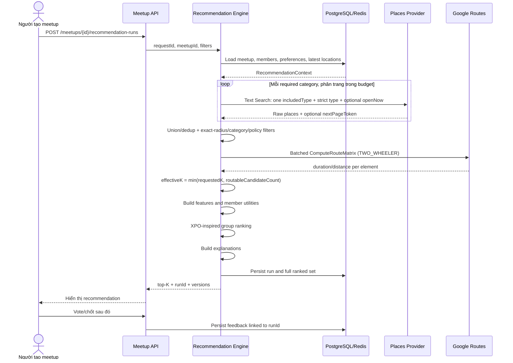
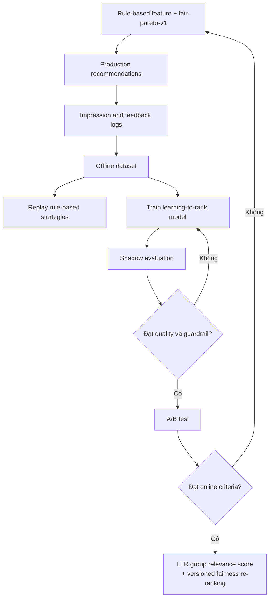

# MeetUp Group Recommendation Engine

> Tài liệu kỹ thuật dùng chung cho team phát triển
>
> Trạng thái: bản thiết kế ban đầu
>
> Ngày cập nhật: 27/10/2026
>
> Phạm vi: online recommendation phiên bản đầu và kiến trúc mở rộng cho offline learning / learning-to-rank

## Mục lục

1. [Tổng quan](#1-tổng-quan)
2. [Glossary](#2-glossary)
3. [Nguyên tắc và giả định](#3-nguyên-tắc-và-giả-định)
4. [Kiến trúc tổng thể](#4-kiến-trúc-tổng-thể)
5. [Luồng online recommendation](#5-luồng-online-recommendation)
6. [Mô hình dữ liệu đầu vào và đầu ra](#6-mô-hình-dữ-liệu-đầu-vào-và-đầu-ra)
7. [Công thức utility](#7-công-thức-utility)
8. [Thuật toán group ranking](#8-thuật-toán-group-ranking)
9. [Vote và feedback](#9-vote-và-feedback)
10. [Offline evaluation và learning-to-rank](#10-offline-evaluation-và-learning-to-rank)
11. [Lưu trữ, API và versioning](#11-lưu-trữ-api-và-versioning)
12. [Xử lý lỗi, hiệu năng và quyền riêng tư](#12-xử-lý-lỗi-hiệu-năng-và-quyền-riêng-tư)
13. [Quyết định thiết kế](#13-quyết-định-thiết-kế)
14. [Đánh giá chất lượng](#14-đánh-giá-chất-lượng)
15. [Kế hoạch triển khai](#15-kế-hoạch-triển-khai)
16. [Hạn chế và câu hỏi còn mở](#16-hạn-chế-và-câu-hỏi-còn-mở)
17. [Tài liệu tham khảo](#17-tài-liệu-tham-khảo)

## 1. Tổng quan

### 1.1. Bài toán

**MeetUp Group Recommendation Engine** nhận bối cảnh của một meetup và trả về danh sách địa điểm phù hợp cho cả nhóm. Hệ thống không chỉ tìm địa điểm gần tâm hình học. Nó phải xem xét thời gian di chuyển của từng thành viên, sở thích trong meetup, thông tin địa điểm và mức bất lợi của thành viên có trải nghiệm tệ nhất.

**[Từ bài báo]** Group recommender system hỗ trợ quyết định chung của nhiều người. Một nhiệm vụ chính là kết hợp preference hoặc prediction của từng thành viên thành recommendation cho cả nhóm [2, Mục 3.1, PDF tr. 5].

**[Điều chỉnh]** Trong MeetUp, mỗi địa điểm được đánh giá riêng cho từng thành viên trước. Kết quả cá nhân được tổng hợp bằng một group ranking strategy có xét fairness. Cách này gần với hướng *aggregated predictions* được trình bày trong [2, Mục 3.1, PDF tr. 5–6], nhưng prediction cá nhân của phiên bản đầu được tính từ ETA và preference hiện tại, không đến từ collaborative filtering.

### 1.2. Người dùng và bên sử dụng kết quả

| Đối tượng | Cách sử dụng |
|---|---|
| Thành viên meetup | Xem top-K địa điểm, ETA của mình, lý do gợi ý và vote sau khi đã nhận recommendation. |
| Người tạo meetup | Yêu cầu chạy recommendation, xem kết quả và chốt địa điểm sau giai đoạn vote. |
| Backend meetup | Cung cấp trạng thái meetup, thành viên hợp lệ và preference hiện tại. |
| Mobile app | Gửi yêu cầu, hiển thị kết quả, thu vote và hành vi sau recommendation. |
| Team phát triển | Theo dõi metric, chạy offline evaluation, thay ranking strategy và triển khai model mới. |

### 1.3. Đầu vào

**[Tự đề xuất]** Một recommendation run cần các nhóm dữ liệu sau:

- `meetupId`, thời gian dự kiến và cấu hình tìm kiếm.
- Danh sách thành viên đã chấp nhận meetup.
- Latest location còn hiệu lực của từng thành viên, gồm tọa độ, `accuracy` và `updatedAt`.
- Preference tạm thời của từng thành viên trong meetup. Preference profile chỉ là fallback.
- Loại địa điểm, bán kính và opening filter tại request time.
- Candidate places từ Google Places hoặc provider tương đương.
- ETA và khoảng cách từ từng thành viên đến từng candidate từ Google Routes.
- `algorithmVersion`, `configVersion` và `modelVersion` nếu có.

### 1.4. Đầu ra

**[Tự đề xuất]** Hệ thống trả tối đa `K` địa điểm. Mỗi kết quả gồm:

- Thứ hạng, `canonicalCandidateKey` và `providerPlaceId`.
- ETA trung bình, ETA lớn nhất và ETA của từng thành viên.
- Member utility của từng thành viên.
- Group utility và candidate least-misery utility; list fairness được báo ở tầng evaluation.
- Các feature chính được dùng để xếp hạng.
- Lý do giải thích dạng có cấu trúc.
- Cờ dữ liệu thiếu và warning khi kết quả ít hơn `requestedK`. Candidate top-K luôn có route hợp lệ cho mọi member.
- Phiên bản thuật toán và cấu hình tạo ra kết quả.

### 1.5. Phạm vi

#### Trong phạm vi

**[Tự đề xuất]** Tài liệu bao phủ:

- Candidate generation và filtering.
- Route Matrix cho phương tiện mặc định là xe máy.
- Member utility theo ETA, preference và chất lượng địa điểm.
- Group ranking dựa trên Pareto/fairness.
- Top-K explanation.
- Logging impression, vote, địa điểm được chốt và hành vi sau recommendation.
- Offline replay, offline evaluation và kiến trúc mở rộng cho learning-to-rank.

#### Ngoài phạm vi hiện tại

**[Tự đề xuất]** Các mục sau chưa thuộc phiên bản đầu:

- Dự đoán hành trình hoặc next-POI từ lịch sử GPS.
- Tối ưu tuyến đường nhiều điểm dừng.
- Recommendation theo thời tiết, lịch cá nhân hoặc phương tiện riêng của từng người.
- Reinforcement learning và cập nhật model theo thời gian thực.
- Thay vote bằng quyết định tự động. Vote luôn diễn ra sau recommendation.
- Dùng AI tạo sinh để quyết định thứ hạng. AI, nếu có, chỉ diễn đạt explanation từ dữ liệu đã tính.

### 1.6. Quy ước nguồn

Mỗi quyết định quan trọng dùng một trong ba nhãn:

- **[Từ bài báo]**: mô tả trực tiếp ý tưởng hoặc phương pháp của nguồn được trích dẫn.
- **[Điều chỉnh]**: bắt đầu từ ý tưởng của nguồn nhưng đã thay đổi cho dữ liệu và nghiệp vụ MeetUp.
- **[Tự đề xuất]**: thiết kế của team, chưa được khẳng định bởi các nguồn tham khảo của tài liệu này.

Thông tin thuần túy về contract, quota hoặc trạng thái tính năng của Google Maps Platform được ghi nguồn `[3]`–`[7]` ngay tại chỗ. Các thông tin này không phải phương pháp nghiên cứu nên không gắn nhãn `[Từ bài báo]`.

## 2. Glossary

| Thuật ngữ | Giải thích đời thường | Ví dụ |
|---|---|---|
| MeetUp Group Recommendation Engine | Hệ thống tạo danh sách địa điểm cho một nhóm trong một meetup. | Trả 5 quán cà phê phù hợp cho nhóm 4 người. |
| Recommender system | Hệ thống chọn và xếp hạng các lựa chọn có khả năng phù hợp. | Xếp các quán từ phù hợp nhất đến ít phù hợp hơn. |
| Group recommender system | Recommender system phục vụ một nhóm thay vì một cá nhân. | Chọn quán sao cho cả An, Bình và Chi đều có thể chấp nhận. |
| Context | Dữ liệu mô tả tình huống hiện tại. | Vị trí thành viên, giờ meetup, loại địa điểm và bán kính. |
| Candidate | Một địa điểm có thể được đưa vào xếp hạng. Raw candidate chưa chắc đã đạt hard constraint. | Một quán do Places API trả về nhưng còn phải kiểm tra bán kính ở backend. |
| Candidate generation | Bước tạo tập địa điểm ban đầu trước khi chấm điểm. | Tìm 50 quán cà phê quanh vùng tìm kiếm. |
| Provider-side filter | Filter được đưa thẳng vào request gửi cho provider để provider trả về ít candidate hơn. | Với Text Search (New), gửi `includedType=cafe`, `strictTypeFiltering=true` và tùy chọn `openNow=true`. |
| Residual filter | Filter nội bộ còn lại sau khi đã nhận candidate từ provider. | Loại place không có Place ID hoặc không phù hợp policy của Meetup. |
| Constraint | Điều kiện địa điểm phải thỏa. | Địa điểm phải nằm trong bán kính được phép. |
| Opening filter | Quy tắc lọc theo trạng thái mở cửa. V1 chỉ hỗ trợ không lọc hoặc mở tại thời điểm gửi request. | `OPEN_AT_REQUEST_TIME` gửi `openNow=true`; không dùng cho giờ meetup tương lai. |
| Hard constraint | Điều kiện không đạt thì loại địa điểm ngay. | Place API xác nhận quán đã đóng vĩnh viễn. |
| Soft penalty | Điểm phạt làm giảm thứ hạng nhưng không loại ngay. | Một thành viên chọn `avoid` cho karaoke nên quán karaoke bị giảm utility. |
| Feature | Một giá trị đầu vào dùng để chấm điểm hoặc huấn luyện model. | ETA 12 phút, rating 4.3, preference `high`. |
| Utility | Trong utility model của MeetUp, điểm từ 0 đến 1 biểu diễn mức phù hợp; điểm càng cao càng tốt. Utility list-level trong [1] là khái niệm khác. | Utility 0.8 nghĩa là địa điểm khá phù hợp theo cách hệ thống đo. |
| Member utility | Utility của một địa điểm đối với một thành viên cụ thể. | Quán A có utility 0.9 với An nhưng 0.4 với Bình. |
| Group utility | Mức phù hợp chung của cả nhóm, trong tài liệu này là trung bình member utility. | Ba utility 0.8, 0.7, 0.6 tạo group utility 0.7. |
| Candidate least-misery utility | Member utility thấp nhất của một candidate. Đây là diagnostic/tie-breaker của MeetUp, không phải list fairness nguyên bản trong [1]. | Quán có utility `[0.8, 0.7, 0.4]` có candidate least-misery utility là `0.4`. |
| List fairness | Mức recommendation list tránh để một thành viên có utility của cả danh sách quá thấp. | Lấy minimum của list utility giữa các thành viên. |
| Least misery | Nguyên tắc nhìn vào thành viên có utility thấp nhất. | Với `[0.9, 0.8, 0.2]`, least-misery score là 0.2. |
| Pareto dominance | Địa điểm A lấn át B nếu A không tệ hơn với mọi thành viên và tốt hơn với ít nhất một người. | A có `[0.8, 0.7]`, B có `[0.8, 0.5]`; A lấn át B. |
| Pareto-optimal | Candidate không bị candidate nào khác lấn át. | Không có quán nào tốt hơn quán A đối với tất cả thành viên. |
| N-level Pareto set | Tập item bị lấn át bởi không quá `N-1` item. | Với `N=2`, item bị tối đa một item khác lấn át vẫn được giữ. |
| NPO | Thuật toán *N-level Pareto Optimal aggregation* trong [1]. | Chọn và xếp hạng trong N-level Pareto set. |
| XPO | Biến thể trong [1] dùng Pareto level nhỏ nhất vẫn có đủ N item. | Nếu Pareto level 1 chỉ có 3 item nhưng cần 5, tăng level đến khi đủ. |
| XPO-inspired ranker | Phiên bản MeetUp điều chỉnh từ XPO. Nó dùng member utility theo session và thêm tie-breaker nghiệp vụ. | Xếp quán theo xác suất vào top-5, sau đó theo fairness và group utility. |
| Rank | Vị trí của candidate trong một danh sách có thứ tự. Rank 1 là tốt nhất. | Quán A đứng thứ 2 với thành viên Bình. |
| Ranking strategy | Module quyết định thứ tự candidate. | `min-sum`, `min-max` hoặc `fair-pareto`. |
| Ground truth | Kết quả mục tiêu dùng để đối chiếu khi đánh giá. | Trong [1], personal top-N là ground truth của một member; MeetUp v1 chưa có dữ liệu này. |
| Query group | Nhóm candidate cạnh tranh với nhau trong một lần xếp hạng hoặc một mẫu LTR. | Tất cả candidate của cùng một `recommendationRunId`. |
| Relevance score | Điểm dự đoán một candidate phù hợp với query đến đâu. | LTR model dự đoán khả năng candidate được nhóm chọn. |
| Domination count | Số candidate lấn át một candidate theo Pareto dominance. | Candidate bị hai candidate khác lấn át có domination count bằng 2. |
| Re-ranking | Sắp xếp lại sau khi đã có score ban đầu để đáp ứng fairness hoặc diversity. | Đẩy một quán khác loại vào top-5 để tránh 5 kết quả giống nhau. |
| Top-K | K kết quả đầu tiên được trả cho client. | `K=5` nghĩa là hiển thị 5 địa điểm. |
| Monte Carlo sampling | Ước lượng kết quả bằng cách thử nhiều bộ trọng số ngẫu nhiên. | Sinh 2.000 weight vector và đếm số lần quán A vào top-5. |
| Weight vector | Bộ trọng số dành cho các thành viên trong một lần mô phỏng. | `[0.5, 0.3, 0.2]` cho nhóm ba người. |
| ETA | *Estimated Time of Arrival*, thời gian dự kiến để đến nơi. | An cần 12 phút để đến quán A. |
| Route Matrix | Ma trận route giữa nhiều điểm đi và nhiều điểm đến. | 4 thành viên × 20 quán tạo 80 phần tử route. |
| Origin | Điểm bắt đầu của route. | Latest location của một thành viên. |
| Destination | Điểm kết thúc của route. | Tọa độ hoặc Place ID của quán. |
| Route element | Một cặp origin–destination trong Route Matrix. | Route từ An đến quán A là một element. |
| `TWO_WHEELER` | Travel mode của Google Routes cho xe hai bánh có động cơ. | Xe máy là `TWO_WHEELER`, không phải `BICYCLE`. |
| Recommendation run | Một lần pipeline được thực thi với input và version xác định. | Người tạo bấm “Tìm địa điểm” lúc 19:00 tạo một run. |
| Impression | Sự kiện một candidate thật sự được hiển thị cho người dùng. | Quán A xuất hiện ở rank 2 trên màn hình. |
| Feedback | Hành vi xảy ra sau khi recommendation được hiển thị. | Vote, đổi vote, chốt địa điểm, mở dẫn đường. |
| Label | Giá trị mục tiêu dùng để đánh giá hoặc huấn luyện model. | Địa điểm được chốt có label cao hơn địa điểm chỉ được xem. |
| Offline evaluation | Đánh giá thuật toán bằng dữ liệu đã lưu, không ảnh hưởng người dùng thật. | Chạy lại meetup cũ bằng `min-max` và `fair-pareto`. |
| Learning-to-rank (LTR) | Machine learning học cách sắp thứ tự candidate từ feature và feedback. | Model học rằng nhóm thường chọn nơi có ETA cân bằng và đúng category. |
| Model | Hàm đã học từ dữ liệu để dự đoán score. | Model dự đoán xác suất một candidate được nhóm chọn. |
| Model Registry | Nơi quản lý model version và trạng thái triển khai. | `ltr-v3` đang production, `ltr-v4` đang shadow. |
| Machine learning (ML) | Cách xây hàm dự đoán bằng dữ liệu ví dụ thay vì chỉ viết quy tắc thủ công. | Học score từ các recommendation run và feedback cũ. |
| Collaborative filtering | Cách học sở thích từ mẫu tương tác giống nhau giữa nhiều user và item. | Hai người thường thích cùng loại quán có thể nhận gợi ý tương tự. |
| Shadow evaluation | Model mới tính kết quả nhưng không hiển thị cho người dùng. | Lưu top-5 của `ltr-v4` để so sánh với production. |
| A/B test | Chia các meetup thành nhóm dùng thuật toán khác nhau để so sánh. | 50% meetup dùng baseline, 50% dùng LTR. |
| NDCG@K | Metric đánh giá thứ tự top-K, cho điểm cao hơn khi item liên quan nằm gần đầu. | Địa điểm được chốt ở rank 1 tốt hơn ở rank 5. |
| HitRate@K | Tỷ lệ trường hợp item mục tiêu xuất hiện trong top-K. | Địa điểm cuối cùng được chọn có nằm trong top-5 hay không. |
| p95 latency | 95% request có thời gian xử lý không vượt quá giá trị này. | p95 = 3 giây nghĩa là 95/100 request nhanh hơn hoặc bằng 3 giây. |
| TTL | *Time To Live*, thời gian dữ liệu cache còn hiệu lực. | Latest location hết hạn sau 5 phút. |
| Stale location | Vị trí đã quá thời hạn cho phép. | Location cập nhật 8 phút trước không được dùng. |
| Modular monolith | Một backend deploy chung nhưng code được chia module rõ ràng. | Recommendation là module riêng trong NestJS, chưa phải microservice riêng. |
| NestJS | Framework TypeScript đang dùng để xây backend MeetUp. | `RecommendationModule` nằm trong ứng dụng NestJS. |
| API | Giao diện để hai phần mềm gửi request và nhận response. | Mobile gọi API tạo recommendation run. |
| Provider | Dịch vụ bên ngoài cung cấp dữ liệu hoặc phép tính. | Google Places là place provider; Google Routes là route provider. |
| Provider adapter | Lớp chuyển request/response riêng của provider sang contract nội bộ. | `GoogleTextSearchAdapter` chuyển Google Place Type và rating về `RawCandidatePlace`. |
| Canonical candidate key | Khóa nội bộ ổn định để deduplicate và join dữ liệu trong một run. | `google-places:ChIJ...`. |
| `RecommendationOrchestrator` | Module điều phối thứ tự các bước của một recommendation run. | Gọi context, candidate, route, utility, ranking rồi persist. |
| `ContextBuilder` | Module kiểm tra member/location/preference và tạo context nhất quán. | Loại member có location stale trước khi gọi Places. |
| `CandidateGenerator` | Module gọi active place provider strategy và phân trang trong budget. | Gọi Text Search cho category `coffee`. |
| `CandidateMerger` | Module union và deduplicate raw candidates từ nhiều category/page của cùng provider. | Hai query cùng trả một quán thì chỉ giữ một canonical candidate. |
| `ConstraintFilter` | Module áp dụng residual hard constraints ở backend. | Loại candidate ngoài exact radius. |
| `RawCandidatePlace` | Candidate vừa được adapter chuẩn hóa nhưng chưa qua hard filter nội bộ. | Place có ID và tọa độ nhưng có thể nằm ngoài radius. |
| `EligibleCandidate` | Candidate đã qua provider-side và residual hard constraints, sẵn sàng gửi tới Routes. | Quán đúng category, trong radius và không đóng vĩnh viễn. |
| `RouteMatrixProvider` | Port tính route theo batch giữa member và candidate. | Tạo route cho 6 member × 20 quán. |
| Route batch | Một phần hình chữ nhật của ma trận origin × destination được gửi trong một provider request. | Batch 10 origins × 20 destinations có 200 elements. |
| `RouteFeature` | ETA/distance hợp lệ của một cặp member–candidate. | An đến quán A mất 720 giây và 4.200 mét. |
| `RouteFailure` | Kết quả cho biết một cặp member–candidate không có route hợp lệ hoặc provider lỗi. | Không tìm được route xe máy từ An đến quán B. |
| `FeatureBuilder` | Module chuẩn hóa provider/route data thành feature. | Chuyển rating và ETA thành input cho utility. |
| `MemberPlaceFeature` | Bộ feature của một cặp member–candidate trước khi tính utility. | ETA, distance, matched tags và rating của An–quán A. |
| `MemberUtilityScorer` | Module tính `T`, `P`, `Q`, `U` cho từng member–candidate. | Tính utility của quán A riêng cho An. |
| `MemberPlaceUtility` | Kết quả `T`, `P`, `Q`, `U` của một cặp member–candidate. | `U(An, quán A)=0.72`. |
| `GroupRanker` | Module chạy ranking strategy đã chọn để tạo full ranking. | Chạy `fair-pareto-v1`. |
| `ExplanationBuilder` | Module tạo explanation chỉ từ feature và score đã lưu. | Giải thích “ETA lớn nhất 18 phút”. |
| `RecommendationRunRepository` | Module persist và đọc run/snapshot/result. | Retry cùng request lấy lại run đã hoàn tất. |
| `FeedbackCollector` | Module validate và ghi event sau khi recommendation được hiển thị. | Ghi vote bằng `eventId` idempotent. |
| `OfflineDatasetBuilder` | Module ghép snapshot với impression/feedback thành dataset có label version. | Tạo một query group cho mỗi run. |
| `OfflineEvaluator` | Module replay và so sánh strategy trên dữ liệu đã lưu. | So sánh `min-max` với `fair-pareto-v1`. |
| `LTRTrainer` | Module huấn luyện model group-level candidate relevance. | Train model dự đoán candidate được chọn. |
| `ShadowRunner` | Module chạy model mới nhưng không trả kết quả đó cho user. | So sánh LTR candidate với production ranking. |
| Google Places | Dịch vụ cung cấp candidate place và thông tin địa điểm. | Tìm các quán cà phê trong bán kính 5 km. |
| Google Routes | Dịch vụ tính route, duration và distance. | Tính ETA từ từng member đến từng quán. |
| PostgreSQL | Cơ sở dữ liệu quan hệ lưu dữ liệu bền vững. | Lưu recommendation run, candidate và feedback. |
| Redis | Kho dữ liệu nhanh dùng cho dữ liệu tạm thời. | Lưu latest location với TTL. |
| Snapshot | Bản chụp dữ liệu đúng tại thời điểm một run diễn ra. | Lưu candidate và feature để replay mà không gọi provider lại. |
| Random seed | Giá trị khởi tạo bộ sinh số ngẫu nhiên để có thể lặp lại cùng kết quả. | Seed `48291` tái tạo các weight vector của run. |
| Cache | Bản lưu tạm để tránh tính hoặc gọi API lại quá sớm. | Dùng lại Route Matrix khi khóa cache còn hợp lệ. |
| Retry | Thử lại một thao tác bị lỗi tạm thời. | Gọi lại Routes sau lỗi mạng. |
| Backoff | Tăng thời gian chờ giữa các lần retry để tránh làm dịch vụ quá tải. | Chờ 200 ms, rồi 500 ms, rồi 1 giây. |
| Circuit breaker | Cơ chế tạm dừng gọi provider đang lỗi liên tục. | Ngừng gọi Routes trong 30 giây sau nhiều lỗi liên tiếp. |
| Checksum | Chuỗi dùng để kiểm tra artifact hoặc config có bị thay đổi không. | Model file có checksum khác thì không được load dưới version cũ. |
| Hyperparameter | Tham số cấu hình quá trình học model, không được model tự học trực tiếp. | Số cây hoặc learning rate của một LTR model tương lai. |
| Overfitting | Model nhớ dữ liệu cũ quá kỹ nhưng hoạt động kém với meetup mới. | Offline score cao trên train nhưng thấp trên test theo thời gian. |
| Exposure bias | Sai lệch vì hệ thống chỉ quan sát feedback trên candidate đã hiển thị. | Candidate không được show không thể bị xem là user không thích. |
| Guardrail | Điều kiện an toàn không được vi phạm dù metric chính tăng. | Không dùng stale location và không tăng p95 latency quá ngưỡng. |
| Member medoid | Vị trí của một member có tổng Haversine distance đến các member còn lại nhỏ nhất; dùng làm search center v1. | Trong ba vị trí, chọn vị trí thành viên nằm giữa và gần tổng thể nhất. |
| Haversine distance | Khoảng cách đường chim bay giữa hai tọa độ trên mô hình Trái Đất hình cầu. | Backend dùng nó để kiểm tra candidate có nằm trong search radius hay không; không dùng thay ETA đường bộ. |
| Diversity | Mức khác nhau giữa các item trong danh sách. | Top-5 không chỉ gồm năm chi nhánh gần như giống nhau. |
| UTC | Chuẩn thời gian thống nhất để lưu timestamp. | Backend lưu `2026-10-26T12:00:00Z`, mobile đổi sang giờ Việt Nam. |
| Fallback | Phương án thay thế khi bước chính thất bại. | Routes lỗi thì trả lỗi có thể retry; không giả ETA bằng đường thẳng. |
| Idempotency | Gửi lại cùng request không tạo kết quả trùng ngoài ý muốn. | Retry cùng `requestId` trả lại run cũ thay vì tạo run mới. |
| Algorithm version | Phiên bản logic xếp hạng. | `fair-pareto-v1`. |
| Config version | Phiên bản tham số của thuật toán. | `utility-config-2026-10-26`. |
| Cold start | Trường hợp chưa có đủ preference hoặc feedback lịch sử. | Member mới không có preference cho bất kỳ tag nào. |
| Train/validation/test split | Cách chia dữ liệu học, chỉnh tham số và kiểm tra cuối cùng thành ba phần tách biệt. | Train bằng các run cũ, validation bằng run mới hơn và test bằng khoảng thời gian cuối. |
| Pseudonymous ID | ID thay thế không trực tiếp lộ định danh thật. | Dataset offline dùng một mã đã biến đổi thay cho `participantId`. |

## 3. Nguyên tắc và giả định

1. **[Tự đề xuất]** Recommendation và vote là hai giai đoạn riêng. Pipeline hoàn tất top-K trước. Vote chỉ hoạt động trên kết quả đã hiển thị.
2. **[Từ bài báo]** Group recommendation có thể gồm preference acquisition, recommendation generation, presentation/explanation và consensus negotiation [2, Mục 3.1, PDF tr. 5–7].
3. **[Điều chỉnh]** MeetUp ánh xạ vote sang bước consensus sau recommendation. Vote không phải feature của chính run đang diễn ra.
4. **[Tự đề xuất]** Preference `avoid` là soft penalty. Nó làm giảm utility nhưng không tự động loại candidate.
5. **[Tự đề xuất]** Travel mode mặc định là xe máy, gửi `TWO_WHEELER` tới Route Matrix. Google định nghĩa đây là xe hai bánh có động cơ và phân biệt với xe đạp [5, mục “Available route matrix vehicle types”].
6. Route Matrix tính duration và distance cho mọi cặp origin–destination; số element bằng số origin nhân số destination [3, mục “Request limits”].
7. **[Tự đề xuất]** Hệ thống không lưu lịch sử GPS. Recommendation run chỉ lưu snapshot feature đã giảm độ nhạy hoặc reference cần thiết để audit.
8. **[Tự đề xuất]** Mọi score, threshold và model phải có version. Không được thay cấu hình production mà không tạo `configVersion` mới.
9. **[Tự đề xuất]** Rule-based ranker là production baseline ngay cả sau khi có LTR. Khi model lỗi, hệ thống quay về baseline có version.
10. **[Tự đề xuất]** Không dùng rating hoặc dữ liệu thiếu như hard constraint nếu provider không xác nhận rõ trạng thái.

## 4. Kiến trúc tổng thể

### 4.1. Kiến trúc triển khai

**[Tự đề xuất]** Phiên bản đầu là modular monolith trong NestJS. Recommendation chạy trong cùng backend nhưng có module, interface và bảng dữ liệu riêng. Chỉ tách thành service độc lập khi có bằng chứng về nhu cầu scale, cadence triển khai hoặc dependency ML khác biệt.

```mermaid
flowchart LR
    Mobile[Mobile App] --> MeetupAPI[Meetup API]
    MeetupAPI --> Orchestrator[Recommendation Orchestrator]

    Orchestrator --> Context[Context Builder]
    Context --> Candidate[Candidate Generator]
    Candidate --> Filter[Constraint Filter]
    Filter --> Route[Route Matrix Provider]
    Route --> Feature[Feature Builder]
    Feature --> Utility[Member Utility Scorer]
    Utility --> Ranker[Group Ranker / Ranking Strategy]
    Ranker --> Explain[Explanation Builder]
    Explain --> Repo[Recommendation Run Repository]
    Repo --> Mobile

    Mobile --> Feedback[Feedback Collector]
    Feedback --> EventStore[(Feedback / Impression Store)]
    Repo --> EventStore

    EventStore --> Dataset[Offline Dataset Builder]
    Dataset --> Evaluator[Offline Evaluator]
    Dataset --> Trainer[LTR Trainer]
    Trainer --> Registry[Model Registry]
    Registry -. model candidate .-> LTR[LTR Group Scorer]
    Feature -. group features .-> LTR
    LTR -. experimental strategy .-> Ranker
    Evaluator --> Dashboard[Metrics Dashboard]

    Candidate --> Places[Google Places]
    Route --> Routes[Google Routes]
    Context --> Redis[(Redis latest location)]
    Context --> Postgres[(PostgreSQL)]
```



### 4.2. Flow end-to-end của engine

**[Tự đề xuất]** Diagram dưới đây là flow hoàn chỉnh. Chuỗi từ `Start` đến `Response` là online path của một request. Chuỗi từ `Impression` trở đi là feedback/offline path; nó không nằm trên đường trả kết quả cho request đó mà dùng dữ liệu đã ghi để đánh giá hoặc huấn luyện cho các meetup tương lai.

```mermaid
flowchart TD
    Start(["Người tạo bấm Tìm địa điểm"]) --> Auth["Kiểm tra quyền, meetup state và idempotency"]
    Auth --> Context["Context Builder<br/>member hợp lệ, location còn hạn, preference, filters"]
    Context --> EnoughMembers{"Đủ ít nhất 2 member<br/>và location hợp lệ?"}
    EnoughMembers -->|Không| InvalidContext["Đánh run failed và trả lỗi có lý do<br/>không tạo ranked result"]
    EnoughMembers -->|Có| Query["CandidateGenerator tạo query"]

    Query --> ProviderFilter["Google Places Text Search<br/>một query cho mỗi required category<br/>strict type và optional openNow tại request time"]
    ProviderFilter --> Places["Google Places"]
    Places --> Raw["Raw candidates<br/>locationBias không bảo đảm bán kính"]
    Places -->|first-page lỗi sau retry| ProviderFailed["Đánh run failed<br/>PLACE_SEARCH_UNAVAILABLE"]
    Raw --> Merge["Union pages và category queries<br/>dedup bằng canonical candidate key"]
    Merge --> ResidualFilter["Backend residual hard filter<br/>required fields, exact radius, category, policy,<br/>business status nếu provider trả về"]
    ResidualFilter --> EnoughCandidates{"Còn candidate?"}
    EnoughCandidates -->|Không| NoCandidate["Đánh run failed<br/>NO_ELIGIBLE_CANDIDATES"]
    EnoughCandidates -->|Có| Matrix["Google Routes ComputeRouteMatrix<br/>TWO_WHEELER, batch khi cần"]
    Matrix -->|batch lỗi sau retry| RouteFailed["Đánh run failed<br/>ROUTE_MATRIX_UNAVAILABLE"]

    Matrix --> RouteCheck["Kiểm tra route element<br/>và loại candidate không đủ route"]
    RouteCheck --> EnoughRoutes{"Còn candidate<br/>có đủ route?"}
    EnoughRoutes -->|Không| NoRoute["Đánh run failed<br/>NO_ROUTABLE_CANDIDATES"]
    EnoughRoutes -->|Có| EffectiveK["effectiveK bằng min của requestedK<br/>và routableCandidateCount"]
    EffectiveK --> Feature["Feature Builder"]
    Feature -->|feature hoặc config không hữu hạn| AlgorithmFailed["Đánh run failed<br/>INVALID_FEATURE_OR_CONFIG"]
    Feature --> Travel["7.1 Travel utility<br/>ETA thành T"]
    Feature --> Preference["7.2 Preference utility<br/>tag thành P"]
    Feature --> Quality["7.3 Place quality utility<br/>rating và review thành Q"]
    Travel --> MemberUtility["7.4 Member utility<br/>T cộng P cộng Q thành U"]
    Preference --> MemberUtility
    Quality --> MemberUtility
    MemberUtility --> GroupMetrics["7.5 Group utility và candidate least-misery<br/>U thành G và F"]
    GroupMetrics --> Pareto["7.6 Pareto dominance<br/>U thành member rank rồi Pareto level"]
    Pareto --> MonteCarlo["7.7 Monte Carlo inclusion probability"]
    MonteCarlo --> Rank["Group Ranker<br/>full ranking và top-K"]
    Rank --> Explain["Explanation Builder"]
    Explain --> Persist["Persist run, snapshots,<br/>full ranking, versions"]
    Persist -->|transaction lỗi| PersistFailed["Giữ run không COMPLETED<br/>trả lỗi retryable"]
    Persist --> Response["Mobile nhận top-K,<br/>ETA và explanation"]

    Response --> Impression["Impression: candidate thực sự được hiển thị"]
    Impression --> Feedback["Vote, đổi vote, chốt,<br/>navigation, favorite"]
    Feedback --> FeedbackStore["Feedback store"]
    Persist --> FeedbackStore
    FeedbackStore --> Dataset["Offline Dataset Builder"]
    Dataset --> Replay["Offline replay và evaluator"]
    Dataset --> Train["LTR trainer khi đủ dữ liệu"]
    Train --> Registry["Model Registry: candidate"]
    Registry --> Shadow["Shadow evaluation"]
    Replay --> OfflineDecision{"Đạt offline metric<br/>và guardrail?"}
    Shadow --> OfflineDecision
    OfflineDecision -->|Không| Config["Điều chỉnh config hoặc model<br/>không đổi run cũ"]
    Config --> Dataset
    OfflineDecision -->|Có| AB["A/B test theo meetup"]
    AB --> OnlineDecision{"Đạt online criteria?"}
    OnlineDecision -->|Không| Retired["Registry: retired"]
    OnlineDecision -->|Có| Production["Registry: production"]
    Production -.-> Rank
```



**Điểm cần đọc đúng trong diagram:** `Raw candidates` là dữ liệu trả **từ Google Places về backend**, không phải danh sách trả cho mobile. Mobile chỉ nhận `top-K` ở node `Response`, sau toàn bộ filter, route, utility và ranking.

**Provider boundary đã xác minh:** Candidate search và các filter `includedType`, `strictTypeFiltering`, `openNow` đều thuộc Google Places Text Search (New) [6]. Text Search chỉ nhận một `includedType`, nên nhiều category tạo nhiều query cùng provider rồi merge. `openNow` chỉ áp dụng tại thời điểm query. Kiểm tra bán kính tròn chính xác và policy nội bộ thuộc backend. Constraint dựa trên ETA thuộc Google Routes, là API khác với Google Places dù cùng nằm trong Google Maps Platform.

### 4.3. Thành phần online

| Thành phần | Vai trò | Input | Output |
|---|---|---|---|
| `RecommendationOrchestrator` | Điều phối toàn bộ run, timeout, retry và trạng thái. | Actor identity và API request chưa validate | `runId`, `RankedPlace[]`, versions/warnings hoặc lỗi có mã. |
| `ContextBuilder` | Kiểm tra meetup và tạo context nhất quán. | Meetup, participant, preference, latest location | `RecommendationContext`. |
| `CandidateGenerator` | Tạo các request cho place provider, phân trang trong budget và trả raw candidates. Nó không quyết định ranking. | Search center, mapped category queries, radius, opening filter | `RawCandidatePlace[]` và provider request metadata. |
| `CandidateMerger` | Union kết quả của nhiều category/page và deduplicate bằng canonical candidate key. | Nhiều `RawCandidatePlace[]` | Candidate duy nhất theo provider identity. |
| `ConstraintFilter` | Áp dụng residual hard constraint mà provider không thể hoặc không nên quyết định. | Context và candidate đã merge | `EligibleCandidate[]` cùng lý do loại. |
| `RouteMatrixProvider` | Tính ETA/distance cho member × candidate, chia batch nếu cần. | Origins, destinations, travel mode | `RouteFeature[]` và `RouteFailure[]`. |
| `FeatureBuilder` | Chuẩn hóa dữ liệu thành feature dùng chung. | Context, place data, route matrix | `MemberPlaceFeature[]`. |
| `MemberUtilityScorer` | Tính utility cho từng member–place. Model LTR group-level không cắm vào component này. | Feature và utility config | `MemberPlaceUtility[]`. |
| `GroupRanker` | Chạy ranking strategy đã chọn. Baseline dùng utility matrix; LTR tương lai dùng group relevance score rồi qua fairness re-ranker có version. | Utility matrix, optional LTR score, strategy config | Full ranked candidates. |
| `ExplanationBuilder` | Tạo lý do dựa trên feature và score thật. | Ranked candidates | Explanation có cấu trúc. |
| `RecommendationRunRepository` | Lưu run, candidate, feature snapshot và result. | Toàn bộ dữ liệu audit đã cho phép | Run đã lưu và `runId`. |
| `FeedbackCollector` | Ghi impression, vote, selection và hành vi sau đó. | Event từ mobile/backend | Feedback event có thời gian và actor. |

### 4.4. Thành phần offline mở rộng

| Thành phần | Vai trò | Input | Output |
|---|---|---|---|
| `OfflineDatasetBuilder` | Ghép feature tại thời điểm recommendation với feedback xảy ra sau đó. | Run, impression, vote, selection | Dataset theo group/query. |
| `OfflineEvaluator` | Replay và so sánh ranking strategy trên cùng candidate set. | Dataset và algorithm versions | Metric report. |
| `LTRTrainer` | Huấn luyện model xếp hạng khi dữ liệu đủ. | Training dataset | Model artifact và training report. |
| `ModelRegistry` | Quản lý version, trạng thái và metadata model; chỉ model ở trạng thái `production` mới được ranking strategy online sử dụng. | Model artifact | `candidate`, `shadow`, `production`, `retired`. |
| `ShadowRunner` | Tính ranking bằng model mới nhưng không trả cho user. | Live feature snapshot | Shadow result để đánh giá. |

### 4.5. Quy tắc tích hợp provider

**[Tự đề xuất]** Mỗi run dùng đúng một `PlaceCandidateProvider` và một `RouteMatrixProvider` đang active theo config version.

```ts
interface PlaceCandidateProvider {
  search(request: CandidateSearchRequest): Promise<RawCandidatePlace[]>;
}

interface RouteMatrixProvider {
  compute(request: RouteBatchRequest): Promise<RouteBatchResult>;
}
```

- Provider adapter chịu trách nhiệm mapping taxonomy, rating scale, status/error code và response field về contract nội bộ ở Mục 6.
- Engine join place và route bằng `canonicalCandidateKey` cùng index mapping nội bộ, không cho hai provider cùng ghi một score.
- Thay provider không được làm `MemberUtilityScorer` hoặc `GroupRanker` đọc field riêng của provider.
- Multi-place-provider retrieval/merge trong cùng run chưa được hỗ trợ. Muốn thêm phải thiết kế canonical identity xuyên provider, source priority, rating normalization và conflict policy trước.
- Provider timeout/retry/circuit-breaker là policy của adapter/orchestrator; provider không tự ghi database hoặc thay run state.

## 5. Luồng online recommendation

### 5.1. Sequence chính



### 5.2. Các bước chi tiết

#### Bước 1 — Xác thực request

**[Tự đề xuất]** Orchestrator kiểm tra:

- Người gọi có quyền yêu cầu recommendation cho meetup.
- Meetup chưa bị hủy hoặc kết thúc.
- `requestId` là UUID hợp lệ. Database phải có unique constraint trên `(meetupId, requestId)`.
- Nếu cùng `requestId` và cùng payload hash được gửi lại, trả run cũ. Nếu payload hash khác, trả `409 IDEMPOTENCY_KEY_REUSED`.
- `topK` là số nguyên trong `[1, maxTopK]`.
- `radiusMeters` là số hữu hạn trong `[1, maxSearchRadiusMeters]`.
- `categories` có từ 1 đến `maxRequiredCategories` giá trị khác nhau và mọi giá trị có mapping provider hợp lệ.
- `openingFilter` thuộc enum được hỗ trợ.

Output của bước này là `ValidatedRecommendationRequest`; các bước sau không đọc trực tiếp payload chưa validate.

#### Bước 2 — Xây dựng context

**[Tự đề xuất]** Chỉ lấy thành viên `accepted`, bật chia sẻ phù hợp, location chưa stale và accuracy đạt yêu cầu. Tọa độ phải hữu hạn, latitude trong `[-90,90]`, longitude trong `[-180,180]`, `accuracyMeters >= 0`, và `updatedAt` phải parse được. Nếu còn dưới hai thành viên hợp lệ, run thất bại với mã `INSUFFICIENT_VALID_MEMBERS`.

`requestedAt`, `scheduledAt` và mọi location timestamp được chuẩn hóa thành ISO 8601 UTC trước khi ghi context.

Mỗi `participantId` chỉ xuất hiện một lần. Member được sort tăng dần theo `participantId` trước khi tạo matrix và snapshot. Với cùng một tag, `meetup_input` ghi đè `profile_fallback`; nếu cả hai nguồn đều không có giá trị thì tag đó được xử lý bằng `p_missing` ở Mục 7.2.

`scheduledAt` được lưu để audit và làm feature offline. Phiên bản đầu **không** suy đoán opening status ở thời điểm tương lai từ `scheduledAt`.

#### Bước 3 — Tạo query và provider-side filter

**[Tự đề xuất]** CandidateGenerator lấy nhiều hơn `K` theo `candidateTargetCount` và không vượt `candidateMaxCount`. Hai giá trị thuộc config có version, không do mobile tùy ý đặt.

Search center của `search-center-medoid-v1` là vị trí member có tổng Haversine distance đến các member còn lại nhỏ nhất:

```math
c^* = \arg\min_{c \in memberLocations} \sum_{u=1}^{m} Haversine(c, location_u)
```

Nếu tie, chọn member có `participantId` nhỏ hơn. Search center chỉ giới hạn retrieval; nó không thay ETA của từng member.

Implementation hiện tại gọi `POST /v1/places:searchText`, tức Google Places Text Search (New). Adapter hiện gửi một `includedType`, `strictTypeFiltering=true`, `pageSize=20` và `locationBias.circle`. Engine đích tiếp tục dùng Text Search nhưng bổ sung category mapping, pagination, field mask và merge contract có version.

Text Search chỉ nhận một `includedType` mỗi request, hỗ trợ tối đa 20 result mỗi page và trả `nextPageToken` để lấy page tiếp theo [6, mục `includedType`, `pageSize`, `pageToken`]. `requiredCategories` của MeetUp có semantics **ANY/OR**. CandidateGenerator chạy một query cho mỗi category đã map, rồi `CandidateMerger` union và deduplicate kết quả.

Mỗi mapping có dạng:

```ts
interface PlaceCategoryMapping {
  internalCategory: string;
  textQuery: string;
  includedType: string; // Google Place Type thuộc Table A
  candidateTags: string[];
  supportsOpenAtRequestTime: boolean;
}
```

Thứ tự retrieval phải deterministic: sort mapping theo `internalCategory`, lấy page đầu của từng category, sau đó lấy page tiếp theo theo round-robin cho đến khi đạt `candidateTargetCount`, hết page token hoặc chạm provider-call budget. Mọi tham số ngoài `pageSize` và `pageToken` của page tiếp theo phải giữ nguyên [6, mục `pageToken`].

Các constraint mà Text Search hỗ trợ và có ý nghĩa giống nghiệp vụ MeetUp nên được đẩy vào request tìm kiếm. Text Search hỗ trợ `includedType`, `strictTypeFiltering` và `openNow` [6, mục “Request body”]. Tuy nhiên:

- Type filter: **đã dùng** trong adapter hiện tại.
- `openingFilter=OPEN_AT_REQUEST_TIME`: gửi `openNow=true`. Google định nghĩa đây là mở tại thời điểm query được gửi, không phải tại `scheduledAt` [6, mục `openNow`].
- `openingFilter=ANY`: không gửi `openNow`; thiếu opening hours không bị coi là đóng.
- `OPEN_AT_SCHEDULED_TIME` chưa được hỗ trợ trong phiên bản đầu.
- Nếu mapping của một category có `supportsOpenAtRequestTime=false`, request kết hợp category đó với `OPEN_AT_REQUEST_TIME` bị từ chối bằng `UNSUPPORTED_OPENING_FILTER_FOR_CATEGORY`; không im lặng bỏ filter. Google nêu `openNow` không áp dụng cho một số nhóm query như hotel hoặc geopolitical [6, mục `openNow`].
- Radius: code dùng `locationBias.circle`. Đây chỉ là bias, không phải hard restriction. Google ghi rõ kết quả có thể nằm ngoài vùng bias [6, mục `locationBias`].
- Activity/category nội bộ phải đi qua `PlaceCategoryMapping`. Không truyền trực tiếp tag chưa được kiểm tra vào `includedType`.

| Constraint | Xử lý ở đâu | Lý do |
|---|---|---|
| Một hoặc nhiều loại địa điểm bắt buộc | Một Text Search cho mỗi mapping: `includedType` + `strictTypeFiltering=true`; merge theo OR rồi backend validate response types. | Text Search chỉ nhận một `includedType`; nhiều category phải là nhiều query [6]. |
| Bán kính tròn | Text Search dùng `locationBias.circle` để ưu tiên retrieval; backend tính khoảng cách đường chim bay và loại ngoài radius. | `locationBias` không bảo đảm kết quả nằm trong vòng tròn [6]. Text Search chỉ hỗ trợ hard `locationRestriction` dạng rectangle. |
| Đang mở tại request time | Khi `openingFilter=OPEN_AT_REQUEST_TIME`, gửi `openNow=true`. | Cùng provider hỗ trợ [6]; không dùng để khẳng định mở tại lịch meetup tương lai. |
| Place ID/location tồn tại | Residual filter. | Chỉ kiểm tra được sau khi provider trả candidate. |
| Provider báo đóng vĩnh viễn | Residual filter. | Đây là thuộc tính của candidate trả về. |
| Policy nội bộ, blacklist, deduplication | Residual filter. | Provider không biết chính sách MeetUp. |
| Có route cho mọi member | Sau Route Matrix. | Cần kết quả route mới quyết định được. |
| `avoid` | Không filter; xử lý trong preference utility. | Đây là soft penalty đã chốt. |

#### Bước 4 — Residual hard filtering

**[Tự đề xuất]** `CandidateMerger` deduplicate trước bằng `canonicalCandidateKey = provider + ':' + providerPlaceId`. `ConstraintFilter` nhận candidate đã merge và loại các candidate chắc chắn không dùng được nhưng chưa thể loại ở request tìm kiếm:

- Thiếu Place ID hoặc location.
- Nằm ngoài `searchRadiusMeters` khi tính lại Haversine distance từ search center. Candidate đúng bằng biên được giữ.
- Provider báo rõ `CLOSED_PERMANENTLY`. Status thiếu/`UNKNOWN` không bị diễn giải thành đóng.
- Không đúng category bắt buộc sau khi chuẩn hóa dữ liệu provider.
- Vi phạm policy hệ thống có version.

Exact-radius distance dùng:

```math
\Delta\varphi = \varphi_2 - \varphi_1
```

```math
\Delta\lambda = \lambda_2 - \lambda_1
```

```math
a = \sin^2(\Delta\varphi/2)
  + \cos(\varphi_1)\cos(\varphi_2)\sin^2(\Delta\lambda/2)
```

Trước bước tiếp theo, clamp `a` vào `[0,1]` để tránh sai số floating-point làm căn bậc hai không hợp lệ.

```math
d = 2R\arctan2(\sqrt{a}, \sqrt{1-a})
```

Trong đó latitude/longitude đổi sang radian, `R = 6.371.000 m`. Giữ candidate khi `d <= searchRadiusMeters`.

`avoid` không nằm trong bước này vì đã được chốt là soft penalty.

#### Ghi chú sau Bước 4 — Có nên đổi sang Nearby Search (New)?

Google Places Nearby Search (New) vẫn là cùng product/provider, nhưng là endpoint khác. Nó hỗ trợ `locationRestriction.circle`, tối đa 50 `includedTypes` và tối đa 20 kết quả cho một request [7, mục `locationRestriction`, `includedTypes`, `maxResultCount`]. Tài liệu endpoint không có `openNow` request filter.

**[Tự đề xuất] Quyết định hiện tại:** chưa đổi adapter sang Nearby Search. Giữ Text Search (New), chạy một query cho mỗi category, phân trang trong budget và hậu kiểm exact radius. Text Search và Nearby Search là hai strategy thay thế nhau; phiên bản đầu không gọi đồng thời. Chỉ đánh giá chuyển sang Nearby Search khi cần một request nhiều types và circular restriction tại provider quan trọng hơn pagination và `OPEN_AT_REQUEST_TIME`.

#### Bước 5 — Route Matrix

`ComputeRouteMatrix` trả distance và duration cho nhiều origin và destination [3, mục “Get a route matrix”]. Giới hạn thông thường là 625 element mỗi request; `TRAFFIC_AWARE_OPTIMAL` giới hạn 100 element. Tổng số address/Place ID origin và destination tối đa là 50 [3, mục “Request limits”].

**[Tự đề xuất]** Engine tính:

```text
elementCount = validMemberCount × eligibleCandidateCount
```

Phiên bản đầu mã hóa origin và destination bằng `latLng`, không phụ thuộc Google Place ID. Element limit là 625, hoặc 100 nếu request dùng `TRAFFIC_AWARE_OPTIMAL` [3, mục “Request limits”]. Giới hạn tổng 50 áp dụng khi waypoint được gửi bằng address hoặc Place ID [3]; nếu adapter đổi encoding thì batch planner phải bật thêm constraint này.

`RouteBatchPlanner` chia **cả origin và destination**. Nó duyệt các cặp số nguyên `(o,d)` thỏa `o >= 1`, `d >= 1`, `o × d <= elementLimit` và constraint waypoint encoding. Chọn cặp làm nhỏ nhất:

```text
ceil(validMemberCount / o) × ceil(eligibleCandidateCount / d)
```

Nếu nhiều cặp cùng số request, chọn cặp có `o × d` lớn hơn, rồi `o` lớn hơn. Mỗi batch lưu ánh xạ local index sang global `participantId` và `canonicalCandidateKey`. Ghép kết quả bằng `originIndex` và `destinationIndex`; không dựa vào thứ tự response [3, mục “gRPC Stream results”].

Sau route validation:

```text
effectiveK = min(requestedK, routableCandidateCount)
```

Nếu `effectiveK = 0`, trả `NO_ROUTABLE_CANDIDATES`. Nếu `effectiveK < requestedK`, tiếp tục ranking và trả warning `RESULT_COUNT_BELOW_REQUESTED_K`.

#### Bước 6 — Feature và utility

**[Điều chỉnh]** Survey mô tả utility values trong `[0,1]` như một dạng biểu diễn preference, với giá trị cao hơn thể hiện preference cao hơn [2, Mục 3.2.1, PDF tr. 8]. MeetUp chọn cùng miền giá trị, nhưng tự định nghĩa member–place utility từ ETA, preference và place quality.

**Thứ tự áp dụng các công thức ở Mục 7**

| Công thức | Thời điểm chạy | Input đã phải có | Output dùng ở bước sau |
|---|---|---|---|
| 7.1 `T(u,p)` — Travel utility | Ngay sau Route Matrix và route validation. | `etaSeconds` của member đến candidate và `tauSeconds`. | Một thành phần của member utility. |
| 7.2 `P(u,p)` — Preference utility | Sau khi có place tags đã chuẩn hóa và preference meetup. | Tag của place và `high/normal/avoid` của member. | Một thành phần của member utility; `avoid` bị phạt tại đây. |
| 7.3 `Q(p)` — Place quality utility | Sau khi có metadata Places. | Rating và review count, hoặc cờ dữ liệu thiếu. | Một thành phần chung của member utility cho mọi member. |
| 7.4 `U(u,p)` — Member utility | Sau khi 7.1, 7.2, 7.3 hoàn tất cho cặp member–candidate. | `T(u,p)`, `P(u,p)`, `Q(p)` và config weights. | Ranking riêng của từng member. |
| 7.5 `G(p), F(p)` — Group utility/candidate least-misery | Sau khi có `U(u,p)` cho tất cả member hợp lệ của candidate. | Utility vector của một candidate. | Explanation, diagnostic và tie-breaker của group ranker. |
| 7.6 Pareto dominance | Sau khi sort utility thành rank riêng từng member. | `r_u(p)` của toàn bộ candidate đủ route. | `paretoLevel` và pool cho XPO-inspired ranking. |
| 7.7 `π̂(p)` — Inclusion probability | Sau Pareto pool selection. | Pareto pool, member ranks, `effectiveK`, random seed, sample count. | Primary score của `fair-pareto-v1`; `null` cho candidate ngoài pool. |

`FeatureBuilder` chịu trách nhiệm lấy và chuẩn hóa input cho 7.1–7.3. `MemberUtilityScorer` chạy 7.1–7.4. `GroupRanker` chạy 7.5–7.7 đúng một lần. Vì vậy, utility **không** được tính khi candidate vừa được Places trả về; lúc đó hệ thống chưa có ETA, route validity và đôi khi chưa có metadata cần thiết.

#### Bước 7 — Group ranking

**[Điều chỉnh]** Ranker tạo ranking riêng cho từng thành viên từ member utility, xác định Pareto level và dùng Monte Carlo weight vectors theo hướng NPO/XPO của [1, Mục 3, PDF tr. 3–4]. Chi tiết ở Mục 8.

#### Bước 8 — Explanation

**[Từ bài báo]** Presentation/explanation giúp thành viên hiểu vì sao item được chọn; survey nêu ví dụ hiển thị prediction của từng người và cả nhóm [2, Mục 3.1, PDF tr. 6].

**[Điều chỉnh]** MeetUp hiển thị ETA từng người, utility thấp nhất, điểm preference và cảnh báo dữ liệu. Explanation không được tạo lý do không có trong feature snapshot.

`summaryCode` là code deterministic theo ranking strategy, không phải câu do AI sinh:

```text
MIN_SUM_RANKED
MIN_MAX_RANKED
FAIR_PARETO_RANKED
LTR_RANKED
```

`facts` tối thiểu gồm rank, `effectiveK`, ETA mean/max, candidate least-misery utility, group utility, và Pareto level/inclusion probability khi strategy có dùng chúng. Mỗi fact ghi `unit` và `source` (`ROUTES`, `PLACES`, `ENGINE`). Client map `summaryCode` sang template đã review. Không được nói “gần nhất”, “công bằng nhất” hoặc “được mọi người thích” nếu snapshot không chứng minh đúng mệnh đề đó.

#### Bước 9 — Persist và trả kết quả

**[Tự đề xuất]** Lưu full ranked candidate set trước khi trả top-K. Candidate/features/ranking và transition sang `COMPLETED` nằm trong cùng transaction. Nếu lưu thất bại, không trả kết quả thành công vì sẽ mất audit trail và feedback linkage. Nếu transaction đã commit nhưng HTTP response bị mất, retry cùng `requestId`/payload trả stored result theo Mục 11.4.

### 5.3. Khác biệt giữa endpoint BE-13 hiện tại và engine đích

**[Tự đề xuất]** `FindPlaceCandidatesUseCase` hiện tại là endpoint candidate-only của BE-13. Nó gọi Google Places và trả `candidates` cho client ngay, chưa gọi Google Routes, chưa tính utility và chưa tạo recommendation run. Đây là bước trung gian trong roadmap, không phải API đầu ra cuối cùng của MeetUp Group Recommendation Engine.

Khi tích hợp engine hoàn chỉnh:

```text
Hiện tại:
Mobile -> FindPlaceCandidatesUseCase -> Google Places -> candidates -> Mobile

Đích:
Mobile -> RecommendationOrchestrator
       -> CandidateGenerator/Google Places
       -> CandidateMerger + residual filters
       -> Google Routes
       -> utility + group ranking
       -> persist run
       -> top-K -> Mobile
```

Candidate-only endpoint có thể được giữ cho debug/admin hoặc chuyển thành internal application service. Mobile production không nên dùng raw provider order như recommendation order.

## 6. Mô hình dữ liệu đầu vào và đầu ra

### 6.1. ValidatedRecommendationRequest

```ts
interface ValidatedRecommendationRequest {
  requestId: string;
  meetupId: string;
  topK: number;
  requiredCategories: string[]; // 1..maxRequiredCategories, semantics ANY/OR
  openingFilter: 'ANY' | 'OPEN_AT_REQUEST_TIME';
  searchRadiusMeters: number;
  payloadHash: string;
}
```

### 6.2. RecommendationContext

```ts
interface RecommendationContext {
  requestId: string;
  meetupId: string;
  requestedAt: string;
  scheduledAt: string;
  topK: number;
  travelMode: 'TWO_WHEELER';
  searchRadiusMeters: number;
  requiredCategories: string[];
  openingFilter: 'ANY' | 'OPEN_AT_REQUEST_TIME';
  members: Array<{
    participantId: string;
    location: {
      latitude: number;
      longitude: number;
      accuracyMeters: number;
      updatedAt: string;
    };
    preferences: Array<{
      tag: string;
      level: 'high' | 'normal' | 'avoid';
      source: 'meetup_input' | 'profile_fallback';
    }>;
  }>;
  algorithmVersion: string;
  rankingStrategy: 'min-sum' | 'min-max' | 'fair-pareto-v1' | string;
  configVersion: string;
  featureSchemaVersion: string;
  modelVersion?: string;
}
```

### 6.3. Place provider contract

Engine chỉ kích hoạt một place provider strategy trong một run. Adapter provider phải chuẩn hóa dữ liệu về contract sau; engine không đọc response Google trực tiếp.

```ts
interface CandidateSearchRequest {
  searchCenter: { latitude: number; longitude: number };
  searchRadiusMeters: number;
  categoryQueries: Array<{
    internalCategory: string;
    textQuery: string;
    providerType: string;
  }>;
  openingFilter: 'ANY' | 'OPEN_AT_REQUEST_TIME';
  candidateTargetCount: number;
  candidateMaxCount: number;
  providerCallBudget: number;
}

interface RawCandidatePlace {
  provider: string;
  providerPlaceId: string;
  canonicalCandidateKey: string; // provider + ':' + providerPlaceId
  name: string;
  latitude: number;
  longitude: number;
  providerTypes: string[];
  normalizedTags: string[];
  formattedAddress?: string;
  rating0To5?: number;
  userRatingCount?: number;
  currentOpen?: boolean;
  businessStatus?: 'OPERATIONAL' | 'CLOSED_TEMPORARILY' | 'CLOSED_PERMANENTLY' | 'UNKNOWN';
  sourceCategory: string;
  sourcePage: number;
}

interface EligibleCandidate extends RawCandidatePlace {
  distanceFromSearchCenterMeters: number;
  matchedRequiredCategories: string[];
}
```

Field mask tối thiểu của Google adapter phải bao gồm ID, display name, location, types, business status và `nextPageToken` khi bật pagination. Nếu bật place quality thì thêm rating và `userRatingCount`; nếu cần hiển thị trạng thái hiện tại thì thêm current opening hours. Field mask làm thay đổi SKU/chi phí nên thuộc `providerRequestOptions` có version [6, mục “FieldMask”].

Adapter của provider khác phải chuẩn hóa rating về `[0,5]`, category về tag nội bộ và business status về enum trên. Nếu không chuẩn hóa được trường tùy chọn, để `undefined`; utility dùng missing-data policy. Multi-provider merge trong cùng một run nằm ngoài phạm vi phiên bản đầu.

### 6.4. Route feature contract

```ts
interface RouteBatchRequest {
  origins: Array<{ participantId: string; latitude: number; longitude: number }>;
  destinations: Array<{
    canonicalCandidateKey: string;
    latitude: number;
    longitude: number;
  }>;
  travelMode: 'TWO_WHEELER';
}

interface RouteBatchResult {
  features: RouteFeature[];
  failures: RouteFailure[];
}

interface RouteFeature {
  participantId: string;
  canonicalCandidateKey: string;
  etaSeconds: number;
  distanceMeters: number;
  status: 'OK';
}

interface RouteFailure {
  participantId: string;
  canonicalCandidateKey: string;
  status: 'NO_ROUTE' | 'PROVIDER_ERROR';
  providerCode?: string;
}
```

Candidate có `RouteFailure` với bất kỳ member nào bị loại trước ranking. `FALLBACK` không phải status của phiên bản đầu. Nếu Google trả `fallbackInfo` nhưng element vẫn hợp lệ, adapter lưu metadata để audit; engine không tự thay ETA bằng khoảng cách đường chim bay.

### 6.5. Feature và utility contract

```ts
interface MemberPlaceFeature {
  participantId: string;
  canonicalCandidateKey: string;
  etaSeconds: number;
  distanceMeters: number;
  matchedTags: Array<{
    tag: string;
    level: 'high' | 'normal' | 'avoid';
    weight: number;
  }>;
  rating0To5?: number;
  userRatingCount?: number;
  missingFlags: string[];
}

interface MemberPlaceUtility {
  participantId: string;
  canonicalCandidateKey: string;
  travelUtility: number;
  preferenceUtility: number;
  placeQualityUtility: number;
  memberUtility: number;
}
```

### 6.6. RankedPlace

```ts
interface RankedPlace {
  canonicalCandidateKey: string;
  providerPlaceId: string;
  rank: number;
  groupUtility: number;
  candidateLeastMiseryUtility: number;
  paretoLevel: number;
  inclusionProbability: number | null;
  avgEtaSeconds: number;
  maxEtaSeconds: number;
  etaRangeSeconds: number;
  memberResults: Array<{
    participantId: string;
    etaSeconds: number;
    distanceMeters: number;
    travelUtility: number;
    preferenceUtility: number;
    placeQualityUtility: number;
    memberUtility: number;
    routeStatus: 'OK';
  }>;
  explanation: {
    summaryCode: string;
    facts: Array<{
      key: string;
      value: string | number;
      unit?: 'SECOND' | 'METER' | 'UTILITY_0_1' | 'PROBABILITY_0_1' | 'COUNT';
      source: 'ROUTES' | 'PLACES' | 'ENGINE';
    }>;
    warnings: string[];
  };
}
```

### 6.7. Điều kiện dữ liệu

**[Tự đề xuất]** Các invariant bắt buộc:

- Mọi utility nằm trong `[0,1]`.
- Mọi candidate trong top-K phải có đúng một route `OK` cho từng member được dùng trong run. Phiên bản đầu loại candidate nếu bất kỳ member nào không có route.
- `algorithmVersion`, `configVersion` không được null.
- Member order phải ổn định trong toàn bộ matrix và logs.
- `requestedK >= 1`, `effectiveK >= 1` và `effectiveK <= requestedK` đối với run thành công.
- `candidateMaxCount >= candidateTargetCount >= requestedK` và `providerCallBudget >= requiredCategories.length`.
- `canonicalCandidateKey` duy nhất trong một run.
- Giá trị số dùng cho formula phải hữu hạn; config không hợp lệ làm run fail trước khi gọi provider.
- Timestamp lưu ở UTC; UI tự chuyển múi giờ.

## 7. Công thức utility

Các công thức trong mục này là **thiết kế của MeetUp**, không xuất hiện nguyên dạng trong [1] hoặc [2]. Chúng cần được kiểm chứng bằng dữ liệu thật.

### 7.1. Travel utility

#### Công thức

**[Tự đề xuất]**

```math
T_{u,p} = \exp\!\left(-\frac{t^{(s)}_{u,p}}{\tau^{(s)}_t}\right)
```

#### Ký hiệu

- `u`: một thành viên.
- `p`: một candidate place.
- `t^{(s)}_{u,p}` (`tSeconds_{u,p}` trong code): ETA từ thành viên `u` đến place `p`, tính bằng giây; phải hữu hạn và không âm.
- `τ^{(s)}_t` (`tauSeconds` trong config): thời gian suy giảm, tính bằng giây; phải hữu hạn và lớn hơn 0.
- `T_{u,p}`: travel utility trong `(0,1]`.

#### Ý nghĩa

Công thức chuyển ETA thành điểm dễ tổng hợp. ETA tăng thì utility giảm dần. Dùng hàm mũ giúp tránh phụ thuộc vào candidate nhanh nhất/chậm nhất của riêng một run, nên score giữa các run ổn định hơn min-max normalization.

#### Ví dụ

Với `tauSeconds = 1200` giây và ETA là `600` giây:

```text
T = exp(-600 / 1200)
  = exp(-0.5)
  ≈ 0.607
```

Nếu ETA là `1800` giây:

```text
T = exp(-1800 / 1200) ≈ 0.223
```

#### Tham số chỉnh được

| Tham số | Tăng tham số | Giảm tham số |
|---|---|---|
| `tauSeconds` | Hệ thống bớt nhạy với ETA dài. | Hệ thống phạt ETA dài mạnh hơn. |

Giá trị khởi tạo đề xuất: `tauSeconds = 1200`, tương đương 20 phút. Đây là giả định cần kiểm chứng, không phải số liệu từ nguồn. Engine không đổi qua lại giữa phút và giây trong formula.

### 7.2. Preference utility

#### Công thức

**[Tự đề xuất]**

```math
P_{u,p} = \frac{\sum_{a \in A_p} s(level_{u,a}) \cdot w_a}{\sum_{a \in A_p} w_a}
```

với:

```text
s(high)   = 1.00
s(normal) = 0.60
s(avoid)  = 0.10
```

#### Ký hiệu

- `A_p`: tập activity/context tag của place `p` có thể đối chiếu với preference.
- `M_{u,p}`: tập con của `A_p` mà member `u` có preference sau khi áp dụng meetup-over-profile fallback.
- `level_{u,a}`: mức preference của member `u` với tag `a`.
- `s(level)`: ánh xạ mức preference sang utility.
- `w_a`: độ quan trọng của tag `a`.
- `P_{u,p}`: preference utility trong `[0,1]`.

Miền hợp lệ: `w_a > 0`, mọi giá trị `s(level)` và `p_missing` nằm trong `[0,1]`. Đặt `M_{u,p}` là tập tag của place có cả mapping và preference cho member. Công thức thực thi là:

```math
P_{u,p} =
\begin{cases}
\frac{\sum_{a \in M_{u,p}} s(level_{u,a})w_a}{\sum_{a \in M_{u,p}} w_a}, & |M_{u,p}| > 0 \\
p_{missing}, & |M_{u,p}| = 0
\end{cases}
```

`p_missing` là config có version; giá trị khởi tạo đề xuất là `0.60`, bằng mức `normal`. Nhờ đó công thức không chia cho 0 và cold-start không bị hiểu nhầm là `avoid`.

#### Ý nghĩa

Công thức đo candidate khớp mong muốn của một thành viên đến đâu. `avoid = 0.10`, không phải `0`, nên candidate bị phạt mềm và vẫn có thể xuất hiện nếu các mặt khác rất tốt hoặc hệ thống thiếu lựa chọn.

#### Ví dụ

Place có hai tag `coffee` và `quiet`, cùng trọng số 1. Thành viên chọn `coffee=high`, `quiet=avoid`:

```text
P = (1.00 × 1 + 0.10 × 1) / (1 + 1)
  = 0.55
```

#### Tham số chỉnh được

| Tham số | Ảnh hưởng |
|---|---|
| `s(high)` | Tăng chênh lệch cho tag rất muốn. |
| `s(normal)` | Điều chỉnh baseline của preference trung lập. |
| `s(avoid)` | Càng gần 0 thì soft penalty càng mạnh. |
| `w_a` | Cho phép một số tag quan trọng hơn tag khác. |
| `p_missing` | Utility khi không có tag nào đối chiếu được; tăng giá trị này làm hệ thống ít phạt cold start hơn. |

### 7.3. Place quality utility

#### Công thức

**[Tự đề xuất]**

```math
Q_p = \left(\frac{rating_p}{5}\right)
      \times
      \min\left(1, \frac{\ln(1 + reviewCount_p)}{\ln(1 + n_{ref})}\right)
```

Nếu thiếu một trong hai trường rating hoặc review count:

```text
Q_p = q_missing
```

#### Ký hiệu

- `rating_p`: rating từ 0 đến 5.
- `reviewCount_p`: số lượng đánh giá.
- `n_ref`: số đánh giá được xem là đủ độ tin cậy tương đối.
- `q_missing`: utility mặc định khi thiếu dữ liệu.
- `Q_p`: place quality utility trong `[0,1]`.

Miền hợp lệ: `rating_p ∈ [0,5]`, `reviewCount_p >= 0`, `n_ref > 0`, `q_missing ∈ [0,1]`. Adapter phải reject hoặc đánh missing đối với giá trị provider ngoài miền; không truyền giá trị đó vào logarit.

#### Ý nghĩa

Rating cao nhưng chỉ có rất ít review không nên được tin ngang với rating cao có nhiều review. Thành phần log làm mức tin cậy tăng nhanh lúc đầu rồi chậm dần.

#### Ví dụ

Với `rating=4.5`, `reviewCount=99`, `n_ref=999`:

```text
Q = (4.5 / 5) × min(1, ln(100) / ln(1000))
  = 0.9 × (2/3)
  = 0.6
```

#### Tham số chỉnh được

| Tham số | Ảnh hưởng |
|---|---|
| `n_ref` | Tăng giá trị này làm hệ thống đòi hỏi nhiều review hơn để đạt độ tin cậy tối đa. |
| `q_missing` | Tăng giá trị này làm hệ thống ít phạt candidate thiếu rating. |

Giá trị cụ thể của `n_ref` và `q_missing` chưa xác định được từ nguồn và phải hiệu chỉnh từ dữ liệu provider. `userRatingCount` phải có trong place-provider contract/field mask nếu bật công thức này [6, mục “FieldMask”].

### 7.4. Member utility tổng hợp

#### Công thức

**[Điều chỉnh]** Paper [1] yêu cầu có ranking/top-N cho từng thành viên nhưng không quy định ETA-based utility cho bài toán MeetUp [1, Mục 3, PDF tr. 3]. MeetUp tự xây utility như sau:

```math
U_{u,p} = \alpha T_{u,p} + \beta P_{u,p} + \gamma Q_p
```

với:

```math
\alpha + \beta + \gamma = 1
```

#### Ký hiệu

- `T_{u,p}`: travel utility.
- `P_{u,p}`: preference utility.
- `Q_p`: place quality utility.
- `α`, `β`, `γ`: trọng số hữu hạn, không âm.
- `U_{u,p}`: member utility.

#### Ý nghĩa

Mỗi thành viên có một điểm riêng cho mỗi place. Điều này giữ lại khác biệt giữa các thành viên; không gộp location hoặc preference quá sớm thành một “người dùng trung bình”.

#### Ví dụ

Giả sử:

```text
α = 0.60, β = 0.30, γ = 0.10
T = 0.607, P = 0.55, Q = 0.60
```

Khi đó:

```text
U = 0.60×0.607 + 0.30×0.55 + 0.10×0.60
  = 0.5892
```

#### Tham số chỉnh được

| Tham số | Tăng tham số sẽ |
|---|---|
| `α` | Ưu tiên ETA hơn. |
| `β` | Ưu tiên preference hiện tại hơn. |
| `γ` | Ưu tiên rating/review hơn. |

Config loader phải kiểm tra từng trọng số hữu hạn, không âm và tổng bằng 1 trong sai số cấu hình. Config sai làm run fail trước provider call. Giá trị khởi tạo `0.60/0.30/0.10` là **[Tự đề xuất]**, chưa được xác nhận bằng experiment.

### 7.5. Group utility và candidate least-misery utility

#### Công thức

**[Điều chỉnh]** [1] định nghĩa group utility là trung bình member utility và fairness là member utility thấp nhất cho một recommendation list [1, Mục 1 và Mục 3, PDF tr. 1, 3]. MeetUp chuyển hai khái niệm này xuống mức từng candidate:

```math
G_p = \frac{1}{m}\sum_{u=1}^{m} U_{u,p}
```

```math
F_p = \min_{u \in group} U_{u,p}
```

#### Ký hiệu

- `m`: số thành viên hợp lệ.
- `U_{u,p}`: member utility.
- `G_p`: group utility trung bình.
- `F_p`: candidate least-misery utility; không phải list fairness nguyên bản của [1].

#### Ý nghĩa

`G_p` đo mức phù hợp chung. `F_p` nhìn vào member có utility thấp nhất cho riêng candidate đó. Hai giá trị này là diagnostic và tie-breaker; không được trình bày như bằng chứng rằng cả recommendation list đã công bằng theo định nghĩa của [1].

#### Ví dụ

Candidate A có utility `[0.90, 0.80, 0.20]`:

```text
G_A = 0.633
F_A = 0.20
```

Candidate B có utility `[0.70, 0.65, 0.60]`:

```text
G_B = 0.650
F_B = 0.60
```

B vừa có group utility cao hơn vừa ít gây bất lợi hơn cho người thấp nhất.

#### Tham số chỉnh được

Công thức không có trọng số. Team có thể thử candidate diagnostic hoặc list-fairness metric khác, nhưng production phải ghi rõ `rankingStrategy`; ký hiệu `F_p` chỉ dành cho candidate least-misery utility đã định nghĩa ở đây.

### 7.6. Pareto dominance

#### Công thức

**[Từ bài báo]** Candidate `p` dominates `q` nếu với mọi member, rank của `p` không tệ hơn `q`, và có ít nhất một member xếp `p` tốt hơn [1, Mục 3, PDF tr. 3]:

```math
p \succ q
\iff
(\forall u: r_u(p) \le r_u(q))
\land
(\exists u: r_u(p) < r_u(q))
```

#### Ký hiệu

- `r_u(p)`: rank của candidate `p` trong danh sách cá nhân của member `u`. Rank nhỏ hơn tốt hơn.
- `p ≻ q`: `p` dominates `q`.

#### Ý nghĩa

Nếu tất cả thành viên đều thấy `p` ít nhất tốt bằng `q`, và có người thấy `p` tốt hơn, không có lý do hợp lý để xếp `q` trước `p`.

#### Ví dụ

```text
r(p) = [1, 3, 2]
r(q) = [2, 3, 4]
```

`p` không tệ hơn ở cả ba vị trí và tốt hơn với thành viên 1 và 3, nên `p` dominates `q`.

#### Tham số chỉnh được

Dominance không có tham số, nhưng member rank phụ thuộc cách xử lý tie. MeetUp lượng tử hóa `U` bằng `round(U / utilityTieEpsilon)` rồi gán cùng rank cho candidate có cùng giá trị lượng tử hóa. Cách này tạo quan hệ tie bắc cầu và replay được; không so sánh epsilon theo từng cặp.

### 7.7. Monte Carlo inclusion probability

#### Công thức

**[Điều chỉnh]** [1] sinh nhiều random weight vector, áp dụng linear rank aggregation và đếm số lần item vào top-N [1, Mục 3, PDF tr. 4]. MeetUp tính:

```math
R_w(p) = \sum_{u=1}^{m} w_u \cdot r_u(p)
```

```math
\hat{\pi}_p = \frac{1}{S}\sum_{s=1}^{S} I[p \in TopK_{effectiveK}(R_{w^{(s)}})]
```

#### Ký hiệu

- `w_u ≥ 0` và `Σw_u = 1`: trọng số member trong một sample.
- `R_w(p)`: aggregate rank; thấp hơn tốt hơn.
- `S`: số sample, là số nguyên lớn hơn 0.
- `I[...]`: bằng 1 khi điều kiện đúng, ngược lại bằng 0.
- `π̂_p`: xác suất ước lượng candidate lọt top-K.

#### Ý nghĩa

Thay vì cố định một người hoặc một bộ trọng số, hệ thống thử nhiều cách phân bổ ảnh hưởng hợp lệ giữa các thành viên. Candidate thường xuyên nằm trong top-`effectiveK` qua nhiều cách phân bổ được xem là một lựa chọn ổn định.

**[Tự đề xuất]** `fair-pareto-v1` lấy weight vector theo phân phối `Dirichlet(1,...,1)`, tức phân phối đều trên simplex. Cách sinh deterministic từ RNG có seed:

```text
for each member u:
    z[u] = -ln(UniformOpen01(rng))
w[u] = z[u] / sum(z)
```

`UniformOpen01` không được trả đúng 0 hoặc 1. Tên phân phối, RNG algorithm và seed đều phải nằm trong snapshot/config để replay.

#### Ví dụ

Nếu chạy `S=1.000` sample và quán A xuất hiện trong top-5 ở 730 sample:

```text
π̂_A = 730 / 1.000 = 0.73
```

#### Tham số chỉnh được

| Tham số | Tăng tham số | Giảm tham số |
|---|---|---|
| `S` | Kết quả ổn định hơn nhưng CPU và latency tăng. | Nhanh hơn nhưng có nhiều nhiễu sampling. |
| `utilityTieEpsilon` | Nhiều candidate được xem là tie hơn. | Ranking cá nhân nhạy hơn với chênh lệch nhỏ. |
| Random seed | Cho phép replay chính xác một run. | Không được để trống trong dữ liệu audit. |

`S`, `utilityTieEpsilon` và mọi tham số RNG phải được validate trước khi chạy. `S <= 0` hoặc `utilityTieEpsilon <= 0` làm config không hợp lệ.

Giá trị `S` phải được benchmark. Chưa xác định được từ nguồn giá trị phù hợp cho quy mô và latency của MeetUp.

## 8. Thuật toán group ranking

### 8.1. Baseline bắt buộc

**[Tự đề xuất]** Mọi phiên bản phải giữ ba strategy để đánh giá:

| Strategy | Cách xếp hạng | Mục đích |
|---|---|---|
| `min-sum` | ETA trung bình tăng dần. | Baseline hiệu quả tổng thể. |
| `min-max` | ETA lớn nhất tăng dần, rồi ETA trung bình. | Baseline bảo vệ người đi xa nhất. |
| `fair-pareto-v1` | XPO-inspired probability, candidate least-misery utility, group utility. | Strategy production đề xuất; list fairness phải được đo riêng ở evaluation. |

### 8.2. `fair-pareto-v1`

**[Từ bài báo]** NPO xét N-level Pareto set. XPO tìm Pareto level nhỏ nhất có ít nhất N item, sau đó dùng random linear aggregation để ước lượng item nào thường nằm trong top-N [1, Mục 3, PDF tr. 3–4].

**[Điều chỉnh]** MeetUp thay “personal ground-truth top-N từ recommender cá nhân” bằng ranking cá nhân được tạo từ `U_{u,p}` trong session. Đây là khác biệt quan trọng; kết quả thực nghiệm của [1] trên MovieLens không thể được coi là bằng chứng trực tiếp cho MeetUp.

```text
function rankFairPareto(candidates, members, requestedK, sampleCount, seed):
    require candidates.length > 0
    require sampleCount > 0
    effectiveK = min(requestedK, candidates.length)

    for each member u:
        quantizedUtility[u][p] = round(memberUtility[u][p] / utilityTieEpsilon)
        sort candidates by quantizedUtility descending, canonicalCandidateKey ascending
        assign equal rank only when quantizedUtility is equal

    for each candidate p:
        candidateLeastMiseryUtility[p] = min(memberUtility[u][p])
        groupUtility[p] = average(memberUtility[u][p])
        dominationCount[p] = number of candidates q where q dominates p
        paretoLevel[p] = dominationCount[p] + 1

    x = smallest level in [1, effectiveK]
        where count(paretoLevel[p] <= x) >= effectiveK
    pool = candidates where paretoLevel[p] <= x

    initialize inclusionCount[p] = 0
    rng = deterministicRandom(seed)

    repeat sampleCount times:
        w = sampleDirichletOnes(rng, memberCount)
        for each p in pool:
            aggregateRank[p] = sum(w[u] * r_u(p))
        sampleTopK = first effectiveK by:
            aggregateRank ascending,
            canonicalCandidateKey ascending
        increment inclusionCount for each p in sampleTopK

    for each p in pool:
        inclusionProbability[p] = inclusionCount[p] / sampleCount

    sort pool by:
        inclusionProbability descending,
        candidateLeastMiseryUtility descending,
        groupUtility descending,
        maxEtaSeconds ascending,
        canonicalCandidateKey ascending

    remaining = candidates not in pool
    set inclusionProbability[p] = null for each p in remaining
    sort remaining by:
        paretoLevel ascending,
        candidateLeastMiseryUtility descending,
        groupUtility descending,
        maxEtaSeconds ascending,
        canonicalCandidateKey ascending
    append remaining
    return full ranking
```

`effectiveK` bảo đảm ranker vẫn chạy khi Route Matrix chỉ còn ít hơn `requestedK` candidate. Theo định nghĩa N-level Pareto set trong [1, Mục 3, PDF tr. 3–4], level `effectiveK` luôn đủ chứa top-`effectiveK` của một Pareto aggregation strategy; do đó `x` tồn tại khi candidate list không rỗng.

### 8.3. Vì sao thêm tie-breaker

**[Tự đề xuất]** Monte Carlo probability có thể bằng nhau, đặc biệt khi candidate ít hoặc sample count thấp. MeetUp thêm các tie-breaker deterministic:

1. Candidate least-misery utility cao hơn.
2. Group utility cao hơn.
3. Max ETA thấp hơn.
4. Canonical candidate key để replay cho ra cùng thứ tự.

Các tie-breaker này không nằm trong XPO gốc. Vì vậy tên module phải là `fair-pareto-v1`, không gọi là triển khai XPO nguyên bản.

### 8.4. Diversity re-ranking

**[Tự đề xuất]** Chưa bật trong phiên bản đầu. Nếu top-K có quá nhiều địa điểm gần như trùng nhau, có thể thêm re-ranker sau group ranker. Re-ranker không được đưa candidate bị hard-filter trở lại và không được hạ candidate có fairness vượt trội chỉ để tăng diversity. Công thức cụ thể còn mở.

## 9. Vote và feedback

### 9.1. Ranh giới nghiệp vụ

**[Điều chỉnh]** Survey xem consensus negotiation là giai đoạn sau khi recommendation được tạo và trình bày [2, Mục 3.1, PDF tr. 7]. Trong MeetUp, vote là cơ chế consensus của sản phẩm nhưng không phải một phần của scoring trong cùng run.

```text
context hiện tại
  -> recommendation run
  -> top-K được hiển thị
  -> impression
  -> vote / đổi vote
  -> organizer chốt
  -> navigation / favorite / meetup completed
  -> feedback cho evaluation và model tương lai
```

### 9.2. Event cần ghi

**[Tự đề xuất]**

| Event | Ý nghĩa | Trường tối thiểu |
|---|---|---|
| `RecommendationShown` | Top-K thật sự xuất hiện trên thiết bị. | `eventId`, `runId`, `participantId`, `items[{canonicalCandidateKey, rank}]`, `shownAt`. |
| `PlaceVoted` | Thành viên vote một candidate. Phiên bản đầu coi vote là chọn candidate, không có thang điểm. | `eventId`, `runId`, `participantId`, `canonicalCandidateKey`, `votedAt`. |
| `VoteChanged` | Thành viên đổi từ candidate cũ sang mới. | `eventId`, `runId`, `participantId`, `fromCanonicalCandidateKey`, `toCanonicalCandidateKey`, `changedAt`. |
| `MeetupPlaceSelected` | Người có quyền chốt địa điểm. | `eventId`, `runId`, `canonicalCandidateKey`, `selectedBy`, `selectedAt`. |
| `NavigationOpened` | Thành viên mở dẫn đường. | `eventId`, `runId`, `participantId`, `canonicalCandidateKey`, `openedAt`. |
| `FavoriteAdded` | Thành viên lưu candidate. | `eventId`, `runId`, `participantId`, `canonicalCandidateKey`, `createdAt`. |
| `MeetupCompleted` | Meetup kết thúc theo trạng thái nghiệp vụ. | `eventId`, `runId`, `meetupId`, `completedAt`. |

`eventId` là idempotency key của event. Database có unique constraint theo `eventId`; retry cùng payload không ghi trùng, còn cùng `eventId` khác payload bị từ chối. Mọi event gắn candidate phải kiểm tra candidate thuộc run; impression/vote phải kiểm tra candidate nằm trong danh sách đã trả cho participant đó.

### 9.3. Nguyên tắc tạo label

**[Tự đề xuất]** Không cộng các event thành “điểm chân lý” ngay trong production. `OfflineDatasetBuilder` tạo label theo version để có thể thử nhiều định nghĩa.

Label khởi tạo cho offline experiment lấy **mức cao nhất** trong các event hợp lệ của candidate trong cùng run:

```text
selected final place = 3
received at least one vote = 2
favorite or navigation without vote = 1
shown but no positive action = 0
not shown = unknown, không coi là negative
```

`favorite` hoặc `navigation` chỉ tạo label `1` khi candidate chưa có vote hoặc selection; vote tạo `2`; final selection luôn ghi đè thành `3`. Event của nhiều participant được hợp nhất bằng maximum, đồng thời giữ các count riêng làm feature phân tích, không làm feature của chính run đó.

Lý do không coi “not shown” là negative: người dùng chưa có cơ hội nhìn thấy candidate đó. Đây là biện pháp giảm exposure bias do team tự đề xuất, không loại bỏ hoàn toàn exposure bias.

## 10. Offline evaluation và learning-to-rank

### 10.1. Kiến trúc hai giai đoạn

**[Tự đề xuất]** Hệ thống phát triển theo hai giai đoạn:



### 10.2. Training unit

**[Tự đề xuất]** Một `recommendationRunId` là một query group trong LTR. Các candidate của cùng run cạnh tranh với nhau. Không trộn candidate của hai meetup thành cùng một ranking query.

Feature ban đầu:

- Số thành viên hợp lệ.
- Giờ và ngày trong tuần.
- Category match theo từng member và thống kê nhóm.
- ETA min/mean/max/range/stddev.
- Travel utility min/mean.
- Preference utility min/mean.
- Place quality utility.
- Pareto level và domination count.
- Candidate rank từ `min-sum`, `min-max`, `fair-pareto-v1`.
- Cờ missing data và provider status.

Không dùng các feature xuất hiện sau recommendation, như vote count hoặc final selection, làm input cho model của cùng run.

### 10.3. Vai trò của LTR

**[Tự đề xuất]** LTR không thay `MemberUtilityScorer`. Model học một **group-level candidate relevance score** từ group/candidate features, sau đó một fairness re-ranker có version tạo thứ tự cuối:

```text
candidate generation
  -> hard constraints
  -> route/features
  -> member utility (giữ để đo fairness và giải thích)
  -> LTR relevance score
  -> versioned fairness re-ranking
  -> explanation
```

Model học “khả năng được nhóm chọn” từ dữ liệu cũ. Fairness layer tiếp tục giữ guardrail để model không chỉ tối ưu lựa chọn phổ biến. `ModelRegistry` chỉ nối vào `LTRGroupScorer`; nó không ghi đè `T`, `P`, `Q` hoặc `U`.

Phiên bản tài liệu này chưa chốt công thức kết hợp LTR score với fairness. Vì vậy model chỉ được chạy `shadow` cho đến khi có một `ltrRankingStrategyVersion` định nghĩa đầy đủ input, normalization, fairness constraint, tie-breaker và fallback. Không được promote model chỉ bằng cách nối raw LTR score vào `fair-pareto-v1`.

Khi một LTR strategy đã được promote nhưng model artifact không load được, feature schema không khớp hoặc score không hữu hạn, orchestrator chạy `fair-pareto-v1` trên cùng feature snapshot, ghi warning `LTR_FALLBACK_TO_BASELINE` và lưu cả `requestedModelVersion` lẫn strategy thực tế đã dùng.

### 10.4. Điều kiện trước khi huấn luyện

**[Tự đề xuất]** Chưa đặt số lượng run tối thiểu cứng vì chưa có bằng chứng từ nguồn. Chỉ bắt đầu khi:

- Event coverage đủ để ghép impression với selection đáng tin cậy.
- Có nhiều hơn một category, nhóm và vùng địa lý trong dữ liệu.
- Có train/validation/test split theo thời gian.
- Baseline replay ổn định.
- Team kiểm tra không có location chính xác hoặc dữ liệu nhạy cảm không cần thiết trong training export.

### 10.5. Model lifecycle

**[Tự đề xuất]**

```text
candidate -> shadow -> A/B test -> production -> retired
```

Mỗi model version lưu:

- Khoảng thời gian dataset.
- Feature schema version.
- Label definition version.
- Hyperparameters.
- Offline metrics theo group size/category.
- Commit SHA và artifact checksum.
- Người phê duyệt và thời điểm đổi trạng thái.

## 11. Lưu trữ, API và versioning

### 11.1. Bảng dữ liệu đề xuất

**[Tự đề xuất]** Tận dụng các bảng hiện có và bổ sung trường/bảng sau khi migration được review:

| Bảng | Mục đích | Trường quan trọng |
|---|---|---|
| `recommendation_runs` | Metadata một run. | `request_id`, `payload_hash`, `ranking_strategy`, `algorithm_version`, `config_version`, `feature_schema_version`, `model_version`, provider/mapping versions, `random_seed`, `requested_k`, `effective_k`, `status`, latency fields. |
| `recommendation_candidates` | Toàn bộ candidate đã xét, kể cả không vào top-K. | `run_id`, `canonical_candidate_key`, `provider`, `provider_place_id`, `filter_status`, `filter_reason`, `final_rank`. |
| `recommendation_member_features` | Feature/utility cho từng member–candidate. | ETA, distance, `T`, `P`, `Q`, `U`, route status. |
| `recommendation_places` | Kết quả tổng hợp và explanation. | group utility, fairness, Pareto level, inclusion probability. |
| `recommendation_impressions` | Candidate nào thực sự được hiển thị. | `event_id`, participant, canonical candidate key, rank, timestamp. |
| `recommendation_feedback_events` | Event sau hiển thị. | `event_id`, event type, actor, canonical candidate key, timestamp, metadata đã lọc. |
| `recommendation_algorithm_configs` | Cấu hình bất biến theo version. | weights, thresholds, sample count, checksum. |
| `recommendation_model_versions` | Registry metadata cho LTR. | state, artifact URI, feature schema, metrics. |

### 11.2. API đề xuất

#### Tạo recommendation run

```http
POST /meetups/{meetupId}/recommendation-runs
Idempotency-Key: <requestId>
```

```json
{
  "topK": 5,
  "filters": {
    "categories": ["coffee"],
    "openingFilter": "OPEN_AT_REQUEST_TIME",
    "radiusMeters": 5000
  }
}
```

Phiên bản đầu dùng response đồng bộ để khớp flow ở Mục 4–5. Run được persist trước khi trả `200 OK`. Nếu vượt timeout, trả lỗi retryable gắn `requestId`; retry cùng payload lấy lại run đã hoàn tất hoặc tiếp tục trạng thái hiện có. Async `202 Accepted` chỉ được thêm bằng một API/version mới có durable job, polling/event contract và state machine riêng.

#### Lấy kết quả

```http
GET /meetups/{meetupId}/recommendation-runs/{runId}
```

#### Ghi impression

```http
POST /recommendation-runs/{runId}/impressions
```

Vote vẫn dùng API nghiệp vụ vote hiện có, nhưng payload phải chứa `runId` để liên kết feedback.

### 11.3. Versioning

**[Tự đề xuất]** Một kết quả chỉ replay được khi có đủ:

```text
algorithmVersion
configVersion
featureSchemaVersion
modelVersion (nullable)
providerRequestOptions
providerAdapterVersion
categoryMappingVersion
randomSeed
candidateSnapshot
```

Thay đổi công thức, tie-breaker hoặc preprocessing bắt buộc tăng version phù hợp.

### 11.4. Run state và transaction

**[Tự đề xuất]** Sau Step 1, backend tạo duy nhất một `recommendation_runs` record bằng unique key `(meetup_id, request_id)` và lưu `payload_hash`.

```text
RUNNING -> COMPLETED
RUNNING -> FAILED
```

- `COMPLETED` và `FAILED` là terminal state; không ghi đè run cũ bằng kết quả của request khác.
- Retry cùng key/payload khi run `COMPLETED` trả stored result.
- Retry cùng key/payload khi run `RUNNING` trả `409 RECOMMENDATION_RUN_IN_PROGRESS` cùng `runId`; client có thể retry GET.
- Retry cùng key/payload khi run `FAILED` trả lỗi đã lưu. Muốn chạy lại phải dùng `requestId` mới.
- Ghi candidate/features/ranking và chuyển `RUNNING -> COMPLETED` trong cùng transaction. Nếu transaction fail, run không được đánh `COMPLETED`.
- Nếu persist thành công nhưng HTTP response bị mất, retry idempotent trả lại kết quả đã persist.

## 12. Xử lý lỗi, hiệu năng và quyền riêng tư

### 12.1. Route Matrix limits và chi phí

Google tính phí Compute Route Matrix theo số element, tức origins × destinations [4, mục “Usage and billing”]. Rate limit được công bố là 3.000 element/phút; giới hạn request thông thường là 625 element, hoặc 100 khi dùng `TRAFFIC_AWARE_OPTIMAL` [4, mục “Usage limits”].

`TWO_WHEELER` là tính năng beta và Google yêu cầu hiển thị cảnh báo cho route hai bánh; tính năng này thuộc nhóm giá cao hơn theo tài liệu billing hiện hành [4, mục “SKU details”; 5, mục “Available route matrix vehicle types”].

**[Tự đề xuất]** Biện pháp kiểm soát:

- Giới hạn candidate trước Route Matrix.
- Tính `elementCount` và estimated cost class trước khi gọi.
- Chia batch hai chiều theo element limit và waypoint-encoding limit.
- Đặt timeout và circuit breaker cho provider.
- Cache ngắn hạn chỉ khi origin cell, destination cell, travel mode và routing preference khớp; thêm departure bucket chỉ khi route request thực sự gửi departure time. Không dùng provider Place ID làm khóa bắt buộc để route provider không phụ thuộc place provider.
- Không cache quá lâu vì ETA có thể đổi theo bối cảnh giao thông.

### 12.2. Lỗi từng element

Google có thể trả lỗi cho toàn response hoặc chỉ một số element [3, mục “Response errors”].

**[Tự đề xuất]** Chính sách phiên bản đầu:

- Place provider: first-page query của bất kỳ required category nào lỗi sau retry thì run `failed`; page sau lỗi thì dừng pagination và ghi warning nếu đã có ít nhất `candidateTargetCount`, ngược lại run `failed`.
- Route Matrix toàn request/batch lỗi: run chuyển `failed`, cho phép retry có backoff.
- Một element lỗi: đánh `NO_ROUTE`.
- Candidate có bất kỳ member `NO_ROUTE`: loại khỏi ranking và lưu lý do.
- Nếu số candidate còn lại dưới `requestedK`: đặt `effectiveK` bằng số lượng thực có, tiếp tục ranking và trả warning; không tạo ETA giả.
- Utility/config sinh giá trị không hữu hạn: run `failed` với `INVALID_ALGORITHM_CONFIG` hoặc `INVALID_FEATURE_VALUE`; không cho `NaN` đi vào sort.
- Explanation lỗi: run `failed` trước persist kết quả thành công; không trả explanation được tạo một phần.
- Impression/feedback lỗi sau khi kết quả đã hiển thị: retry bằng `eventId`; không chạy lại recommendation.

### 12.3. Quyền riêng tư

**[Tự đề xuất]**

- Chỉ đọc latest location khi meetup và quyền còn hiệu lực.
- Không ghi raw member coordinates vào log ứng dụng, analytics hoặc training dataset.
- Provider request có thể cần tọa độ để tính route, nhưng payload không được xuất hiện trong log thông thường.
- `recommendation_member_features` ưu tiên lưu ETA/distance, không lưu origin coordinate lâu dài.
- Explanation không chứa tọa độ hoặc tên người nếu không cần.
- Dataset offline thay participant ID bằng pseudonymous ID theo export.

### 12.4. Determinism và replay

**[Tự đề xuất]** Cùng candidate snapshot, utility config, algorithm version và random seed phải tạo cùng ranking. External provider có thể trả dữ liệu khác theo thời gian, nên replay dùng snapshot đã lưu, không gọi provider lại.

## 13. Quyết định thiết kế

| Quyết định đã chốt | Lý do | Phương án đã cân nhắc | Vì sao chưa chọn | Trade-off |
|---|---|---|---|---|
| Modular monolith trước | Dễ tích hợp với NestJS và transaction hiện tại. | Microservice recommendation riêng. | Chưa có bằng chứng về tải hoặc chu kỳ deploy cần tách. | Coupling runtime cao hơn, nhưng vận hành đơn giản hơn. |
| Một active place provider strategy mỗi run | Tránh merge taxonomy, rating scale và identity chưa được định nghĩa. | Gọi nhiều place provider song song. | Chưa có canonical cross-provider identity và source weighting. | Ít khả năng fallback nguồn hơn; đổi provider vẫn thực hiện qua adapter contract. |
| Text Search theo từng category trong v1 | Có pagination và `OPEN_AT_REQUEST_TIME`; phù hợp adapter hiện tại. | Nearby Search một request nhiều types. | Nearby tối đa 20 result/request và không có `openNow` request filter trong contract đã kiểm tra [7]. | Nhiều category làm tăng số provider call; cần budget và deterministic merge. |
| Opening filter chỉ tại request time | Khớp chính xác semantics `openNow` của provider [6]. | Suy đoán mở cửa tại `scheduledAt`. | Cần regular hours, timezone và xử lý ngoại lệ; chưa có evaluator đã kiểm chứng. | Không hard-filter được opening status tương lai trong v1. |
| Vote sau recommendation | Vote là quyết định trên danh sách đã tạo. | Dùng vote hiện tại để thay đổi ranking trong cùng run. | Tạo vòng lặp khó giải thích và không đúng flow sản phẩm đã chốt. | Recommendation không thích nghi trong cùng phiên. |
| `avoid` là soft penalty | Vẫn có kết quả khi candidate ít hoặc preference xung đột. | Hard filter. | Một member có thể loại toàn bộ lựa chọn. | Có khả năng item bị `avoid` vẫn xuất hiện; UI phải giải thích. |
| Xe máy mặc định (`TWO_WHEELER`) | Phù hợp bối cảnh sản phẩm đã chốt. | `DRIVE`, `WALK`, travel mode riêng từng người. | Chưa thuộc scope hiện tại. | Tính năng beta, cảnh báo bắt buộc và chi phí API cao hơn [4][5]. |
| Utility riêng từng member | Giữ khác biệt và hỗ trợ fairness. | Gộp location/preference thành một group profile trước. | Có thể che mất người bất lợi. | Tăng số feature và computation. |
| XPO-inspired, không tuyên bố XPO nguyên bản | Dùng được ý tưởng Pareto trong khi dữ liệu MeetUp khác paper. | Triển khai nguyên XPO. | Paper giả định personal top-N/ground truth; MeetUp chưa có recommender cá nhân [1, Mục 3]. | Cần tự đánh giá lại, không được dùng kết quả MovieLens làm bằng chứng trực tiếp. |
| Ba baseline song song | Có mốc so sánh và fallback. | Chỉ triển khai một công thức production. | Không biết cải tiến có thật sự tốt hơn. | Tốn thêm test và maintenance. |
| Rule explanation trước AI text | Trung thực và tái lập. | LLM tự giải thích recommendation. | Có nguy cơ sinh lý do không dùng trong ranking. | Văn bản ít tự nhiên hơn. |
| LTR là tầng mở rộng | Cần feedback thật trước khi học. | Dùng ML ngay từ đầu. | Cold start và thiếu label. | Chậm có cá nhân hóa học máy nhưng giảm rủi ro. |
| Full candidate logging | Cần offline replay và phân tích funnel. | Chỉ lưu top-K. | Không thể so sánh algorithm khác trên cùng run. | Tăng dung lượng; phải kiểm soát retention. |
| Loại candidate nếu một route lỗi | Không che giấu bất lợi hoặc bịa ETA. | Dùng khoảng cách đường chim bay làm fallback. | Hai đại lượng không tương đương, dễ xếp hạng sai. | Có thể trả ít hơn K khi provider thiếu route. |
| `effectiveK = min(requestedK, routableCandidateCount)` | Ranker luôn có miền hợp lệ khi route filtering làm thiếu candidate. | Fail nếu còn ít hơn K. | Mất toàn bộ kết quả dù vẫn có lựa chọn hợp lệ. | UI phải hiển thị warning khi số kết quả ít hơn yêu cầu. |

## 14. Đánh giá chất lượng

### 14.1. Ba lớp metric

**[Tự đề xuất]** Không dùng một metric duy nhất. Theo dõi ba lớp:

1. Chất lượng recommendation/fairness.
2. Hành vi sau recommendation.
3. Độ tin cậy và chi phí hệ thống.

### 14.2. Metric utility và fairness

#### MeetUp list utility theo member

**[Điều chỉnh]** [1] định nghĩa member utility của recommendation list bằng độ tương tự với personal ground-truth list. MeetUp v1 chưa có personal ground truth, nên không gọi metric dưới đây là utility nguyên bản của [1]. Thay vào đó, v1 dùng discounted average của candidate-level `U_{u,p}`:

```math
d_i = \frac{1}{\log_2(i+1)}
```

```math
MeetUpListUtility_u@K
= \frac{\sum_{i=1}^{effectiveK} d_i U_{u,p_i}}
       {\sum_{i=1}^{effectiveK} d_i}
```

Ví dụ một member có utility `[0.90, 0.40]` ở top-2:

```text
d1 = 1
d2 = 1/log2(3) ≈ 0.631
MeetUpListUtility@2
  = (1×0.90 + 0.631×0.40) / (1 + 0.631)
  ≈ 0.707
```

#### Minimum và average MeetUp list utility

```math
MinMeetUpListUtility@K = \min_u MeetUpListUtility_u@K
```

```math
AvgMeetUpListUtility@K = \frac{1}{m}\sum_u MeetUpListUtility_u@K
```

Minimum phản ánh member có list utility thấp nhất; average phản ánh mức chung. Dashboard có thể báo thêm `mean(F_p)` trong top-K nhưng phải đặt tên `MeanCandidateLeastMisery@K`, không gọi đó là list fairness của [1]. Khi có personal ground-truth list đủ tốt, team mới bổ sung metric similarity đúng theo [1] và ghi metric version riêng.

#### ETA metrics

**[Tự đề xuất]**

```math
AvgETASeconds_p = \frac{1}{m}\sum_u t^{(s)}_{u,p}
```

```math
MaxETASeconds_p = \max_u t^{(s)}_{u,p}
```

```math
ETARangeSeconds_p = \max_u t^{(s)}_{u,p} - \min_u t^{(s)}_{u,p}
```

Ví dụ ETA `[600, 900, 1.500]` giây, tương ứng `[10, 15, 25]` phút:

```text
AvgETASeconds = 1.000
MaxETASeconds = 1.500
ETARangeSeconds = 900
```

`AvgETASeconds` đo tổng hiệu quả, `MaxETASeconds` đo người đi lâu nhất, `ETARangeSeconds` đo chênh lệch. UI có thể đổi sang phút để hiển thị; engine và snapshot giữ giây.

### 14.3. Metric ranking từ feedback

#### HitRate@K

```math
HitRate@K = \frac{1}{R}\sum_{j=1}^{R} I[target_j \in TopK_j]
```

- `R`: số run đủ điều kiện đánh giá; nếu `R=0`, metric là `N/A`, không phải 0.
- `target_j`: địa điểm cuối cùng được chọn trong run `j`.

Ví dụ 8/10 shadow rankings chứa địa điểm cuối cùng được chọn trong top-5 thì `HitRate@5 = 0.8`.

#### NDCG@K

**[Tự đề xuất]** Dùng label graded ở Mục 9.3:

```math
DCG@K = \sum_{i=1}^{K}\frac{2^{rel_i}-1}{\log_2(i+1)}
```

```math
NDCG@K = \frac{DCG@K}{IDCG@K}
```

- `rel_i`: label relevance của candidate ở rank `i`.
- `IDCG@K`: DCG của thứ tự tốt nhất có thể cho cùng candidate set có label quan sát được.

Ví dụ top-3 có relevance `[3,0,2]`:

```text
DCG@3 = 7/log2(2) + 0/log2(3) + 3/log2(4)
      = 7 + 0 + 1.5
      = 8.5
```

NDCG graded chỉ được dùng để so sánh thứ tự trên **cùng impressed candidate set**. Candidate `not shown = unknown` không được gán relevance 0 và không tham gia NDCG. Vì vậy metric này đánh giá re-ordering trong tập đã hiển thị, không đánh giá counterfactual retrieval của candidate chưa từng được xem. Run có `IDCG@K=0` bị loại khỏi NDCG và phải báo riêng `NDCGEvaluableRunCoverage`.

Tham số `K` dùng `min(UI K, impressedCandidateCount)`. Label definition phải có version.

#### Vote coverage và selection conversion

**[Tự đề xuất]**

```math
VoteCoverage = \frac{membersWhoVoted}{membersWhoSawRecommendations}
```

```math
SelectionConversion = \frac{runsWithFinalSelection}{successfulRunsShown}
```

Mỗi tử/mẫu đếm entity duy nhất trong evaluation window, không đếm số event retry. Nếu mẫu số bằng 0, metric là `N/A`. Các metric này phản ánh funnel, không chứng minh riêng thuật toán tốt hay xấu vì còn chịu ảnh hưởng UI và hành vi nhóm.

### 14.4. Metric hệ thống

**[Tự đề xuất]**

| Metric | Cách tính | Ngưỡng ban đầu |
|---|---|---|
| Successful run rate | Run `completed` / run hợp lệ | ≥ 95% trong môi trường demo ổn định. |
| Route element coverage | Element `OK` / element yêu cầu | ≥ 95%; nếu thấp phải phân tích theo provider/region. |
| Route-complete candidate coverage | Candidate có route `OK` cho mọi member / candidate gửi tới Routes | Theo dõi theo group size; chưa đặt ngưỡng cho đến khi có dữ liệu. |
| End-to-end p95 latency | Từ nhận request đến persist kết quả | ≤ 5 giây cho nhóm 2–6 và tối đa 20 candidate. |
| Explanation coverage | Top-K có explanation có cấu trúc / tổng top-K | 100%. |
| Replay consistency | Run replay có cùng full ranking / run kiểm tra | 100% khi dùng cùng snapshot/version/seed. |
| Stale-location violation | Số run dùng stale location | 0. |
| Unauthorized-location access | Số truy cập location trái quyền | 0. |
| Matrix elements per run | `members × candidates` | Theo dõi distribution và budget; chưa có ngưỡng cố định. |

Các ngưỡng trên là **[Tự đề xuất]** cho giai đoạn đầu, không lấy từ [1]–[7]. Team phải điều chỉnh sau benchmark.

### 14.5. Tiêu chí so sánh strategy

**[Tự đề xuất]** Không promote strategy mới chỉ vì một metric tăng. Một strategy thử nghiệm phải:

- Không vi phạm privacy, stale-location và replay guardrail.
- Cải thiện fairness hoặc feedback metric chính trên test theo thời gian.
- Không làm p95 latency vượt ngưỡng.
- Không làm AvgETA hoặc provider cost xấu đi quá mức đã được product owner chấp thuận.
- Có kết quả theo group size và category, không chỉ số trung bình toàn bộ.

Mức “xấu đi quá mức” chưa được chốt và là câu hỏi mở.

## 15. Kế hoạch triển khai

### Giai đoạn 1 — Pipeline và baseline

**[Tự đề xuất]**

- Tạo module recommendation và contracts.
- Triển khai ContextBuilder, category mapping, CandidateGenerator, CandidateMerger, ConstraintFilter và place-provider contract.
- Triển khai RouteBatchPlanner hai chiều và RouteMatrixProvider bằng `latLng`.
- Triển khai utility formulas có config version.
- Triển khai `min-sum`, `min-max`, `fair-pareto-v1`.
- Lưu full candidate set, random seed và explanations.
- Unit test bằng matrix nhỏ tính tay được.

### Giai đoạn 2 — Observability và feedback

- Ghi impression, vote, selection, navigation và favorite bằng `eventId` idempotent.
- Dashboard latency, error, element usage và funnel.
- Replay command cho một `runId`.
- Data retention và privacy review.

### Giai đoạn 3 — Offline evaluation

- Dataset builder theo thời gian.
- So sánh ba strategy trên cùng candidate snapshots.
- Báo cáo metric theo group size/category.
- Hiệu chỉnh utility weights và thresholds bằng validation set; không chỉnh trên test set.

### Giai đoạn 4 — LTR mở rộng

- Feature schema và label version.
- Huấn luyện model candidate.
- Shadow evaluation.
- A/B test theo meetup, không chia cùng một meetup cho hai strategy.
- Giữ `fair-pareto-v1` làm fallback.

## 16. Hạn chế và câu hỏi còn mở

### 16.1. Hạn chế đã biết

1. **[Điều chỉnh]** [1] đánh giá NPO/XPO bằng MovieLens và personal top-N lists. MeetUp dùng session utility từ ETA/preference. Hiệu quả được báo trong paper không chuyển trực tiếp sang domain địa điểm.
2. **[Tự đề xuất]** Utility weights và mapping `high/normal/avoid` chưa được kiểm chứng với người dùng.
3. **[Tự đề xuất]** Rating/review có thể thiên lệch theo popularity và provider coverage.
4. **[Tự đề xuất]** Route Matrix là dependency có phí, quota và lỗi vùng địa lý.
5. Route `TWO_WHEELER` đang beta và phải hiển thị cảnh báo [5].
6. **[Tự đề xuất]** Vote phản ánh lựa chọn trong danh sách đã hiển thị, không cho biết người dùng sẽ nghĩ gì về candidate chưa từng thấy.
7. **[Tự đề xuất]** Organizer có quyền chốt nên final selection không nhất thiết phản ánh đồng thuận của mọi thành viên.
8. **[Tự đề xuất]** Top-K nhỏ giúp UI đơn giản nhưng hạn chế quan sát preference và tạo exposure bias.

### 16.2. Câu hỏi cần chốt

| Câu hỏi | Vì sao quan trọng | Cách trả lời đề xuất |
|---|---|---|
| `tauSeconds` và utility weights nên là bao nhiêu? | Quyết định độ nhạy ETA/preference. | Benchmark + validation trên feedback thật. |
| Candidate count trước Route Matrix là bao nhiêu? | Ảnh hưởng chất lượng, latency và chi phí. | Load test 20/30/50 candidates. |
| Có cho candidate thiếu opening hours vào top-K không? | Thiếu dữ liệu không đồng nghĩa đã đóng. | Product decision + theo dõi conversion. |
| Khi nào hỗ trợ `OPEN_AT_SCHEDULED_TIME`? | `openNow` chỉ phản ánh thời điểm query, không phải lịch meetup tương lai. | Thiết kế evaluator từ regular hours + timezone + ngoại lệ trước khi thêm enum mới. |
| Route element lỗi có nên loại cả candidate lâu dài? | Có thể làm kết quả quá ít. | Thu thập tỷ lệ lỗi và thiết kế fallback có nhãn nếu cần. |
| Khi nào bật diversity re-ranking? | Top-K cùng loại có thể kém hữu ích. | User test và metric category coverage. |
| Định nghĩa label LTR cuối cùng là gì? | Vote, selection và navigation có ý nghĩa khác nhau. | So sánh nhiều label version offline. |
| Ngưỡng dữ liệu tối thiểu để train là bao nhiêu? | Dữ liệu ít gây overfit và kết quả không ổn định. | Learning curve; chưa xác định được từ nguồn. |
| Có hỗ trợ travel mode riêng từng member không? | Tăng chính xác nhưng làm matrix và UX phức tạp hơn. | Để roadmap sau khi xe máy mặc định ổn định. |
| Mức đánh đổi fairness–ETA nào product chấp nhận? | Không có strategy tốt tuyệt đối cho mọi nhóm. | User study và A/B test. |
| LTR score kết hợp fairness bằng công thức nào? | Chưa có contract đủ để promote model khỏi shadow. | So sánh re-ranking strategies offline, chốt `ltrRankingStrategyVersion` rồi mới A/B. |
| Có cần multi-place-provider retrieval không? | Merge nhiều nguồn cần canonical identity và conflict policy. | Chỉ mở scope sau khi một-provider pipeline có metric ổn định. |
| Retention cho candidate/feature snapshot là bao lâu? | Cân bằng audit, training và privacy. | Security/privacy review trước production. |

## 17. Tài liệu tham khảo

[1] Dimitris Sacharidis. “Top-N Group Recommendations with Fairness.” *Proceedings of the 34th ACM/SIGAPP Symposium on Applied Computing (SAC ’19)*, 2019, pp. 1663–1670. DOI: [10.1145/3297280.3297442](https://doi.org/10.1145/3297280.3297442). Bản PDF được dùng để đối chiếu trang: [dsachar.net](https://dsachar.net/publication/2019-sac-sac/2019-sac-sac.pdf).

[2] Thi Ngoc Trang Tran, Alexander Felfernig, Viet Man Le. “An overview of consensus models for group decision-making and group recommender systems.” *User Modeling and User-Adapted Interaction*, vol. 34, 2024, pp. 489–547. Published online 22/09/2023. DOI: [10.1007/s11257-023-09380-z](https://doi.org/10.1007/s11257-023-09380-z).

[3] Google Maps Platform. “Get a route matrix — Routes API.” Tài liệu chính thức, truy cập ngày 26/10/2026. [https://developers.google.com/maps/documentation/routes/compute_route_matrix](https://developers.google.com/maps/documentation/routes/compute_route_matrix).

[4] Google Maps Platform. “Routes API Usage and Billing.” Tài liệu chính thức, truy cập ngày 26/10/2026. [https://developers.google.com/maps/documentation/routes/usage-and-billing](https://developers.google.com/maps/documentation/routes/usage-and-billing).

[5] Google Maps Platform. “Available route matrix vehicle types.” Tài liệu chính thức, truy cập ngày 26/10/2026. [https://developers.google.com/maps/documentation/routes/vehicles-rm](https://developers.google.com/maps/documentation/routes/vehicles-rm).

[6] Google Maps Platform. “Text Search (New) — Places API (New).” Tài liệu chính thức, truy cập ngày 27/10/2026. [https://developers.google.com/maps/documentation/places/web-service/text-search](https://developers.google.com/maps/documentation/places/web-service/text-search).

[7] Google Maps Platform. “Nearby Search (New) — Places API (New).” Tài liệu chính thức, truy cập ngày 27/10/2026. [https://developers.google.com/maps/documentation/places/web-service/nearby-search](https://developers.google.com/maps/documentation/places/web-service/nearby-search).
