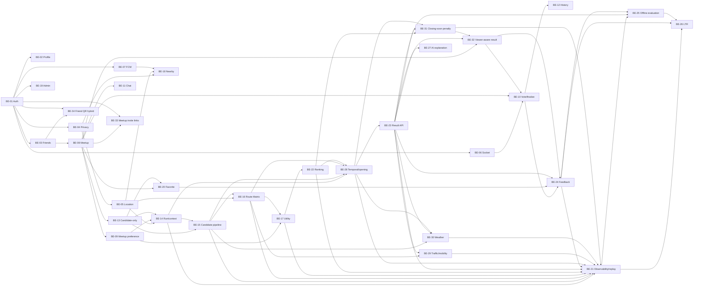

# Kế hoạch triển khai Backend — 13_implementation_plan

> Ngày lập: 27/10/2026; cập nhật closing-soon, viewer privacy, invite link và QR hybrid ngày 02/11/2026
>
> Phạm vi nguồn: workbook `MeetUp_Product_Backlog_Function_Points.xlsx` và tài liệu hiện có trong dự án
>
> Trạng thái: kế hoạch triển khai; quyết định tại Mục 7 là baseline triển khai hiện hành. Các ngưỡng benchmark còn mở không được tự hard-code cho production.

## Mục lục

1. [Mục tiêu và phạm vi](#1-mục-tiêu-và-phạm-vi)
2. [Tóm tắt đầu vào](#2-tóm-tắt-đầu-vào)
3. [Giả định và rủi ro](#3-giả-định-và-rủi-ro)
4. [Đồ thị phụ thuộc](#4-đồ-thị-phụ-thuộc)
5. [Các giai đoạn thực hiện](#5-các-giai-đoạn-thực-hiện)
6. [Bảng đối chiếu function → bước](#6-bảng-đối-chiếu-function--bước)
7. [Quyết định đã chốt và câu hỏi còn mở](#7-quyết-định-đã-chốt-và-câu-hỏi-còn-mở)

## 1. Mục tiêu và phạm vi

### 1.1. Mục tiêu

Kế hoạch này sắp xếp toàn bộ 34 function trong tab **Chức năng BE** theo phụ thuộc kỹ thuật và nghiệp vụ. Mỗi bước nêu rõ việc cần làm, đầu vào, đầu ra và điều kiện hoàn thành để developer có thể bắt đầu và reviewer có thể quyết định đạt hay không đạt. [Nguồn: `MeetUp_Product_Backlog_Function_Points.xlsx` — sheet `Chức năng BE`, BE-01 đến BE-34]

Kế hoạch bắt đầu từ trạng thái hiện tại của workbook:

- 17 function đã thực hiện: BE-01 đến BE-09, BE-13 đến BE-17, BE-22, BE-23 và BE-28.
- 17 function chưa thực hiện: BE-10 đến BE-12, BE-18 đến BE-21, BE-24 đến BE-27 và BE-29 đến BE-34.
- Mọi phần của recommendation engine, gồm online pipeline, offline evaluation và learning-to-rank, do **Dev Backend 2** phụ trách. [Nguồn: workbook — sheet `Chức năng BE`, cột `Phụ trách` và `Trạng thái`; sheet `Phân công BE`]

Các function đã thực hiện không bị mặc định là “đạt”. Bước 0 kiểm chứng contract và tiêu chí trong nguồn trước khi function phụ thuộc được bắt đầu.

### 1.2. Trong phạm vi

- Xác thực, profile, friendship, privacy, realtime location, Socket, FCM, meetup, preference, vote, chat, history, favorite và admin account theo đúng function trong sheet. [Nguồn: workbook — `Chức năng BE`, BE-01 đến BE-12, BE-18 đến BE-20]
- Candidate-only endpoint hiện có và recommendation engine hoàn chỉnh: run/context, candidate pipeline, Route Matrix, feature/utility, fairness ranking, temporal/opening context, traffic/mobility, weather, explanation, persistence và result API. [Nguồn: workbook — `Chức năng BE`, BE-13 đến BE-17, BE-22, BE-23, BE-28 đến BE-30; `12_meetup_group_recommendation_engine.md` — Mục 4–8, 11, 15]
- Impression/feedback, observability/replay, offline dataset/evaluation và LTR lifecycle. [Nguồn: workbook — `Chức năng BE`, BE-21, BE-24 đến BE-26; Doc 12 — Mục 9–10, 14]
- AI explanation tùy chọn và nearby friend detection theo phạm vi đã ghi trong sheet. [Nguồn: workbook — `Chức năng BE`, BE-18, BE-27]
- Closing-soon soft ranking, viewer-aware result, link mời meetup và QR kết bạn hybrid. [Nguồn: workbook — `Chức năng BE`, BE-31 đến BE-34; Doc 02 — BR-22 đến BR-26]

### 1.3. Ngoài phạm vi

- Function không có trong sheet; microservice, Kafka hoặc RabbitMQ. [Nguồn: `09_cong_nghe_su_dung.md` — Mục 1, 10]
- Budget filter, Google `priceLevel` hoặc `PricePenalty`. [Nguồn: workbook — `Giới thiệu`; `06_database_schema.dbml` — Project note]
- GPS history, multi-stop routing, calendar/FreeBusy, reinforcement learning và real-time model update. [Nguồn: Doc 12 — Mục 1.5]
- Future-traffic second pass tại thời điểm khởi hành, travel mode ngoài `TWO_WHEELER`/`DRIVE`, multi-place-provider retrieval trong cùng một run và diversity re-ranking. [Nguồn: Doc 12 — Mục 1.5, 4.5, 8.4, 13, 16.2]
- Admin report handling, admin metrics UI và admin health UI không được đưa vào BE-19 vì sheet chỉ giao khóa/mở khóa tài khoản và audit. [Nguồn: workbook — `Chức năng BE`, BE-19; đối chiếu `07_usecase_admin.puml`]

## 2. Tóm tắt đầu vào

### 2.1. Cấu trúc workbook

Tab `Chức năng BE` có 10 cột:

| Cột                      | Ý nghĩa dùng trong plan                                       |
| ------------------------ | ------------------------------------------------------------- |
| `Mã`                     | ID duy nhất của function, từ BE-01 đến BE-34.                 |
| `Chức năng Backend`      | Tên function dùng nguyên văn trong plan.                      |
| `API/Event/Worker chính` | Bề mặt tích hợp phải được triển khai hoặc kiểm chứng.         |
| `Phạm vi`                | `Core` hoặc `Planned`.                                        |
| `Điểm BE`                | Độ lớn tương đối đã chốt trong workbook; không đổi thành giờ. |
| `Phụ trách`              | Dev Backend 1 hoặc Dev Backend 2.                             |
| `Sprint`                 | Thứ tự mục tiêu S1 đến S7+. Không phải cam kết ngày.          |
| `Phụ thuộc`              | Cạnh trong đồ thị phụ thuộc.                                  |
| `Tiêu chí hoàn thành`    | Nguồn chính để viết exit gate.                                |
| `Trạng thái`             | `Đã thực hiện`, `Đang triển khai` hoặc `Chưa thực hiện`.      |

[Nguồn: workbook — sheet `Chức năng BE`, hàng tiêu đề và BE-01 đến BE-34]

### 2.2. Thống kê function

| Nhóm           | Số function | Điểm BE | ID                                                              |
| -------------- | ----------: | ------: | --------------------------------------------------------------- |
| Core           |          19 |     173 | BE-01–BE-10, BE-13–BE-17, BE-22–BE-23, BE-28, BE-32             |
| Planned        |          15 |     120 | BE-11–BE-12, BE-18–BE-21, BE-24–BE-27, BE-29–BE-31, BE-33–BE-34 |
| Đã thực hiện   |          17 |     157 | BE-01–BE-09, BE-13–BE-17, BE-22–BE-23, BE-28                    |
| Đang triển khai |           3 |      14 | BE-11, BE-19, BE-20                                               |
| Chưa thực hiện |          14 |     122 | BE-10, BE-12, BE-18, BE-21, BE-24–BE-27, BE-29–BE-34            |
| Dev Backend 1  |          13 |      88 | BE-01–BE-04, BE-08–BE-12, BE-19–BE-20, BE-33–BE-34              |
| Dev Backend 2  |          21 |     205 | BE-05–BE-07, BE-13–BE-18, BE-21–BE-32                           |
| **Tổng**       |      **34** | **293** | BE-01–BE-34                                                     |

[Nguồn: workbook — sheet `Chức năng BE`; sheet `Tổng quan BE`]

Phân bố theo sprint: S1 có 3 function; S2 có 4; S3 có 3; S4 có 7; S5 có 11; S6 có 4; S7 có 1; S7+ có 1. [Nguồn: workbook — `Chức năng BE`, cột `Sprint`]

### 2.3. Nguồn tài liệu và quy tắc rút ra

| Nguồn                                            | Nội dung dùng trong plan                                                                                                                |
| ------------------------------------------------ | --------------------------------------------------------------------------------------------------------------------------------------- |
| `README.md`, `docs/README.md`                    | Lệnh build/test/migration; phạm vi và chỉ mục tài liệu.                                                                                 |
| `01_danh_gia_pham_vi.md`                         | Phạm vi Core/Planned, privacy, TTL 5 phút và mục tiêu chất lượng.                                                                       |
| `02_nghiep_vu_va_dac_ta.md`                      | Actor, meetup lifecycle, business rules, preference và vote. Công thức recommendation tại đây được chính tài liệu đánh dấu là tạm thời. |
| `03_usecase_users.puml`, `07_usecase_admin.puml` | Quan hệ use case người dùng và admin.                                                                                                   |
| `04_product_backlog.md`                          | Owner, Definition of Done chung và backlog nghiệp vụ.                                                                                   |
| `05_ke_hoach_kiem_thu.md`                        | Scenario bắt buộc về privacy, TTL, vote, recommendation, AI và nearby.                                                                  |
| `06_database_schema.dbml`                        | Schema hiện tại; là nguồn phát hiện drift với engine mới.                                                                               |
| `08_huong_dan_cau_truc_ddd.md`                   | Layering, bounded context, port/event, error mapping, test và migration rule.                                                           |
| `09_cong_nghe_su_dung.md`                        | Stack đã chốt: NestJS, PostgreSQL/PostGIS, Redis, BullMQ, Socket.IO, FCM, Google Places/Routes, Jest/Supertest/Testcontainers.          |
| `docs/outbox_event/notifications_api.md`         | Device token encryption, outbox, retry và notification payload.                                                                         |
| `11_backend_integration_handoff.md`              | Contract giao thoa, BE-13 hiện tại, event và error code.                                                                                |
| `12_meetup_group_recommendation_engine.md`       | Nguồn thiết kế đích cho recommendation online, offline và LTR.                                                                          |
| `docs/friends/friends_api.md`                    | Contract BE-03, QR hybrid và concurrency.                                                                                               |
| `docs/outbox_event/realtime_event_contracts.md`  | Event versioning, room authorization, outbox và idempotency.                                                                            |
| `Source/11_location_privacy_api.md`              | Privacy mode, projection và kiểm tra quyền trên từng request.                                                                           |
| `Source/12_audit_remediation.md`                 | OAuth/profile transaction và các điểm audit đã sửa.                                                                                     |
| `Source/13_backend2_roadmap.md`                  | Roadmap cũ; chỉ dùng để phát hiện mâu thuẫn với workbook mới và Doc 12.                                                                 |

### 2.4. Ràng buộc kiến trúc đã chốt

- Backend là NestJS modular monolith. Dependency đi từ `presentation -> application -> domain`; infrastructure hiện thực port và domain không phụ thuộc NestJS/TypeORM/SDK ngoài. [Nguồn: `08_huong_dan_cau_truc_ddd.md` — Mục 2–4]
- Context không đọc repository hoặc bảng của context khác. Tích hợp bằng public application port hoặc integration event có version. Không dùng `forwardRef` để che vòng phụ thuộc. [Nguồn: DDD doc — Mục 6, 11; `11_backend_integration_handoff.md` — Mục 2]
- PostgreSQL/PostGIS lưu dữ liệu bền; Redis lưu latest location/presence/cooldown có TTL. Không lưu GPS history. [Nguồn: `09_cong_nghe_su_dung.md` — Mục 3–4; `06_database_schema.dbml` — Redis keys]
- Side effect Socket/FCM được phát sau commit qua outbox; consumer phải idempotent. [Nguồn: `docs/outbox_event/notifications_api.md` — Mục 5–6; realtime contracts — Mục 3]
- Error mapping: 400 validation, 401 authentication, 403 authorization, 404 not found, 409 conflict, 502/503 external dependency. [Nguồn: DDD doc — Mục 8]
- Migration là append-only; schema DBML phải được cập nhật cùng migration. [Nguồn: DDD doc — Mục 7, 12; `11_backend_integration_handoff.md` — Mục 3]
- Recommendation dùng một active place provider và một route provider cho mỗi run; provider được che sau adapter. [Nguồn: Doc 12 — Mục 4.5, 13]
- Vote chỉ xảy ra sau recommendation và không rerank cùng run. [Nguồn: workbook — BE-10; Doc 12 — Mục 3, 9]
- Travel mode mặc định là `TWO_WHEELER`; `avoid` là soft penalty. [Nguồn: workbook — `Giới thiệu`, BE-16–BE-17; Doc 12 — Mục 3, 7]
- `scheduledAt` là temporal snapshot của run; opening/weather được đánh giá tại thời điểm này. API trả `etaSeconds` cho từng member–candidate; không suy diễn/lưu giờ khởi hành hoặc tích hợp calendar. [Nguồn: workbook — BE-28, BE-30; Doc 12 — Mục 3, 5.2 Bước 2, 5–7]
- Traffic được điều khiển bằng config deployment `ROUTES_ROUTING_PREFERENCE`; chỉ `TRAFFIC_UNAWARE`/`TRAFFIC_AWARE`, không truyền `scheduledAt` làm `departureTime`. [Nguồn: workbook — BE-29; Doc 12 — Mục 5.2 Bước 7, 13]
- `CLOSING_SOON` là shared soft ranking signal: candidate còn mở không bị loại, nhưng risk/penalty có version làm score xấu đi. [Nguồn: workbook — BE-31; Doc 12 — Mục 5.2 Bước 5, 7.8]
- Result API là viewer-aware: mọi participant thấy ETA, chỉ actor thấy preference/utility của mình; group/least-misery utility không thuộc public DTO. [Nguồn: workbook — BE-32; Doc 12 — Mục 6.7, 11.2, 12.3]
- Link mời meetup lưu token hash bền vững; QR hồ sơ lưu public handle; QR tạm thời dùng Redis TTL. Không lưu bitmap QR. [Nguồn: workbook — BE-33–BE-34; Doc 02 — BR-25–BR-26]

## 3. Giả định và rủi ro

### 3.1. Giả định đang dùng

| Giả định                                                                                             | Ảnh hưởng                                                                                                |
| ---------------------------------------------------------------------------------------------------- | -------------------------------------------------------------------------------------------------------- |
| Workbook backend là inventory hiện hành cho ID, tên, owner, sprint, điểm và trạng thái.              | Không dùng ID/điểm cũ trong `13_backend2_roadmap.md`. Quy tắc canonical đã được chốt tại Mục 7.1.        |
| **[Giả định]** Function có trạng thái `Đã thực hiện` được kiểm chứng trước, không viết lại mặc định. | Bước 0 tạo baseline; chỉ sửa khi test hoặc contract chứng minh có gap.                                   |
| **[Giả định]** Sprint biểu diễn thứ tự ưu tiên, không phải deadline.                                 | Không quy đổi điểm BE thành giờ hoặc ngày.                                                               |
| **[Giả định]** Lệnh kiểm chứng chạy từ `Source/Meet-Up-Mobile-App-BE`.                               | Mọi exit gate dùng script đã công bố trong README/package scripts.                                       |
| **[Giả định]** Mỗi PR là một vertical slice hoặc một thay đổi contract rõ ràng.                      | Giảm conflict; phù hợp hướng dẫn PR hiện có. [Nguồn: DDD doc — Mục 12; `13_backend2_roadmap.md` — Mục 5] |

### 3.2. Rủi ro và cách giảm thiểu

| Rủi ro                                                                                                                                                   | Function bị ảnh hưởng                   | Cách giảm thiểu trong plan                                                                                                                                                    |
| -------------------------------------------------------------------------------------------------------------------------------------------------------- | --------------------------------------- | ----------------------------------------------------------------------------------------------------------------------------------------------------------------------------- |
| Schema/roadmap cũ còn `exact/batch/cluster` và score thấp hơn tốt hơn; Doc 12 dùng route batching hai chiều, utility cao hơn tốt hơn và fairness ranker. | BE-14–BE-17, BE-22–BE-23                | Dùng Route Matrix đầy đủ, batch hai chiều và `rankingStrategy`; migration append-only thay thế model cũ theo Mục 7.1.                                                         |
| Endpoint BE-13 không thống nhất GET/POST và search center không thống nhất trung bình/medoid.                                                            | BE-13–BE-15                             | Giữ BE-13 dưới POST candidate-only; engine dùng medoid. Contract deprecation/internalization thực hiện theo Mục 7.1.                                                          |
| Provider Places/Routes có quota, chi phí, timeout và lỗi từng element.                                                                                   | BE-13, BE-15–BE-16, BE-21               | Adapter contract, timeout/retry có giới hạn, element accounting, circuit breaker metric và test stub. [Nguồn: Doc 12 — Mục 12.1–12.2]                                         |
| Opening tương lai có timezone/special-day/missing data; regular hours không bảo đảm ngày lễ.                                                             | BE-28                                   | `OPEN/CLOSED/UNKNOWN`, chỉ filter `CLOSED`, lưu evidence/version và test timezone/overnight/24h. [Nguồn: Doc 12 — Mục 5.2 Bước 5, 13, 16]                                     |
| Traffic-aware có thể tăng latency/cost hoặc fallback không đồng nhất giữa batch.                                                                         | BE-29                                   | Validate config lúc boot; khi fallback phải chạy lại toàn matrix và snapshot effective preference. Không thêm congestion utility. [Nguồn: Doc 12 — Mục 5.2 Bước 7, 12.1–12.2] |
| Weather provider/taxonomy/threshold chưa được chốt có thể loại nhầm candidate.                                                                           | BE-30                                   | Production mặc định `OFF`; chỉ filter forecast `AVAILABLE` + `OUTDOOR` + threshold versioned; relax nếu rỗng. [Nguồn: Doc 12 — Mục 5.2 Bước 6, 13, 16.2]                      |
| Closing-soon penalty quá mạnh/yếu làm méo ETA/fairness hoặc không đủ ảnh hưởng rank.                                                                     | BE-31                                   | Giữ `U_base`, persist `U_rank`/risk riêng, version window/weight, dev baseline 5.400 giây/0,15 và bắt buộc offline evaluation trước production.                               |
| Public response làm lộ preference/utility người khác, đặc biệt qua aggregate ở nhóm nhỏ.                                                                 | BE-32                                   | Actor-aware presenter; mọi người chỉ thấy ETA; organizer không ngoại lệ; không trả group/least-misery utility; test response theo hai actor.                                  |
| Token link/QR bị log, đoán, replay hoặc dùng sau revoke.                                                                                                 | BE-33–BE-34                             | Opaque entropy cao, chỉ lưu hash khi bền vững, Redis TTL cho phiên tạm, rate limit, no-store/redaction, revoke/rotate và E2E negative cases.                                  |
| LTR thiếu dữ liệu, label và fairness formula promotion.                                                                                                  | BE-24–BE-26                             | Time split, impressed-set evaluation, shadow trước A/B, fallback `fair-pareto-v1`; không promote khi contract chưa chốt. [Nguồn: Doc 12 — Mục 9–10, 14.5]                     |
| Dữ liệu vị trí/token bị lộ qua log, event hoặc dataset.                                                                                                  | BE-04–BE-07, BE-18, BE-21, BE-24–BE-26  | Per-request authorization, redaction test, pseudonymous offline export và không lưu origin coordinate lâu dài. [Nguồn: location privacy API; Doc 12 — Mục 12.3]               |
| Acceptance criteria còn thiếu cho một số hành vi phụ.                                                                                                    | BE-11, BE-12, BE-19, BE-21, BE-25–BE-27 | Exit gate chỉ bắt buộc phần có nguồn; tiêu chí đề xuất được gắn **[Thiếu tiêu chí trong nguồn]** để Product/Tech Lead duyệt.                                                  |

## 4. Đồ thị phụ thuộc

### 4.1. Dependency graph theo workbook



[Nguồn: workbook — sheet `Chức năng BE`, cột `Phụ thuộc`]

### 4.2. Thứ tự triển khai và nhánh song song

```text
Bước 0: kiểm chứng BE-01..09, BE-13
  ├─ Bước 1: BE-14, BE-15 (đã hoàn tất)
  │    └─ Bước 2: BE-16, BE-17, BE-22 (đã hoàn tất)
  │         └─ Bước 2A: BE-28 temporal/opening
  │              └─ Bước 3: BE-23 result API
  │                   ├─ Bước 3A: BE-29 traffic/mobility, BE-30 weather
  │                   ├─ Bước 3B: BE-31 closing-soon, BE-32 viewer-aware result
  │                   │    └─ Bước 4: BE-10, BE-11, BE-12, BE-20
  │                   │    └─ Bước 5: BE-24, BE-21
  │                   │         └─ Bước 7: BE-25 ──> Bước 8: BE-26
  │                   └─ Bước 6: BE-27
  └─ Bước 6 độc lập sau baseline: BE-18, BE-19
  └─ Bước 4A độc lập sau baseline: BE-33 meetup invite links, BE-34 friend QR hybrid
```

BE-11, BE-20, BE-33 và BE-34 có thể bắt đầu ngay sau Bước 0. BE-18 và BE-19 cũng không cần chờ recommendation core. BE-10 phải chờ BE-32 để không phát hành vote UI với contract làm lộ utility. Thứ tự đặt sau Core chỉ phản ánh phạm vi `Planned`, không phải mọi nhánh đều phụ thuộc kỹ thuật. [Nguồn: workbook — BE-11, BE-18–BE-20, BE-32–BE-34, cột `Phạm vi`, `Sprint`, `Phụ thuộc`]

## 5. Các giai đoạn thực hiện

### 5.1. Bước 0 — Khóa baseline cho function đã thực hiện

**Trạng thái: ✅ Hoàn tất (27/10/2026).** Evidence chi tiết: [`baseline-verification.md`](baseline-verification.md).

**Mục tiêu.** Chứng minh 10 function đang ghi `Đã thực hiện` đáp ứng contract nguồn và cung cấp đầu vào ổn định cho phần còn lại. Không mở rộng scope. [Nguồn: workbook — BE-01–BE-09, BE-13]

**Function thuộc bước**

| ID    | Function                               | Owner         |
| ----- | -------------------------------------- | ------------- |
| BE-01 | Xác thực và phiên đăng nhập            | Dev Backend 1 |
| BE-02 | Hồ sơ và sở thích profile              | Dev Backend 1 |
| BE-03 | Kết bạn                                | Dev Backend 1 |
| BE-04 | Quyền riêng tư vị trí                  | Dev Backend 1 |
| BE-05 | Nhận và lưu vị trí realtime            | Dev Backend 2 |
| BE-06 | Nền tảng Socket và presence            | Dev Backend 2 |
| BE-07 | Thiết bị và nền tảng FCM               | Dev Backend 2 |
| BE-08 | Vòng đời Meetup và thành viên          | Dev Backend 1 |
| BE-09 | Sở thích tạm thời meetup               | Dev Backend 1 |
| BE-13 | Lấy địa điểm ứng viên (candidate-only) | Dev Backend 2 |

**Checklist triển khai/kiểm chứng**

- [x] BE-01: access/refresh flow, refresh reuse detection và locked account không đăng nhập — `session-flows.use-case.spec.ts` pass. [Nguồn: workbook — BE-01; `12_audit_remediation.md` — Mục 1]
- [x] BE-02: profile preference chỉ prefill; không ghi đè preference đã nhập trong meetup — evidence trong `baseline-verification.md`. [Nguồn: workbook — BE-02; `02_nghiep_vu_va_dac_ta.md` — BR-14 đến BR-16]
- [x] BE-03: canonical friend pair, không self-friend, không duplicate và concurrency protection — unit/E2E pass; unique pair + lock được đối chiếu tại repository/migration. [Nguồn: workbook — BE-03; `docs/friends/friends_api.md` — Mục 3–7]
- [x] BE-04: bốn privacy mode và authorization mỗi lần đọc/publish, không cache — `location-access.service.spec.ts` và `privacy.e2e-spec.ts` pass. [Nguồn: workbook — BE-04; `11_location_privacy_api.md` — Mục 3–6]
- [x] BE-05: location hữu hạn, timestamp/accuracy, privacy, Redis TTL 5 phút và không GPS history — `publish-location.use-case.spec.ts` và `redis-location.adapter.spec.ts` pass. [Nguồn: workbook — BE-05; realtime contracts — Mục 5; DBML — Redis keys]
- [x] BE-06: JWT handshake, room authorization, presence TTL và shared publisher contract — `location.gateway.spec.ts`, `realtime-publisher.adapter.spec.ts` pass. [Nguồn: workbook — BE-06; realtime contracts — Mục 4–6]
- [x] BE-07: AES-256-GCM, HMAC fingerprint, outbox worker/retry và revoke token invalid — notification/outbox specs pass. [Nguồn: workbook — BE-07; `docs/outbox_event/notifications_api.md` — Mục 2–6]
- [x] BE-08: meetup lifecycle/member invariants; `recommendationMode` không còn ở public BE-08 DTO/OpenAPI/response — `meetups.e2e-spec.ts` pass. [Nguồn: workbook — BE-08; `02_nghiep_vu_va_dac_ta.md` — BR-06 đến BR-13]
- [x] BE-09: meetup preference thay profile theo tag, profile fallback khi thiếu và giữ `avoid` phạt mềm — meetup preference specs pass. [Nguồn: workbook — BE-09; Doc 12 — Mục 5.2 Bước 2, 7.2]
- [x] BE-13: candidate-only `POST`, Google Places adapter, authorization/state/error; không dùng provider order làm rank — `recommendations.e2e-spec.ts` pass. [Nguồn: workbook — BE-13; `11_backend_integration_handoff.md` — Mục 8; Doc 12 — Mục 5.3]
- [x] Báo cáo baseline theo 10 BE ID: [`baseline-verification.md`](baseline-verification.md).

**Đầu vào cần có**

- Code/migration hiện tại; PostgreSQL, Redis và test config.
- Contract trong friends API, privacy API, realtime contracts, notifications API và handoff.

**Đầu ra/deliverable**

- Báo cáo baseline theo 10 BE ID.
- Test thiếu được bổ sung; fix regression nếu có.
- Public port/event/DTO được khóa version để Bước 1–6 dùng.
- Khóa BE-13 là endpoint candidate-only `POST`; không dùng raw provider order cho mobile production sau khi BE-23 hoàn tất. [Nguồn: Mục 7.1, Q3]

**Phụ thuộc và song song**

- Không phụ thuộc bước trong plan.
- Có thể chạy song song theo ba nhánh: BE-01–03; BE-04–07; BE-08–09/13.

**Độ phức tạp: L.** Có 10 function, nhiều boundary PostgreSQL/Redis/Socket/FCM/Google và contract giao thoa.

**Exit gate**

Điều kiện bắt buộc:

- [x] Test chứng minh từng acceptance criterion trong workbook cho BE-01–BE-09 và BE-13 — mapping test-by-test trong [`baseline-verification.md`](baseline-verification.md).
- [x] Privacy test cho `off`, `friends`, `selected_friends`, `meetup_only`; unauthorized request không nhận exact location — `location-access.service.spec.ts`, `privacy.e2e-spec.ts` pass.
- [x] TTL test chứng minh latest location có TTL 5 phút — `redis-location.adapter.spec.ts` assert Redis `set(..., 300)`; `publish-location.use-case.spec.ts` pass.
- [x] Socket room từ chối non-member; notification retry không rollback business transaction — `location.gateway.spec.ts`, `outbox-worker.service.spec.ts` pass.
- [x] BE-13 trả đúng năm nhóm lỗi đã tài liệu hóa: `MEETUP_NOT_FOUND` 404, `MEETUP_FORBIDDEN` 403, `MEETUP_INSUFFICIENT_PARTICIPANTS` 400, `RECOMMENDATION_INSUFFICIENT_LOCATIONS` 400, `PLACE_SEARCH_UNAVAILABLE` 503 — `recommendations.e2e-spec.ts` pass. [Nguồn: handoff — Mục 8]
- [x] `npm run lint`, `npm test`, `npm run test:e2e`, `npm run build` đều exit code 0 — lint/build exit 0; unit 34/149 pass; E2E 5/47 pass. [Nguồn: backend README; DDD doc — Mục 9, 12]

Cách kiểm chứng:

```bash
npm run lint
npm test
npm run test:e2e
npm run build
```

Reviewer đối chiếu report với từng BE ID và xem kết quả test trong CI. Nếu có migration bổ sung, chạy `npm run migration:run`, `npm run migration:revert`, rồi `npm run migration:run` trên database dùng cho test. [Nguồn: backend README — Scripts; DDD doc — Mục 7]

Tiêu chí không đạt:

- Bất kỳ command nào lỗi; thiếu test cho tiêu chí sheet; public contract chưa version; truy cập location bỏ qua permission; BE-13 chưa xác định contract hiện hành.

Người xác nhận: owner theo sheet thực hiện; backend còn lại review PR. Thay đổi cross-context phải được cả hai owner chấp nhận contract trước khi merge. [Nguồn: workbook — sheet `Hướng dẫn`; DDD doc — Mục 12]

**Deliverable thực tế.** `docs/baseline-verification.md`; regression specs `session-flows.use-case.spec.ts`, `redis-location.adapter.spec.ts`, `recommendations.e2e-spec.ts`; BE-08 public DTO/OpenAPI/response đã bỏ `recommendationMode`.

**[Giả định].** Giữ cột legacy `meetup_sessions.recommendation_mode` với giá trị nội bộ cố định `balanced` để tương thích schema hiện có; field không còn được nhận, mô tả hoặc trả qua BE-08. Xóa cột cần migration append-only và thuộc thay đổi recommendation schema ở bước sau.

**Ghi chú cho Bước 1.** Dùng BE-13 `POST` candidate-only làm input; không đưa `recommendationMode` trở lại mobile/BE-08. Bước 1 phải persist `rankingStrategy` server-side theo Q2 và xử lý migration schema đích append-only.

### 5.2. Bước 1 — Recommendation run, context và candidate pipeline

**Trạng thái: ✅ Hoàn tất (27/10/2026).** Repository/API, ContextBuilder privacy/location,
Google pagination, DBML/entity/migration, migration cycle, integration/E2E và full quality gate
đều đã có evidence chạy thật. Chi tiết kiểm toán: [`step1-tracker.md`](../../step1-tracker.md).

**Mục tiêu.** Tạo run idempotent, context hợp lệ và tập `EligibleCandidate` đã qua provider-side filter, merge/dedup và residual hard constraint. [Nguồn: workbook — BE-14, BE-15; Doc 12 — Mục 4.2, 5.2 Bước 1–4]

**Function thuộc bước**

| ID    | Function                               | Owner         |
| ----- | -------------------------------------- | ------------- |
| BE-14 | Khởi tạo recommendation run và context | Dev Backend 2 |
| BE-15 | Candidate pipeline và constraint       | Dev Backend 2 |

**Checklist triển khai**

- [x] Tạo bounded module `recommendations` theo layering hiện có; định nghĩa orchestrator, context builder, ports và DTO trước adapter. [Nguồn: DDD doc — Mục 2–6; Doc 12 — Mục 4.3]
- [x] BE-14 validate actor, meetup state, UUID `requestId`, `topK`, radius, distinct categories và `openingFilter`; output là `ValidatedRecommendationRequest`. [Nguồn: Doc 12 — Mục 5.2 Bước 1]
- [x] Thêm idempotency unique `(meetup_id, request_id)` và `payload_hash`; same key/same payload trả run cũ, different payload trả 409 `IDEMPOTENCY_KEY_REUSED`. [Nguồn: Doc 12 — Mục 5.2 Bước 1, 11.4]
- [x] Context chỉ nhận accepted member có quyền chia sẻ, latest location chưa stale và dữ liệu tọa độ/accuracy/timestamp hợp lệ; sort member theo `participantId`; dưới 2 member trả `INSUFFICIENT_VALID_MEMBERS`. [Nguồn: workbook — BE-14; Doc 12 — Mục 5.2 Bước 2]
- [x] Snapshot `rankingStrategy`, `algorithmVersion`, `configVersion`, `featureSchemaVersion` và provider/category mapping version. `recommendationMode`, nếu cần tương thích workbook, chỉ là alias nội bộ của `rankingStrategy`, không là input organizer. [Nguồn: workbook — BE-14; Doc 12 — Mục 6.2, 11.3; Mục 7.1, Q2]
- [x] BE-15 tạo query deterministic cho từng required category với semantics ANY/OR; Text Search dùng một `includedType`, strict type và optional `openNow` tại request time. [Nguồn: workbook — BE-15; Doc 12 — Mục 4.2, 5.2 Bước 3]
- [x] Phân trang round-robin trong `providerCallBudget`; union và dedup bằng `canonicalCandidateKey`; giữ source category/page metadata. [Nguồn: Doc 12 — Mục 5.2 Bước 3, 6.3]
- [x] Áp dụng residual hard filter cho required field, exact radius, category/policy và business status khi provider xác nhận. Không hard-filter `avoid`, rating thiếu hoặc opening data thiếu. [Nguồn: workbook — BE-15; Doc 12 — Mục 5.2 Bước 4, Mục 3.10]
- [x] First page của required category lỗi sau retry thì run failed `PLACE_SEARCH_UNAVAILABLE`; không còn candidate thì `NO_ELIGIBLE_CANDIDATES`. [Nguồn: Doc 12 — Mục 4.2, 12.2]
- [x] Adapter không ghi database hoặc đổi run state; engine không đọc field riêng của Google ngoài canonical contract. [Nguồn: Doc 12 — Mục 4.5, 6.3]

**Đầu vào cần có**

- Bước 0 đạt cho BE-05, BE-08, BE-09, BE-13.
- Google Places config/key và category mapping có version.
- Các quyết định Mục 7.1: `rankingStrategy` server-side, medoid retrieval center và synchronous run API.

**Đầu ra/deliverable**

- `RecommendationModule`, run/context contracts, place-provider port/adapter.
- Migration append-only cho run/idempotency và candidate snapshot cần thiết; DBML cập nhật cùng PR.
- POST/GET run API theo Mục 7.1, Q3/Q5.
- Unit, adapter contract, integration và E2E tests.

**Phụ thuộc và song song**

- BE-14 phụ thuộc BE-05/08/09/13; BE-15 phụ thuộc BE-13/14.
- Sau khi BE-14 contracts được khóa, ContextBuilder và CandidateGenerator/ConstraintFilter có thể làm song song.

**Độ phức tạp: L.** Có idempotency, privacy context, provider pagination, dedup/filter và migration mới.

**Exit gate**

Điều kiện bắt buộc:

- [x] Same requestId/same payload không tạo run thứ hai; different payload trả 409 đúng code.
- [x] 0 hoặc 1 valid member trả `INSUFFICIENT_VALID_MEMBERS`; stale/unauthorized/invalid location không lọt context.
- [x] Multi-category query có thứ tự deterministic, merge không duplicate canonical key và filter exact radius bằng backend.
- [x] `avoid` không bị loại; `OPEN_AT_REQUEST_TIME` chỉ dùng `openNow` tại thời điểm request.
- [x] Provider first-page failure và empty candidate set chuyển run sang `FAILED` với code đúng.
- [x] Migration chạy trên database rỗng; DBML phản ánh cùng schema; lint/unit/integration/E2E/build pass.
- [x] Validation/config có version `recommendation-config-dev-v1` theo Q10; các giá trị production chưa được duyệt không bị hard-code.

Cách kiểm chứng:

- Unit test ContextBuilder bằng member/location matrix; property/table test validation biên.
- Adapter contract test với hai category, hai page, duplicate Place ID, place ngoài radius, `CLOSED_PERMANENTLY`, thiếu rating/opening.
- E2E gửi cùng idempotency key hai lần và so `runId`.
- Chạy bộ lệnh chuẩn ở Bước 0 và migration cycle nếu có migration.

**Evidence đóng gate ngày 27/10/2026**

- Build, typecheck, lint: `npm run build`, `npm run typecheck`,
  `npx eslint "{src,apps,libs,test}/**/*.ts"` đều exit 0.
- Unit: `npm test -- --runInBand` — 39 suite, 166 test pass.
- Integration chạy hai lần trên PostgreSQL thật — mỗi lần 2 suite, 13 test pass.
- E2E chạy hai lần qua HTTP app thật + PostgreSQL + Redis, Google giả lập ở HTTP boundary —
  mỗi lần 6 suite, 51 test pass.
- Migration thật: chuẩn bị baseline, `run` → kiểm tra 15/14 cột → `revert` → kiểm tra hai
  relation đã drop → `run` lại; toàn bộ exit 0.
- Source audit `TODO|FIXME|not implemented|skip|xit|it.skip|only(` trong phần Bước 1: 0 finding.

**Danh sách file chính**

- `src/bounded-contexts/recommendations/**`: domain, application, adapter Google, TypeORM repository,
  controller, module và unit/adapter tests.
- `src/infrastructure/database/migrations/1792080000000-create-recommendation-run-baseline.ts`,
  `docs/06_database_schema.dbml`, `compose.yaml`, `package.json`.
- `test/recommendations.integration-spec.ts`, `test/recommendation-runs.e2e-spec.ts`,
  `test/jest-integration.json`.

**[Giả định].** PostgreSQL/Redis test dùng image/config của `compose.yaml` với host port
`55432`/`56379` để tránh xung đột cục bộ; default port dự án không đổi.

**Vấn đề cần quyết định.** Không có blocker còn lại cho Bước 1. Ngưỡng production chưa được duyệt
vẫn là quyết định product/benchmark về sau và không ảnh hưởng dev config có version.

**Bàn giao Bước 2.** Có thể dùng persisted completed run/candidate snapshot, context privacy-safe,
canonical candidate contract và các version snapshot làm đầu vào BE-16/BE-17/BE-22; không mở rộng
Bước 1 sang route matrix, utility hoặc ranking.

Tiêu chí không đạt:

- Raw candidate được trả như final recommendation; provider adapter làm ranking; thiếu idempotency unique; privacy bị bỏ qua; tham số benchmark chưa duyệt bị hard-code; PR đi ngược `rankingStrategy` server-side, medoid hoặc synchronous API đã chốt.

Người xác nhận: Dev Backend 2; Dev Backend 1 review các port Meetup/Preference/Location và API contract. [Nguồn: workbook — `Phân công BE`; handoff — Mục 2]

### 5.3. Bước 2 — Route Matrix, feature/utility và group ranking

**Trạng thái: ✅ Hoàn tất (28/10/2026).**

**Mục tiêu.** Biến eligible candidates thành full deterministic ranking bằng route hợp lệ cho mọi member, utility versioned và ba strategy bắt buộc. [Nguồn: workbook — BE-16, BE-17, BE-22; Doc 12 — Mục 5.2 Bước 5–7, Mục 7–8]

**Function thuộc bước**

| ID    | Function                         | Owner         |
| ----- | -------------------------------- | ------------- |
| BE-16 | Route Matrix và route validation | Dev Backend 2 |
| BE-17 | Feature và member utility        | Dev Backend 2 |
| BE-22 | Group ranking và fairness        | Dev Backend 2 |

**Checklist triển khai**

- [x] BE-16 tạo `RouteBatchPlanner` chia cả origins và destinations theo element/waypoint limit; giữ index mapping sau khi ghép batch. [Nguồn: workbook — BE-16; Doc 12 — Mục 6.4, 12.1]
- [x] Gọi ComputeRouteMatrix với `TWO_WHEELER`; validate duration/distance hữu hạn, không âm; element lỗi thành `NO_ROUTE`. [Nguồn: workbook — BE-16; Doc 12 — Mục 3.5, 6.4]
- [x] Loại candidate nếu bất kỳ valid member thiếu route; toàn batch lỗi trả `ROUTE_MATRIX_UNAVAILABLE`; không còn candidate trả `NO_ROUTABLE_CANDIDATES`; thiếu K dùng `effectiveK` và warning, không bịa ETA. [Nguồn: Doc 12 — Mục 4.2, 12.2]
- [x] BE-17 dựng feature schema có version và tính `T`, `P`, `Q`, `U` đúng thứ tự sau route validation. [Nguồn: workbook — BE-17; Doc 12 — Mục 5.2 Bước 6, Mục 7.1–7.4]
- [x] Validate mọi input/config hữu hạn; utility nằm `[0,1]`; `tauSeconds > 0`; tag weights dương; `alpha+beta+gamma=1`; missing policy tránh chia 0. [Nguồn: Doc 12 — Mục 6.7, 7.1–7.4]
- [x] `avoid` dùng `s(avoid)` như soft penalty, không hard filter. Preference meetup ưu tiên profile fallback theo tag. [Nguồn: workbook — BE-17; Doc 12 — Mục 7.2]
- [x] BE-22 hiện thực `min-sum`, `min-max`, `fair-pareto-v1`; tính `G`, candidate least-misery `F`, member rank, Pareto level và Monte Carlo inclusion probability. [Nguồn: workbook — BE-22; Doc 12 — Mục 7.5–7.7, 8]
- [x] Tie-break deterministic theo strategy, seed, `utilityTieEpsilon` và `canonicalCandidateKey`; lưu full ranking, không chỉ top-K. [Nguồn: Doc 12 — Mục 8.2–8.3, 11.3]
- [x] Không gọi implementation này là XPO nguyên bản; tên production strategy là `fair-pareto-v1`. [Nguồn: Doc 12 — Mục 8.2–8.3, 13]

**Đầu vào cần có**

- Bước 1 đạt; `EligibleCandidate[]`, ordered valid members và config versions.
- Google Routes config/key/quota test project.
- Route Matrix đầy đủ/batch hai chiều và `rankingStrategy` server-side theo Mục 7.1, Q1/Q2.

**Đầu ra/deliverable**

- Route provider port/adapter, batch planner và element assembler.
- Versioned FeatureBuilder, MemberUtilityScorer và GroupRanker.
- Golden test vectors tính tay cho công thức và ranking.
- Cost/element metadata để Bước 5 quan sát.

**Phụ thuộc và song song**

- BE-16 sau BE-05/15; BE-17 sau BE-09/16; BE-22 sau BE-17.
- Adapter Route và pure utility/ranker có thể làm song song bằng fake contracts, nhưng integration theo đúng chuỗi trên.

**Độ phức tạp: L.** Đây là lõi thuật toán, có external matrix, numeric validation, deterministic Monte Carlo và fairness semantics.

**Exit gate**

Điều kiện bắt buộc:

- [x] Test matrix nhiều batch chứng minh mọi `(participantId, canonicalCandidateKey)` được join đúng một lần, không đảo index. Bằng chứng: `route-batch-planner.spec.ts`, `route-matrix.service.spec.ts`.
- [x] Candidate có một `NO_ROUTE` bị loại; còn ít hơn K trả `effectiveK` và warning; không có route nào trả đúng failure code. Bằng chứng: unit + E2E `NO_ROUTABLE_CANDIDATES`/`ROUTE_MATRIX_UNAVAILABLE` pass.
- [x] Golden tests khớp ví dụ Doc 12: `T≈0.607` với 600/1200; `P=0.55` với high+avoid; `Q=0.6` với 4.5/99/999; `U=0.5892` với 0.60/0.30/0.10. Bằng chứng: `member-utility.service.spec.ts`. [Nguồn: Doc 12 — Mục 7.1–7.4]
- [x] Test reject `tauSeconds<=0`, negative/NaN/Infinity, invalid rating/review, weight sum sai và `S<=0`. Bằng chứng: `member-utility.service.spec.ts`.
- [x] Cùng snapshot/version/seed tạo cùng full rank; test matrix nhỏ tính tay cho `min-sum`, `min-max`, Pareto dominance và tie-breaker. Bằng chứng: `group-ranker.service.spec.ts`.
- [x] Không candidate nào trong ranking thiếu route OK cho một valid member; utility đều hữu hạn và trong `[0,1]`. Bằng chứng: route service unit và HTTP+DB E2E snapshot.
- [x] Lint/unit/integration/E2E/build pass. Bằng chứng: build/typecheck/lint exit 0; unit 44/190; integration 2/13 hai lần; E2E 6/53 hai lần.
- [x] **[Thiếu tiêu chí trong nguồn]** `tauSeconds`, utility weights, `p_missing`, `q_missing`, `n_ref`, sample count và epsilon chưa được kiểm chứng. Dev/test values nằm trong `recommendation-config-dev-v1`; chưa tuyên bố production-approved.

Cách kiểm chứng:

- Chạy unit test bằng fixture số cố định và snapshot full ranking.
- Integration test Route adapter với response out-of-order, partial element failure, batch failure và quota/timeout.
- Chạy bộ lệnh chuẩn ở Bước 0.

**File tạo/sửa.** `route-matrix.port.ts`, `route-batch-planner.ts`, `route-matrix.service.ts`, `google-routes.adapter.ts`, `feature-builder.ts`, `member-utility.service.ts`, `group-ranker.service.ts`, `recommendation-config.ts`, `recommendation-context.builder.ts`, `create-recommendation-run.use-case.ts`, recommendation entities/repository/module, migration `1792090000000`, `06_database_schema.dbml`, unit/integration/E2E specs và `Source/step2-tracker.md`.

**[Giả định].** `q_missing=0.60`, `n_ref=999`, `monteCarloSamples=1000`, `utilityTieEpsilon=1e-6`, RNG `mulberry32-v1` chỉ là baseline dev/test có version. PostgreSQL/Redis kiểm chứng bằng compose trên host port `5433`/`6380`; cấu hình runtime mặc định không đổi.

**Bàn giao Bước 2A/Bước 3.** Full rank, per-member route/utility snapshots, `effectiveK`, warning, seed và cost metadata đã persist atomically. Bước 2A bổ sung temporal/opening mà không đổi công thức utility; Bước 3 dựng top-K/explanation từ cùng snapshot, không tính lại route/utility và không gọi kết quả hiện tại là XPO nguyên bản. Các production value chưa duyệt vẫn phải giữ version/dev-only.

Tiêu chí không đạt:

- Sai đơn vị giây/phút; có NaN/Infinity; dùng straight-line ETA fallback; random seed không lưu; rerun khác rank; dùng cluster hoặc public route strategy trái Mục 7.1, Q1.

Người xác nhận: Dev Backend 2; reviewer phải kiểm tra golden vector, không chỉ happy-path API.

### 5.4. Bước 2A — Temporal context và opening tại `scheduledAt`

**Trạng thái: ✅ Hoàn tất (30/10/2026; contract ETA được điều chỉnh và kiểm chứng lại 02/11/2026).** Evidence kiểm toán chi tiết: [`step2a-tracker.md`](../../step2a-tracker.md).

**Mục tiêu.** Đưa thời điểm gặp đã có trong meetup vào engine theo cách có thể audit: snapshot `scheduledAt`, đánh giá opening tại thời điểm gặp, trả ETA minh bạch cho từng member–candidate và phát hiện kết quả cũ khi thời gian meetup thay đổi. [Nguồn: workbook — BE-28; Doc 12 — Mục 4.2, 5.2 Bước 2 và Bước 5, 6, 11]

**Function thuộc bước**

| ID    | Function                                    | Owner         |
| ----- | ------------------------------------------- | ------------- |
| BE-28 | Temporal context và opening tại scheduledAt | Dev Backend 2 |

**Checklist triển khai**

- [x] Snapshot `requestedAt` và `scheduledAt` vào run; `scheduledAt` không nhận lại từ client nếu meetup đã là nguồn canonical — `CreateRecommendationRunUseCase`, request DTO và E2E rejection test. [Nguồn: Doc 12 — Mục 5.2 Bước 2, 6.2]
- [x] Thêm `OPEN_AT_SCHEDULED_TIME`; không gửi `openNow`, yêu cầu opening hours/timezone có version và chạy `ScheduledOpeningEvaluator` — Google adapter contract spec và evaluator specs. [Nguồn: Doc 12 — Mục 5.2 Bước 3, Bước 5]
- [x] Evaluator trả `OPEN/CLOSED/UNKNOWN`; chỉ loại `CLOSED`, giữ `UNKNOWN` với warning/evidence. Ưu tiên current hours trong cửa sổ hỗ trợ, fallback regular hours có evidence riêng — unit và E2E pass. [Nguồn: Doc 12 — Mục 5.2 Bước 5]
- [x] Persist và trả `etaSeconds` cho từng member–candidate sau route validation; không suy diễn/lưu giờ khởi hành và không tích hợp calendar — repository/API/E2E test pass. [Nguồn: Doc 12 — Mục 5.2 Bước 7]
- [x] Run đã hoàn tất immutable; GET so sánh `scheduledAt` hiện tại với snapshot và trả `contextStatus=STALE_CONTEXT` khi khác; shared decision guard chặn stale run — freshness guard unit/integration/E2E pass. [Nguồn: Doc 12 — Mục 4.2, 11.4]
- [x] Persist evaluator version, opening evidence/status và scheduled snapshot bằng migration append-only; DBML, entities, repository và API contract đã đồng bộ — migration/repository integration pass. [Nguồn: Doc 12 — Mục 11.1, 11.3]

**Đầu vào cần có**

- Bước 2 đã đạt; meetup có `scheduledAt`, route ETA và full ranking.
- Google Places field mask/cost cho opening fields; timezone data được chuẩn hóa.

**Đầu ra/deliverable**

- Temporal context contract, `ScheduledOpeningEvaluator`, DTO/schema migration, ETA per-member và stale-context guard.
- Unit tests cho timezone/overnight/24h/missing; integration/E2E cho filter và thay đổi `scheduledAt`.

**Phụ thuộc và song song**

- BE-28 phụ thuộc BE-14/15/16/22. Evaluator thuần có thể viết song song với migration/API contract; integration cần route snapshot của Bước 2.

**Độ phức tạp: L.** Có timezone, periods qua ngày, missing-data policy, schema/API và consistency với vote.

**Exit gate**

Điều kiện bắt buộc:

- [x] `OPEN_AT_SCHEDULED_TIME` không gửi `openNow`; fixture open/closed/overnight/24h trả đúng `OPEN/CLOSED` theo timezone địa điểm — adapter/evaluator unit specs pass.
- [x] Thiếu/invalid hours hoặc timezone trả `UNKNOWN`, candidate vẫn còn và có `OPENING_STATUS_UNKNOWN` — evaluator, policy và E2E specs pass.
- [x] Candidate `CLOSED` bị loại trước weather/Routes mới; `OPEN` được giữ — pipeline unit/E2E assertions pass và route request không chứa candidate đã đóng.
- [x] ETA từng member được persist/return đúng; output, DBML, entity và migration không chứa giờ khởi hành suy diễn — repository/API/E2E specs pass.
- [x] Đổi `scheduledAt` sau completed run làm GET trả `STALE_CONTEXT`; ranked snapshot không bị sửa và stale run bị chặn ở vote/chốt — freshness integration/E2E specs pass.
- [x] Migration cycle, lint/unit/integration/E2E/build pass — migration `up → down → up` trên PostgreSQL 18; lint/build/typecheck exit 0; unit `47/47` suites, `208/208` tests; integration hai lượt `2/2`, `14/14`; E2E hai lượt `6/6`, `57/57`.

Cách kiểm chứng: unit test evaluator bằng fixed clock và timezone fixtures; provider contract test field mask; E2E tạo run, đổi `scheduledAt`, GET/vote; query database đối chiếu snapshot/evidence; chạy bộ lệnh chuẩn.

Tiêu chí không đạt: dùng timezone server; dùng `openNow` để suy ra giờ tương lai; coi missing là closed; sửa run cũ khi meetup đổi giờ; suy diễn/lưu giờ khởi hành thay vì trả ETA minh bạch.

Người xác nhận: Dev Backend 2; Dev Backend 1 review meetup `scheduledAt` và vote/finalize guard.

**Bằng chứng đóng gate cập nhật ngày 02/11/2026**

- `npm run lint`, `npm run build`, `npm run typecheck` đều exit `0`.
- `npm test -- --runInBand`: `46/46` suites, `203/203` tests pass sau khi bỏ contract giờ khởi hành suy diễn.
- `npm run test:integration` chạy hai lần liên tiếp trên PostgreSQL 18 thật: mỗi lần `2/2` suites, `14/14` tests pass; test recommendation chứng minh schema, legacy backfill và migration `up → down → up`.
- `npm run test:e2e -- --runInBand` chạy hai lần liên tiếp qua HTTP app thật, PostgreSQL 18 và Memurai 8.1.240; Google chỉ mock tại HTTP boundary: mỗi lần `6/6` suites, `57/57` tests pass.
- Audit source trong phạm vi sửa đổi không có `TODO|FIXME|not implemented|skip|xit|it.skip|only(`; `git diff --check` exit `0`.

**Danh sách file chính**

- `src/bounded-contexts/recommendations/**`: temporal/opening contracts, evaluator/policy, freshness guard, use cases, Google/Meetup/TypeORM adapters, DTO/controller/module và test tương ứng.
- `src/infrastructure/database/migrations/1792100000000-add-recommendation-temporal-context.ts`, `docs/06_database_schema.dbml`.
- `test/recommendations.integration-spec.ts`, `test/recommendation-runs.e2e-spec.ts`, `Source/step2a-tracker.md`.

**[Giả định].** Run legacy không có temporal snapshot gốc để khôi phục chính xác. Migration backfill `requested_at=created_at`, `scheduled_at_snapshot=meetup.scheduled_at` hiện tại, `opening_filter=ANY`, version `legacy-pre-temporal-v1`/`not-applied` và warning `LEGACY_TEMPORAL_CONTEXT_BACKFILL`; freshness guard luôn coi run legacy là stale để không dùng cho vote/chốt.

**Vấn đề cần quyết định.** Không có blocker cho Bước 2A. Câu hỏi product hiện hữu về độ chính xác regular hours trong ngày lễ vẫn giữ nguyên; implementation tuân theo contract đã chốt: fallback regular hours phải có warning/evidence và không biến dữ liệu thiếu thành `CLOSED`.

**Bàn giao Bước 3.** Dùng nguyên persisted temporal/opening/ETA snapshot để dựng explanation/result, không tính lại từ provider. Mọi luồng quyết định phải gọi freshness guard; run legacy luôn stale. Không sửa full ranking của completed run khi meetup đổi `scheduledAt`.

### 5.5. Bước 3 — Explanation, persistence và API kết quả

**Trạng thái: ✅ Hoàn tất (02/11/2026).** Evidence kiểm toán chi tiết: [`step3-tracker.md`](../../step3-tracker.md).

**Mục tiêu.** Persist atomically full run và trả top-K có explanation bám đúng feature/ranking/temporal snapshot. [Nguồn: workbook — BE-23; Doc 12 — Mục 5.2 Bước 10–11, Mục 11]

**Function thuộc bước**

| ID    | Function                                | Owner         |
| ----- | --------------------------------------- | ------------- |
| BE-23 | Explanation, persistence và API kết quả | Dev Backend 2 |

**Checklist triển khai**

- [x] Tạo rule-based `ExplanationBuilder`; `summaryCode` theo strategy và facts từ snapshot thật, có unit/source — `explanation-builder.ts` và 5 unit cases pass. [Nguồn: Doc 12 — Mục 5.2 Bước 10, 6.6]
- [x] Không dùng claim “gần nhất”, “công bằng nhất”, “mọi người thích” nếu facts không chứng minh — forbidden-claim unit test và added-line grep 0 finding. [Nguồn: Doc 12 — Mục 5.2 Bước 10]
- [x] Persist run, candidate/filter reason, member feature/utility, full rank, seed, versions và explanation theo schema được duyệt — migration `1792110000000`, DBML, entities/repository và integration assertions pass. [Nguồn: workbook — BE-23; Doc 12 — Mục 11.1, 11.3]
- [x] Chuyển `RUNNING -> COMPLETED` trong cùng transaction với candidate/features/ranking; transaction lỗi không trả success — trigger fault-injection integration/E2E pass. [Nguồn: Doc 12 — Mục 11.4]
- [x] POST tạo run trả sau khi commit; GET trả stored result; retry same key/payload trả lại cùng result — HTTP E2E pass. [Nguồn: Doc 12 — Mục 11.2, 11.4]
- [x] Ghi `RecommendationReady.v1` qua outbox sau commit với contract đã version — atomic outbox integration test và worker retry unit test pass. [Nguồn: workbook — BE-23; `11_backend_integration_handoff.md` — Mục 4]
- [x] Response chỉ chứa top-K nhưng database giữ full rank để replay; không trả raw provider order — 3 persisted places/2 HTTP results E2E pass. [Nguồn: Doc 12 — Mục 5.3, 11.1]

**Đầu vào cần có**

- Bước 2A đạt; full deterministic ranking, feature và temporal/opening snapshot.
- API/state theo Mục 7.1, Q5; target schema theo Mục 7.1, Q6. Numeric retention phải có quyết định privacy riêng.

**Đầu ra/deliverable**

- Migration + DBML; repositories/mappers; result API; outbox event.
- Atomic persistence integration test và lost-response/idempotent retry E2E.
- API/event documentation cập nhật.

**Phụ thuộc và song song**

- Phụ thuộc BE-14, BE-22 và BE-28.
- Schema/repository và ExplanationBuilder có thể làm song song sau khi contract được khóa.

**Độ phức tạp: L.** Nhiều bảng, transaction boundary, replay metadata, API và event cùng thay đổi.

**Exit gate**

Điều kiện bắt buộc:

- [x] Persisted snapshot của mỗi top-K item có rank, ETA mean/max, member feature, group/least-misery utility và explanation facts đúng snapshot. Public response ban đầu của Bước 3 đã được Bước 3B thay bằng `memberEtas[]` + `viewerFeature`; không còn expose aggregate/private utility. [Bằng chứng: repository integration, `recommendation-result.presenter.ts`, E2E]
- [x] Full rank được lưu; top-K không chứa candidate filtered/no-route — result projection unit test và 3-full/2-top-K E2E pass.
- [x] Inject lỗi giữa persist và state transition: run không ở `COMPLETED` và client không nhận success — PostgreSQL trigger fault test rollback về `RUNNING` ở repository, HTTP trả 503 và terminal `FAILED` ở orchestrator.
- [x] Mất HTTP response sau commit rồi retry: trả cùng `runId`, result và versions; không duplicate rows/event — idempotent retry E2E count assertions pass.
- [x] `RUNNING` retry trả 409 `RECOMMENDATION_RUN_IN_PROGRESS`; failed retry trả lỗi đã lưu theo Doc 12 — E2E pass và không gọi lại provider.
- [x] `RecommendationReady.v1` chỉ phát sau commit và consumer retry không tạo side effect trùng — rollback/commit integration assertions và delivered-event worker unit test pass.
- [x] Migration cycle, lint/unit/integration/E2E/build pass — PostgreSQL Step 3 `up/down/up`; final gate: build/lint/typecheck exit 0, unit 48/48 suite (211), integration 2/2 (15), E2E 6/6 (60).

Cách kiểm chứng: transaction integration tests với fault injection; E2E POST/GET/retry; query database kiểm tra full count và terminal state; chạy bộ lệnh chuẩn.

**File tạo/sửa.** `explanation-builder.ts` và spec; `recommendation-result.presenter.ts` và spec; recommendation run domain/use cases/controller/module; candidate/opening audit services; `recommendation-place.typeorm-entity.ts`; recommendation run entity/repository; migration `1792110000000-create-recommendation-results.ts`; `06_database_schema.dbml`; outbox worker spec; integration/E2E specs; `11_backend_integration_handoff.md`; Doc 12; `docs/outbox_event/realtime_event_contracts.md`; `Source/step3-tracker.md`.

**[Giả định].** `recommendation_places` tham chiếu trực tiếp candidate snapshot hiện có và lưu một row cho mỗi candidate trong full rank; không nhân bản qua `place_snapshots`. Event `strategy` giữ contract v1 và chỉ phát `exact`/`batched`, không phát `clustered`. Numeric retention không được tự đặt và vẫn thuộc Bước 5/Q13.

**Vấn đề cần quyết định.** Không có blocker cho Bước 3. TTL theo loại run, lịch cleanup và approver Product + Security/Privacy vẫn chưa chốt, không được bật cleanup production trước quyết định Bước 5/Q13.

**Bàn giao Bước 3A.** Dùng `recommendation_places`/explanation snapshot hiện có để bổ sung fact traffic/weather; không thay lại rank/result đã hoàn tất. Khi thêm routing preference, static duration, travel mode hoặc weather evidence phải evolve append-only, snapshot version tương ứng và giữ response top-K từ stored full rank. Không gửi `scheduledAt` làm departure time.

Tiêu chí không đạt: explanation không truy vết được fact; completed run thiếu full rank/version/seed; event phát trước commit; retry tạo run mới; schema đi ngược target của Mục 7.1, Q6 hoặc tự đặt retention chưa được duyệt.

Người xác nhận: Dev Backend 2; Dev Backend 1 review `RecommendationReady.v1` và DTO mà Meetup/Vote dùng.

### 5.6. Bước 3A — Traffic/mobility và weather context

**Trạng thái: ✅ Hoàn tất 10/11/2026.**

**Mục tiêu.** Mở rộng engine đã persist kết quả để route theo phương tiện từng member, có thể bật/tắt traffic theo deployment và áp dụng weather policy trước Routes mà không đổi công thức utility hiện tại. [Nguồn: workbook — BE-29, BE-30; Doc 12 — Mục 4.2, 5.2 Bước 6–8, 13]

**Function thuộc bước**

| ID    | Function                                     | Owner         |
| ----- | -------------------------------------------- | ------------- |
| BE-29 | Traffic-aware và travel mode theo thành viên | Dev Backend 2 |
| BE-30 | Weather context và outdoor filtering         | Dev Backend 2 |

**Checklist triển khai**

- [x] BE-29 validate `ROUTES_ROUTING_PREFERENCE=TRAFFIC_UNAWARE|TRAFFIC_AWARE` khi boot; mobile không truyền giá trị này. Snapshot requested/effective preference. Không có route cache trong adapter hiện hành nên không có cache key để thay đổi. [Bằng chứng: `environment.validation.ts`, `RecommendationRunEntity`, `environment.validation.spec.ts`]
- [x] Khóa baseline travel mode hiện hành là `TWO_WHEELER`; chưa có persistence/API được duyệt cho per-member `DRIVE`, nên không suy diễn mode từ client. Route batch vẫn giữ canonical index mapping để mở rộng mode sau khi Q20 được chốt. [Bằng chứng: `recommendation-context.builder.ts`, `route-batch-planner.ts`]
- [x] Không gửi `scheduledAt` làm `departureTime`; `duration` đi vào travel utility, `staticDuration` chỉ metric/persisted explanation; không congestion penalty. [Bằng chứng: `google-routes.adapter.ts`, `member-utility.service.spec.ts`, migration `179217`]
- [x] Nếu traffic-aware lỗi sau retry, bỏ toàn matrix đã tính và chạy lại toàn bộ bằng `TRAFFIC_UNAWARE`; ghi `TRAFFIC_DATA_UNAVAILABLE`. Fallback lỗi trả `ROUTE_MATRIX_UNAVAILABLE`. [Bằng chứng: `route-matrix.service.ts/spec.ts`]
- [x] BE-30 đặt weather sau scheduled opening và trước Routes; `OFF` không gọi provider, `WARN_ONLY` giữ candidate, `FILTER_OUTDOOR` chỉ loại `AVAILABLE + OUTDOOR + threshold versioned`. [Bằng chứng: `weather-policy.ts/spec.ts`, orchestration use case]
- [x] Weather missing/error/out-of-range và exposure `UNKNOWN` không loại candidate. Nếu hard filter làm rỗng tập, hạ xuống `WARN_ONLY` và ghi `WEATHER_FILTER_RELAXED`. [Bằng chứng: `weather-policy.ts/spec.ts`]
- [x] Persist requested/effective policy, forecast evidence và warning; weather không thay `T/P/Q/U`. [Bằng chứng: entity/domain/DBML, migration `179216`, `feature-builder.ts`]

**Đầu vào cần có**

- Bước 3 đạt; route/result repository có thể lưu thêm provider snapshot/warning.
- BE-29 cần nguồn travel-mode contract. Khi chưa chốt API/persistence, test bằng context fixture và production mặc định `TWO_WHEELER`.
- BE-30 cần weather provider, forecast horizon, outdoor mapping và threshold version được duyệt; trước đó production bắt buộc `OFF`.

**Đầu ra/deliverable**

- Config validation, mode-aware batch planner/adapter, traffic fallback và metrics.
- Weather provider port/adapter, policy evaluator, taxonomy/threshold config và persistence/explanation extension.
- Unit/provider-contract/integration/E2E tests; DBML/API/runbook cập nhật.

**Phụ thuộc và song song**

- BE-29 phụ thuộc BE-16/23. BE-30 phụ thuộc BE-15/23/28. Hai function có thể làm song song sau khi snapshot schema/extension points được khóa.

**Độ phức tạp: L.** Có hai external contexts, fallback toàn matrix, mixed travel-mode batching, cost/latency và missing-data policy.

**Exit gate**

Điều kiện bắt buộc:

- [x] App fail boot với routing preference ngoài enum; snapshot lưu requested/effective. [Bằng chứng: `environment.validation.spec.ts`; entity/repository mapping]
- [x] Fixture mixed `TWO_WHEELER`/`DRIVE` tạo hai group, canonical pair không thiếu/trùng. [Bằng chứng: `route-batch-planner.spec.ts`]
- [x] `TRAFFIC_AWARE` dùng `duration` cho `T`; `staticDuration` không đổi utility. [Bằng chứng: `google-routes.adapter.ts`, `member-utility.service.spec.ts`]
- [x] Lỗi traffic-aware bỏ matrix cũ, fallback toàn matrix unaware và warning; fallback lỗi chuẩn hóa `ROUTE_MATRIX_UNAVAILABLE`. [Bằng chứng: `route-matrix.service.spec.ts`]
- [x] Routes request không chứa `departureTime`. [Bằng chứng: `google-routes.adapter.spec.ts`]
- [x] Weather `OFF` không gọi provider; `WARN_ONLY` giữ candidate; `FILTER_OUTDOOR` lọc đúng tổ hợp. [Bằng chứng: `weather-policy.spec.ts`]
- [x] Provider error/out-of-range/unknown giữ candidate; empty filter relax với `WEATHER_FILTER_RELAXED`. [Bằng chứng: `weather-policy.ts/spec.ts`]
- [x] Migration up → inspect → down → up chạy trên PostgreSQL thật; build/typecheck/unit/integration/E2E pass. [Bằng chứng: `179216`, `179217`; unit 49/218, integration 4/25 ×2, E2E 8/69 ×2]
- [x] Production không bật per-member mode hoặc weather khác `OFF` trước Q20/Q21; context cố định `TWO_WHEELER`, module truyền `OFF`. [Bằng chứng: `recommendation-context.builder.ts`, `recommendations.module.ts`]

**Files tạo/sửa.** Route port/planner/service và Google Routes adapter; weather port/policy; use case/context/config; run/candidate/place/member-feature entity/domain/repository; migrations `179216`, `179217`; DBML; unit/integration/E2E tests.

**[Giả định].** Không có route cache trong code hiện hành nên effective preference không thể đưa vào cache key; khi thêm cache phải key theo effective preference. Q20 chưa có persistence/API nên production always-default `TWO_WHEELER`. Q21 chưa được duyệt nên không có external weather adapter/config production và policy production là `OFF`; port/policy fixture chỉ phục vụ kiểm chứng.

**Bàn giao Bước 3B.** Dùng `etaSeconds` và snapshot weather/opening đã persist; không reroute/reweather completed run. Bước 3B mới được thêm closing-risk/ranking penalty và actor-aware projection; không sửa `T/P/Q/U_base` của Bước 3A.

Cách kiểm chứng: config boot tests; fake Routes ghi request body và fault injection; matrix fixture hai mode; fake weather table tests; E2E so candidate count/warning/snapshot; replay với provider fail-fast; chạy bộ lệnh chuẩn.

Tiêu chí không đạt: mobile điều khiển traffic; mixed routing preference trong một run; gửi `scheduledAt` làm departure; tính congestion hai lần; weather missing làm fail/loại candidate; weather filter chạy sau Routes; owner khác Dev Backend 2.

Người xác nhận: Dev Backend 2; Dev Backend 1 review nguồn travel mode và warning/DTO hiển thị.

### 5.7. Bước 3B — Closing-soon penalty và result theo người xem

**Mục tiêu.** Candidate còn mở nhưng sắp đóng được giữ và tụt điểm theo soft penalty có version; result API cho mọi participant xem ETA nhưng chỉ trả preference/utility của chính actor, kể cả sau vote/finalize. [Nguồn: workbook — BE-31, BE-32; Doc 12 — Mục 5.2 Bước 5/8–11, 6.7, 7.8, 11.2, 12.3]

**Function thuộc bước**

| ID    | Function                                         | Owner         |
| ----- | ------------------------------------------------ | ------------- |
| BE-31 | Cảnh báo sắp đóng cửa và soft ranking penalty    | Dev Backend 2 |
| BE-32 | Projection kết quả recommendation theo người xem | Dev Backend 2 |

**Checklist triển khai**

- [x] Thêm `ClosingSoonEvaluator` sau scheduled-opening evaluator. Chỉ candidate `OPEN` có `nextClosingAt` chắc chắn mới tính `secondsUntilClose`/`closingRisk`; `CLOSED` vẫn bị loại, `UNKNOWN` không bị phạt. [Bằng chứng: `closing-soon.evaluator.ts/spec.ts`]
- [x] Áp `closingPenalty` vào mọi ranking strategy theo Doc 12: utility strategy dùng `U_rank=clamp(U_base-penalty)`, ETA baseline dùng adjusted normalized score. Không sửa `T/P/Q/U_base`, không hard-filter `CLOSING_SOON`. [Bằng chứng: `closing-soon-adjuster.ts`, `group-ranker.service.ts/spec.ts`]
- [x] Bump algorithm/config version; persist `nextClosingAt`, seconds/risk/penalty/policy version và explanation warning. GET dùng persisted snapshot, không đọc lại provider. [Bằng chứng: `recommendation-engine-v2`, migration `179218`, presenter snapshot-only]
- [x] Đổi GET authorization từ requester-only sang participant-aware và thêm `presentForViewer(actorId, run)`. Organizer không có ngoại lệ privacy. [Bằng chứng: `get-recommendation-run.use-case.ts`, `meetup-membership-reader.ts`, E2E actor/member/outsider]
- [x] Public DTO trả `memberEtas[]` cho mọi member có quyền; chỉ `viewerFeature` của actor chứa matched tags/preference/utility. Loại `groupUtility`, `candidateLeastMiseryUtility`, `rankingUtility` và feature người khác khỏi public DTO/explanation facts. [Bằng chứng: `recommendation-result.presenter.ts`, controller OpenAPI, E2E]
- [x] Sau finalize, API trả `runId` + `canonicalCandidateKey`; mobile dùng cùng GET run. Không recompute, không copy feature vào vote và không tạo route feature riêng. **Đã thực hiện qua BE-10/Bước 4; Bước 3B chuẩn hóa GET theo runId đọc snapshot.**

**Đầu vào cần có**

- Bước 3 đạt. BE-31 cần opening evidence của Bước 2A; có thể làm song song với Bước 3A nhưng phải merge version/snapshot fields thống nhất.
- BE-32 cần public membership/history authorization từ Meetups và contract finalize của BE-10; presenter có thể hoàn tất trước BE-10 bằng fake public port.

**Đầu ra/deliverable**

- Closing evaluator/adjuster, versioned config, persistence/DBML/migration và rule explanation.
- Viewer-aware presenter, membership port, OpenAPI contract và finalize linkage.
- Unit/integration/E2E cho rank movement, missing hours và actor privacy; post-vote read is implemented through BE-10; cross-feature test evidence is still needed to close the exit gate.

**Phụ thuộc và song song**

- BE-31 phụ thuộc BE-22/23/28; BE-32 phụ thuộc BE-08/23/31. BE-10 không đóng exit gate trước BE-32.
- BE-31/32 cùng owner Backend 2; Backend 1 review membership/finalize DTO.

**Độ phức tạp: L.** Thay đổi ranking version, schema snapshot, replay và public authorization/projection.

**Exit gate**

Điều kiện bắt buộc:

- [x] Fixture có cùng ETA/utility nhưng một candidate đóng trong window: candidate đó có score xấu hơn/rank thấp hơn, vẫn hiện trong full rank và có `CLOSING_SOON`. [Bằng chứng: `group-ranker.service.spec.ts`, `closing-soon.evaluator.spec.ts`]
- [x] Candidate `CLOSED` bị loại; `UNKNOWN`, thiếu timezone/hours hoặc đóng ngoài window không nhận penalty giả. [Bằng chứng: scheduled-opening policy + `closing-soon.evaluator.spec.ts`]
- [ ] Thay window/weight làm thay checksum/version; replay cùng snapshot/config cho đúng rank mà không gọi Places/Routes. **Chưa đạt:** policy version/evidence đã persist nhưng chưa có replay use case/checksum versioned của Bước 5/BE-21 để chứng minh provider-disabled replay.
- [x] Hai actor accepted gọi cùng run thấy cùng `memberEtas`, nhưng mỗi actor chỉ thấy `viewerFeature` của mình; organizer không thấy utility người khác và outsider bị từ chối. [Bằng chứng: `recommendation-runs.e2e-spec.ts`]
- [ ] Public response/OpenAPI/serialized log không có `groupUtility`, `candidateLeastMiseryUtility`, `rankingUtility`, matched tags hoặc preference của actor khác. **Chưa đạt hoàn toàn:** HTTP/OpenAPI/presenter đã được E2E chứng minh; chưa có structured-log serialization contract để kiểm chứng phần log.
- [ ] Finalize rồi GET lại cùng `runId` trả rank snapshot bất biến và viewer feature đúng actor; không có provider call/recompute/duplicate feature row. **Chưa đạt:** BE-10 đã có vote/finalize; chưa có kiểm thử liên tính năng chứng minh GET cùng run giữ snapshot và viewer privacy.
- [x] Migration cycle, lint/unit/integration/E2E/build pass; E2E privacy/ranking chạy lặp hai lần xanh. [Bằng chứng: migration down/up PostgreSQL; quality gate 10/11/2026]
- [x] Production chưa dùng `closing-policy-dev-v1` nếu window/weight chưa được Product phê duyệt; dev fixture mặc định 5.400 giây/0,15 phải ghi rõ môi trường. [Bằng chứng: `recommendationConfigForEnvironment`; production `closing-policy-off-v1`]

**Trạng thái: ⏸ Đang dở — core BE-31/BE-32 hoàn tất 10/11/2026; còn exit gate replay, structured-log và post-finalize.**

**Files tạo/sửa.** Closing evaluator/adjuster, config/module, ranking/explanation/presenter/use cases, membership public query/repository, recommendation entities/domain/repository/controller/OpenAPI, DBML, migration `179218`, và unit/integration/E2E tests.

**[Giả định].** `closing-policy-dev-v1` chỉ chạy development/test với window 5.400 giây và weight 0,15; production persist `closing-policy-off-v1` cho đến khi Product phê duyệt phiên bản policy mới. Bước 4/BE-10 là owner của mutation finalize; Bước 3B chỉ cung cấp projection snapshot bất biến theo `runId` và không làm trước endpoint đó.

**Bàn giao Bước 4.** Finalize phải lưu `runId` và `canonicalCandidateKey`, sau đó mobile dùng GET recommendation run hiện có. Không copy member feature, không reroute/recompute; GET authorizes active accepted participant and projects feature theo `participantId` của actor. Bước 4 phải bổ sung E2E post-finalize; Bước 5/BE-21 phải bổ sung replay/checksum và structured-log redaction để đóng exit gate còn mở.

Cách kiểm chứng: unit table test biên `0`, `window-1`, `window`, unknown; integration đọc snapshot/schema; E2E bằng organizer, member, outsider trước/sau finalize; replay với provider fail-fast; full quality gate.

Tiêu chí không đạt: hard-filter `CLOSING_SOON`; missing hours bị phạt; penalty không thể ảnh hưởng rank; GET vẫn requester-only; organizer thấy feature member khác; tạo route feature sau vote hoặc recompute run.

Người xác nhận: Dev Backend 2; Dev Backend 1 review membership/finalize; Product duyệt production closing window/weight.

### 5.8. Bước 4 — Vote, chat, history và favorite

**Mục tiêu.** Hoàn tất các tính năng người dùng sau nền tảng và gắn vote/final selection với recommendation đã hiển thị. [Nguồn: workbook — BE-10–BE-12, BE-20]

**Function thuộc bước**

| ID    | Function                                 | Owner         |
| ----- | ---------------------------------------- | ------------- |
| BE-10 | Vote và chốt địa điểm sau recommendation | Dev Backend 1 |
| BE-11 | Chat trong meetup                        | Dev Backend 1 |
| BE-12 | Lịch sử meetup                           | Dev Backend 1 |
| BE-20 | Địa điểm yêu thích                       | Dev Backend 1 |

**Checklist triển khai**

- [x] BE-10 chỉ cho accepted participant vote candidate thuộc displayed run; một vote/member/meetup, cho đổi vote, tôn trọng deadline và quyền finalize. [Nguồn: workbook — BE-10; `02_nghiep_vu_va_dac_ta.md` — BR-17 đến BR-20; Doc 12 — Mục 9.1]
- [x] Vote payload có `runId`; không rerank cùng run; ghi `VoteUpdated.v1`/`MeetupFinalized.v1` qua outbox sau commit. [Nguồn: workbook — BE-10; handoff — Mục 4; Doc 12 — Mục 11.2]
- [x] Finalize response/event giữ `runId` và selected candidate key; client xem lại feature qua viewer-aware GET run, không có route feature riêng và không copy utility sang vote/history. [Nguồn: Doc 02 — BR-24; handoff — Mục 9]
- [x] Từ chối vote/chốt khi run có `contextStatus=STALE_CONTEXT`; client phải tạo run mới sau khi `scheduledAt` đổi. [Nguồn: Doc 12 — Mục 5.2 Bước 2, 11.4]
- [x] BE-11 kiểm tra accepted membership và meetup state trước join/send; PostgreSQL trigger cưỡng chế quyền insert, former member chỉ đọc đến `leftAt`, participant accepted muộn đọc toàn bộ lịch sử, và recipient snapshot được khóa trong transaction trước khi fan-out user room. Bằng chứng: `test/chat-favorites-admin.integration-spec.ts`, `test/chat-favorites-admin.e2e-spec.ts`; DBML — `chat_conversations`, `chat_conversation_members`, `chat_messages`.
- [x] Chat meetup/direct dùng schema hợp nhất; mobile retry bắt buộc `clientMessageId`; attachment metadata chuẩn hóa trong `chat_message_attachments`, nội dung private trên Cloudinary và URL tải ký hạn 15 phút chỉ được sinh ở HTTP. Migration `1792200000000-unify-chat-conversations`; contract: `docs/chat/chat_api.md`.
- [x] Direct chat chỉ tạo conversation ở lần gửi hợp lệ đầu tiên. Unfriend/block chặn gửi mới nhưng không xóa quyền đọc lịch sử đã tồn tại; DB trigger đóng race với thay đổi friendship. Realtime outbox chỉ giữ reference, không giữ content hoặc signed URL.
- [x] BE-12 chỉ trả meetup đã hoàn tất/đủ quyền cùng selected place snapshot; không lưu hoặc trả GPS/route history. API dùng `GET /meetups/history` và phân trang theo `offset`/`limit` hiện có. [Nguồn: workbook — BE-12; `02_nghiep_vu_va_dac_ta.md` — BR-14, UC-11]
- [x] BE-20 add/remove favorite theo canonical Place ID/snapshot, unique theo user/place; DTO/use case/URL/entity cùng giới hạn 300, duplicate idempotent và không lưu route history. Bằng chứng: `test/chat-favorites-admin.integration-spec.ts`, `test/chat-favorites-admin.e2e-spec.ts` (03/11/2026). [Nguồn: workbook — BE-20; DBML — `favorite_places`, `place_snapshots`]

**Bổ sung mô hình chat hợp nhất — ✅ Hoàn tất và kiểm toán ngày 13/11/2026.**

- Quyết định đã khóa: participant accepted muộn được đọc toàn bộ lịch sử meetup; đây là môi trường mới nên migration không backfill dữ liệu từ các bảng chat tạm; các quyết định còn lại tuân theo Q27.
- Schema/DB: DBML, bốn TypeORM entity và migration `1792200000000-unify-chat-conversations.ts` đồng bộ cho `chat_conversations`, `chat_conversation_members`, `chat_messages`, `chat_message_attachments`. Vòng migration PostgreSQL thật `up → inspect trigger/index/FK → down → up` đều thoát mã 0.
- Correctness/security: PostgreSQL trigger cưỡng chế quyền gửi và đồng bộ membership; direct chat khóa friendship khi tạo/gửi; recipient snapshot và outbox được ghi atomic trong cùng transaction; attachment chỉ lưu private storage key, signed URL chỉ được sinh khi trả HTTP; integration event không chứa text, attachment hoặc signed URL.
- Idempotency/concurrency: `clientMessageId` UUID là bắt buộc và unique theo conversation/sender; integration test chứng minh hai request direct đồng thời chỉ tạo một message/outbox; E2E chứng minh retry trả cùng identity.
- Bằng chứng quality gate: `npm run typecheck` (0), `npm run build` (0), `npm test -- --runInBand` (53 suites/237 tests), `npm run test:integration -- --runInBand` (4 suites/27 tests), `npm run test:e2e -- --runInBand` (8 suites/71 tests); integration và E2E được chạy lại lần hai liên tiếp với cùng kết quả xanh. ESLint trên toàn bộ TypeScript thay đổi và grep `TODO|FIXME|not implemented|skip|xit|it.skip|only(` trong phạm vi thay đổi đều sạch.
- Tài liệu/contract: `docs/chat/chat_api.md`, DBML, nghiệp vụ, backlog, test plan, delivery note và realtime/outbox contract đã đồng bộ. Không mở rộng sang generic group chat, edit/delete, retention hoặc antivirus/quarantine.

**Đầu vào cần có**

- Bước 0 cho BE-06/08/13; Bước 3B cho displayed recommendation run và viewer privacy.
- BE-11 và phần BE-20 canonical place có thể bắt đầu trước BE-23 nếu dùng contract fake.

**Đầu ra/deliverable**

- Vote/finalize APIs và events; chat API/Socket event; history query; favorite APIs.
- Migration/DBML nếu schema hiện tại chưa đủ; tests cho authorization/concurrency/idempotency.

**Phụ thuộc và song song**

- BE-10 sau BE-06/08/32; BE-12 sau BE-08/10; BE-11 sau BE-06/08; BE-20 sau BE-08/13.
- BE-11 và BE-20 làm song song với BE-10; BE-12 bắt đầu sau finalize contract.

**Độ phức tạp: L.** Bốn vertical slice, có concurrency, Socket/outbox và privacy history.

**Exit gate**

Điều kiện bắt buộc:

- [ ] Concurrent first vote/change vote không tạo hơn một active vote cho member/meetup.
- [ ] Candidate ngoài displayed run, run stale, non-member, quá deadline hoặc actor không có quyền finalize bị từ chối bằng nhóm status/error phù hợp.
- [ ] Vote không thay đổi rank trong cùng run; event có `runId` và phát sau commit.
- [ ] Sau finalize, hai participant đọc cùng `runId` thấy cùng ETA/selected candidate nhưng chỉ thấy viewer feature của chính mình; không phát sinh run/feature row mới.
- [ ] Non-member không join/send chat; persisted message và emitted event có cùng identity/version.
- [ ] History/favorite response không chứa member coordinates hoặc route history; duplicate favorite không tạo row thứ hai.
- [ ] Lint/unit/integration/E2E/build pass; migration cycle pass nếu có.
- [x] Chat attachments: tối đa 5 tệp/message, 10 MiB/tệp, 25 MiB tổng; chỉ nhận ảnh, PDF, Office, văn bản và archive allow-list sau kiểm tra chữ ký file. Chat 1–1 yêu cầu bạn bè accepted để gửi; unfriend/block ngăn gửi mới nhưng conversation cũ vẫn chỉ đọc. Antivirus/quarantine, edit/delete và retention không thuộc phiên bản này.

Cách kiểm chứng: E2E với hai member và một outsider; test đồng thời vote/favorite; đọc outbox; scan response/log không có coordinates; chạy bộ lệnh chuẩn.

Tiêu chí không đạt: vote candidate không được hiển thị; same-run rerank; chat outsider lọt; history lộ GPS/routes; event phát trước transaction commit.

Người xác nhận: Dev Backend 1; Dev Backend 2 review Socket/outbox và `runId` linkage.

### 5.9. Bước 4A — Link mời meetup và QR kết bạn hybrid

**Trạng thái: ✅ Hoàn tất ngày 03/11/2026.**

**Mục tiêu.** Cho phép chia sẻ meetup qua link có hạn/revoke và kết bạn bằng QR hồ sơ ổn định hoặc QR tạm thời, nhưng mọi hành vi cuối vẫn đi qua membership/friendship rule hiện có. [Nguồn: workbook — BE-33, BE-34; Doc 02 — Mục 3.5, BR-25–BR-26, UC-16–UC-17; handoff — Mục 10–11]

**Function thuộc bước**

| ID    | Function                              | Owner         |
| ----- | ------------------------------------- | ------------- |
| BE-33 | Liên kết mời meetup có hạn và thu hồi | Dev Backend 1 |
| BE-34 | QR kết bạn hybrid                     | Dev Backend 1 |

**Checklist triển khai**

- [x] BE-33 thêm `meetup_invite_links`: opaque token entropy cao, chỉ lưu hash; `expiresAt`, `revokedAt`, `useCount`, creator/audit; unique/index/check/FK rõ trong DBML/entity/migration. Không lưu raw token. Một link active dùng cho nhiều actor; `useCount` chỉ tăng khi actor lần đầu accepted qua link. Bằng chứng: `test/invite-links-friend-qr.integration-spec.ts`. [Nguồn: Doc 02 — BR-25; handoff — Mục 10]
- [x] Implement create/preview/accept/revoke/rotate. Rotate chính là create với `revokePrevious=true`: transaction revoke mọi link active của meetup rồi tạo link mới. Chỉ organizer tạo/thu hồi; `expiresAt <= invitationDeadlineAt`; preview tối thiểu; accept yêu cầu JWT, idempotent và khóa/check state/deadline trong transaction. Lời mời trực tiếp hiện có vẫn hoạt động. Bằng chứng: HTTP E2E và PostgreSQL concurrency integration. [Nguồn: Doc 02 — UC-16]
- [x] Phát `MeetupInviteLinkAccepted.v1` qua outbox sau commit, không chứa raw token/hash/URL. Rate limit và redaction bao phủ token sai, expired, revoked và enumeration. Bằng chứng: outbox payload/hash-only assertion trong integration test. [Nguồn: realtime contract; handoff — Mục 10]
- [x] BE-34 thêm `user_accounts.public_handle` nullable/unique có thể disable/rotate; không tạo bảng profile/QR riêng. QR hồ sơ chỉ resolve `{ publicHandle, displayName, avatarUrl, friendship }`, không trả internal ID; scan gửi `recipientPublicHandle` vào friend-request controller, controller resolve rồi gọi use case hiện có. Bằng chứng: stable-handle integration và HTTP E2E. [Nguồn: Doc 02 — BR-26; `docs/friends/friends_api.md`]
- [x] QR tạm thời tạo session/token trong Redis TTL, có revoke và rate limit; Redis key/value dùng token HMAC/hash, không raw token; không tạo bảng PostgreSQL cho session hoặc lưu bitmap QR. Resolve yêu cầu JWT; friend-request controller nhận `qrSessionToken`, resolve rồi gọi cùng service tạo friendship. Bằng chứng: Redis DB 15 integration test kiểm tra TTL, revoke, key/value và rate limit. [Nguồn: Doc 02 — Mục 3.5, UC-17]
- [x] Cả hai QR áp dụng self/duplicate/pending/accepted/blocked rule, không trả email/số điện thoại/coordinates/internal auth data. Bằng chứng: `SendFriendRequestUseCase` dùng chung và E2E selector/privacy regression. [Nguồn: BE-03 contract]

**Đầu vào cần có**

- Bước 0 đã kiểm chứng BE-01/03/08, Redis/outbox nền tảng.
- HTTPS universal/app-link domain, QR-session TTL và rate limits đều do deployment cung cấp qua env. Contract test inject config test; không hard-code production host hoặc numeric production default. Tên env chuẩn: `PUBLIC_APP_BASE_URL`, `FRIEND_QR_SESSION_TTL_SECONDS`, `MEETUP_INVITE_RATE_LIMIT`, `FRIEND_QR_RATE_LIMIT`.

**Đầu ra/deliverable**

- Migration/DBML/entity/repository/service/controller/DTO cho invite link và public handle.
- Redis QR-session adapter, rate limiting/redaction, OpenAPI/event contract và deep-link payload.
- Integration/E2E thật cho DB/Redis, expiry/revoke/concurrency/idempotency và privacy.

**Phụ thuộc và song song**

- BE-33 phụ thuộc BE-01/08; BE-34 phụ thuộc BE-01/03. Hai vertical slice độc lập với recommendation và có thể chạy song song với Bước 3A/3B/4.

**Độ phức tạp: L.** Gồm secret lifecycle, DB + Redis, deep link, membership/friendship concurrency và abuse controls.

**Exit gate**

Điều kiện bắt buộc:

- [x] Database/log/outbox không chứa raw meetup invite token; đúng token accept được, token sai/expired/revoked/meetup locked bị từ chối và không tạo participant. Nhiều actor khác nhau accept cùng active link được; retry/cùng actor không tăng `useCount` hoặc phát event mới. Kiểm chứng: `npm run test:integration`, 22/22 test pass.
- [x] Hai accept đồng thời cùng actor không tạo duplicate membership/use side effect; revoke/accept race có kết quả transaction rõ và event chỉ phát sau commit. Kiểm chứng: PostgreSQL pessimistic-lock race test pass.
- [x] Preview link không lộ participant list, location, preference; direct invite cũ vẫn pass regression. Kiểm chứng: Supertest privacy assertion và full regression suite.
- [x] QR stable resolve/rotate/disable đúng; handle cũ không resolve sau rotate; preview/request không trả/nhận internal user ID; scan không tự tạo friendship. Kiểm chứng: PostgreSQL integration + Supertest.
- [x] QR temporary hết TTL/revoke không resolve; Redis không còn key sau expiry; Redis không dùng raw token làm key/value; không có QR-session row hoặc bitmap trong PostgreSQL. Kiểm chứng: Redis integration trên DB test cô lập.
- [x] Self/duplicate/pending/accepted/blocked/rate-limit cùng kết quả qua search/direct/QR; response không có email, phone, coordinates hoặc access token. Kiểm chứng: cùng `SendFriendRequestUseCase`, HTTP error/privacy tests và Redis limiter test.
- [x] Migration up/down/up, Redis integration, lint/unit/integration/E2E/build pass; concurrency/expiry tests chạy lặp hai lần xanh. Kiểm chứng ngày 03/11/2026: `npm run typecheck`, ESLint, `npm test -- --runInBand`, `npm run test:integration`, `npm run test:e2e -- --runInBand`, `npm run build` đều exit 0; integration/E2E lặp hai lần xanh.

**File tạo/sửa chính:** các use case đơn nhiệm `get/rotate/disable-public-handle`, `preview/resolve/revoke-friend-qr-session`; DI/controller tương ứng; `test/invite-links-friend-qr.integration-spec.ts`; `test/invite-links-friend-qr.e2e-spec.ts`; plan và API handoff.

**[Giả định]:** raw token chỉ được xuất hiện trong response create/URL do client giữ; session QR tạm dùng SHA-256 vì token có 256-bit entropy. Test dùng PostgreSQL/Redis container cô lập và cấu hình inject, không đặt default production.

**Bàn giao Bước 5:** BE-33/BE-34 đã đóng gate. Bước 5 không được dựa vào raw invite/QR token; observability chỉ dùng `inviteLinkId`, `sessionId` hoặc identity đã hash. Cleanup dài hạn của invite/recommendation snapshot vẫn thực hiện theo retention policy của Bước 5.

Cách kiểm chứng: PostgreSQL migration + DB query hash-only; Redis TTL inspection; Supertest với organizer/member/outsider; parallel accept/request; log/outbox grep raw token; full quality gate.

Tiêu chí không đạt: raw token được persist/log; link accept bỏ qua meetup state; QR scan auto-friend; tạo bảng cho ephemeral QR không có lý do; duplicate membership/friendship; public preview lộ PII.

Người xác nhận: Dev Backend 1; Dev Backend 2 review Redis/outbox/security; mobile review universal/app-link contract.

### 5.10. Bước 5 — Impression, feedback, observability và replay

**Mục tiêu.** Tạo dữ liệu có thể audit/replay, quan sát pipeline và quản lý vòng đời snapshot recommendation mà không chạy lại provider, tạo orphan record hoặc lộ dữ liệu nhạy cảm. [Nguồn: workbook — BE-24, BE-21; Doc 12 — Mục 9, 12.3–12.4, 14; Q6, Q13]

**Function thuộc bước**

| ID    | Function                               | Owner         |
| ----- | -------------------------------------- | ------------- |
| BE-24 | Impression và feedback linkage         | Dev Backend 2 |
| BE-21 | Observability và replay recommendation | Dev Backend 2 |

**Checklist triển khai**

- [ ] BE-24 ghi `RecommendationShown`, vote/change, selection, navigation và favorite linkage bằng unique `eventId`; same ID/different payload bị từ chối. [Nguồn: workbook — BE-24; Doc 12 — Mục 9.2]
- [ ] Candidate gắn event phải thuộc run; impression/vote phải thuộc list đã hiển thị cho participant. `not shown` là unknown, không phải negative. [Nguồn: Doc 12 — Mục 9.2–9.3]
- [ ] Feedback collection lỗi sau display được retry bằng eventId và không chạy lại recommendation. [Nguồn: workbook — BE-24; Doc 12 — Mục 12.2]
- [ ] BE-21 xuất metric latency/error/cost/coverage theo stage/provider/version; structured log redacted. [Nguồn: workbook — BE-21; Doc 12 — Mục 12.1, 14.4]
- [ ] Replay dùng candidate/feature/config/seed snapshot đã lưu, không gọi Places/Routes; so full rank và explanation facts. [Nguồn: workbook — BE-21; Doc 12 — Mục 12.4]
- [ ] Metric bổ sung gồm opening unknown, stale context, traffic fallback/delta và weather availability/filter relaxation; replay không gọi weather provider. [Nguồn: Doc 12 — Mục 14.4]
- [ ] BE-21 triển khai `RecommendationSnapshotRetentionJob` đọc **retention policy có version đã được phê duyệt**; chọn run đủ điều kiện theo trạng thái/thời điểm, sắp xếp ổn định `(created_at, id)` và xử lý theo batch hữu hạn. Job xóa từ aggregate root `recommendation_runs`; FK cascade chịu trách nhiệm xóa `recommendation_candidates`, `recommendation_member_features`, `recommendation_places` và snapshot con, không xóa rời từng feature/candidate/place. [Nguồn: Doc 12 — Mục 11.1, 11.3; Q6, Q13]
- [ ] Retention policy phân loại tối thiểu `FAILED`, completed chưa sử dụng, đã shown/vote/selected và run cần cho replay/evaluation/export/legal hold. Run có vote/final selection hoặc đang được giữ cho replay/evaluation/export không được cleanup trước khi policy tương ứng cho phép. Không suy diễn một TTL chung cho mọi loại run. [Nguồn: Doc 12 — Mục 9, 10, 12.4; Q13]
- [ ] Cleanup có dry-run, retry idempotent, chống hai worker xử lý trùng, tiếp tục an toàn sau lỗi giữa batch và không giữ transaction/lock cho toàn bộ backlog. Structured audit/metric tối thiểu gồm số run scanned/deleted/protected/failed, duration và oldest eligible age; không log exact coordinates hoặc raw member-feature payload. [Nguồn: Doc 12 — Mục 12.1, 14.4; Q13]
- [ ] Readiness phản ánh PostgreSQL, Redis và dependency worker mà không lộ secret. [Nguồn: `13_backend2_roadmap.md` — Mục 4 Giai đoạn 6; `09_cong_nghe_su_dung.md` — Mục 9]

**Đầu vào cần có**

- BE-10, BE-20, Bước 3 và linkage vote/selection của Bước 4; versioned event contract.
- Retention/export/privacy policy đã được Product và Security/Privacy phê duyệt, gồm TTL theo từng loại run, protected/hold rules, lịch chạy, batch size, archive/anonymization (nếu có) và người chịu trách nhiệm. Khi Q13 chưa được phê duyệt, job chỉ được test bằng fixture policy và phải **disabled by default** ở production; không tự đặt số ngày.

**Đầu ra/deliverable**

- Feedback tables/consumer/API; metric/log instrumentation; replay command/use case; runbook và privacy test.
- Versioned retention-policy contract/config; scheduled cleanup job; dry-run command; audit/metrics/alert hook; integration, failure-recovery và concurrency tests trên PostgreSQL thật.

**Phụ thuộc và song song**

- BE-24 sau BE-10/20/32. BE-21 sau toàn bộ BE-14–17, BE-22–24 và BE-28–32.
- Cleanup sau schema snapshot của Bước 3 và vote/selection linkage của Bước 4. Có thể implement/test bằng fixture policy, nhưng chỉ được bật production sau khi Q13 được phê duyệt.
- Instrumentation skeleton có thể thêm song song từ Bước 1; exit gate chỉ đạt khi full flow có metric.

**Độ phức tạp: L.** Cross-cutting event linkage, idempotency, privacy, metrics và deterministic replay.

**Exit gate**

Điều kiện bắt buộc:

- [ ] Retry cùng feedback event không tăng row/count; same eventId khác payload bị reject.
- [ ] Event cho candidate/run/participant không hợp lệ bị reject; không gán negative cho candidate chưa shown.
- [ ] Provider/feedback lỗi làm đúng metric tăng; log không chứa token, exact coordinates, raw AI payload hoặc request body nhạy cảm.
- [ ] Replay một completed run khi provider bị vô hiệu hóa vẫn tạo full rank giống 100% snapshot. [Nguồn: Doc 12 — Mục 14.4]
- [ ] Metric tối thiểu có run success, route element coverage, route-complete candidate coverage, end-to-end latency, explanation coverage, replay consistency, stale/unauthorized violations và elements/run. [Nguồn: Doc 12 — Mục 14.4]
- [ ] Nếu BE-28–31 đã bật, metric có opening unknown/stale context/traffic fallback/weather availability-relaxation/closing-soon penalty; replay provider-disabled vẫn giống snapshot.
- [ ] Với fixed clock và PostgreSQL thật, fixture có expired/young/protected runs chứng minh chỉ run đủ điều kiện bị xóa; candidate/member-feature/recommendation-place/snapshot con của run đó được cascade sạch, không còn orphan; run còn hạn hoặc protected không đổi.
- [ ] Chạy cleanup hai lần và chạy hai worker đồng thời cho cùng backlog cho cùng kết quả cuối, không double-count side effect, không deadlock; inject lỗi giữa batch rồi retry vẫn hoàn tất đúng và không xóa run protected.
- [ ] Dry-run xóa `0` row nhưng báo đúng scanned/eligible/protected; cleanup thật bị giới hạn bởi batch size, phát metric/audit đúng và không chứa coordinates/raw feature. Cleanup không làm hỏng luồng POST/GET recommendation đang chạy đồng thời.
- [ ] Lint/unit/integration/E2E/build pass; migration cycle pass.
- [ ] **[Thiếu tiêu chí trong nguồn]** Dashboard backend cụ thể và alert thresholds chưa được chốt. Các giá trị retention production (TTL từng loại, lịch chạy, batch size, archive/anonymization và approver) phải được chốt tại Q13; trước đó không bật cleanup production và không coi một TTL tự đặt là điều kiện merge.

Cách kiểm chứng: integration test duplicate/out-of-order events; replay test với network adapter fail-fast; log capture/redaction assertions; metrics scrape/assert; chạy retention integration test trên PostgreSQL thật với fixed clock, dry-run, cascade/orphan query, concurrent workers và injected failure; chạy bộ lệnh chuẩn.

Tiêu chí không đạt: replay gọi provider; duplicate feedback; log lộ sensitive data; metric không tách version/provider; feedback failure kích hoạt rerun; hard-code TTL chưa phê duyệt; xóa run protected/đã chọn/cần evaluation; còn orphan; unbounded delete/transaction dài; cleanup audit chứa coordinates hoặc raw member feature.

Người xác nhận: Dev Backend 2; Dev Backend 1 review linkage từ Vote/Favorite.

### 5.11. Bước 6 — Planned features độc lập: nearby, admin và AI explanation

**Mục tiêu.** Hoàn tất ba Planned function có thể phát triển tương đối độc lập sau contract nền tảng. [Nguồn: workbook — BE-18, BE-19, BE-27]

**Function thuộc bước**

| ID    | Function                          | Owner         |
| ----- | --------------------------------- | ------------- |
| BE-18 | Phát hiện bạn ở gần               | Dev Backend 2 |
| BE-19 | Quản trị tài khoản                | Dev Backend 1 |
| BE-27 | AI explanation mở rộng (tùy chọn) | Dev Backend 2 |

**Checklist triển khai**

- [ ] BE-18 chỉ xử lý khi hai user là accepted friends, cả hai opt-in, latest location hợp lệ và privacy cho phép; không phát tọa độ/địa chỉ người kia. [Nguồn: workbook — BE-18; `02_nghiep_vu_va_dac_ta.md` — BR-21]
- [ ] Chuẩn hóa pair key và dùng Redis cooldown 2 giờ; concurrent request không gửi hơn một notification cho cùng pair. [Nguồn: workbook — BE-18; DBML — Redis keys]
- [ ] BE-19 khóa/mở khóa account và ghi security audit không có exact coordinates/token; locked account không đăng nhập. [Nguồn: workbook — BE-19; `07_usecase_admin.puml`; DBML — `audit_logs`]
- [ ] BE-27 nhận only aggregate facts từ BE-23, redaction trước provider, validate schema/length/timeout và dùng deterministic rule fallback. [Nguồn: workbook — BE-27; DBML — `ai_explanation_cache`; Doc 12 — Mục 1.5, 13]
- [ ] AI không thay score/rank và không tạo claim ngoài feature snapshot. [Nguồn: workbook — BE-27; Doc 12 — Mục 5.2 Bước 10, 13]

**Đầu vào cần có**

- BE-18: BE-04/05/07 và friendship contract BE-03.
- BE-19: BE-01 và admin authorization.
- BE-27: BE-23; chỉ bắt đầu khi capacity/release scope cho phép theo Mục 7.1, Q7.

**Đầu ra/deliverable**

- Nearby detector/cooldown/notification tests.
- Admin lock/unlock APIs và audit tests.
- Nếu release scope chọn triển khai BE-27: AI port/adapter, schema validator, cache/fallback và redaction tests.

**Phụ thuộc và song song**

- Cả ba nhánh có thể làm song song sau dependency riêng; BE-27 không chặn Core result API.

**Độ phức tạp: M.** Ba slice tách biệt; BE-18 có privacy/concurrency, BE-27 có external provider/fallback.

**Exit gate**

Điều kiện bắt buộc:

- [ ] BE-18: một phía opt-in, non-friend, stale location hoặc privacy deny đều không gửi; cùng pair trong 2 giờ tối đa một notification; payload không có coordinates/address.
- [ ] BE-19: actor không có quyền bị từ chối; lock/unlock đổi trạng thái đúng; mỗi thay đổi có audit actor/action/subject/timestamp; locked login bị chặn.
- [ ] BE-27 nếu được duyệt: timeout/invalid JSON/invalid schema đều dùng rule fallback; AI output không đổi ranking; redaction test chứng minh không gửi coordinate, GPS history, token hoặc tên thật không cần thiết.
- [ ] Lint/unit/integration/E2E/build pass; migration cycle pass nếu có.
- [ ] **[Thiếu tiêu chí trong nguồn]** Sheet chưa nêu role model/admin endpoint cụ thể và AI provider/model/timeout/retention. Các giá trị này phải được duyệt trước khi adapter production được bật.

Cách kiểm chứng: E2E/privacy/concurrency cho nearby; admin auth/audit E2E; fake AI provider cho timeout/schema/redaction; chạy bộ lệnh chuẩn.

Tiêu chí không đạt: notification lộ location; cooldown race gửi trùng; admin action thiếu audit; AI đổi rank hoặc fail mà không fallback; BE-27 bị bật production khi không nằm trong release scope.

Người xác nhận: owner theo sheet; backend còn lại review integration contract. Security/privacy reviewer nếu team có vai trò này; tài liệu hiện tại chưa nêu tên cụ thể.

### 5.12. Bước 7 — Offline dataset và evaluation

**Mục tiêu.** Tạo dataset tái lập và báo cáo so sánh strategy mà không leakage và không gọi provider lại. [Nguồn: workbook — BE-25; Doc 12 — Mục 9.3, 10, 14]

**Function thuộc bước**

| ID    | Function                      | Owner         |
| ----- | ----------------------------- | ------------- |
| BE-25 | Offline dataset và evaluation | Dev Backend 2 |

**Checklist triển khai**

- [ ] Join feature snapshot tại recommendation time với impression/feedback theo `runId`, eventId và canonical key; pseudonymize participant ID. [Nguồn: Doc 12 — Mục 10.2, 12.3]
- [ ] Tạo label versioned: selected=3, voted=2, favorite/navigation=1, shown-no-action=0, not-shown=unknown; giữ raw event counts để phân tích. [Nguồn: Doc 12 — Mục 9.3]
- [ ] Split train/validation/test theo thời gian; không dùng vote/selection của cùng run làm input feature. [Nguồn: workbook — BE-25; Doc 12 — Mục 10.2, 10.4]
- [ ] Replay `min-sum`, `min-max`, `fair-pareto-v1` trên cùng snapshot/version/seed. [Nguồn: workbook — BE-25; Doc 12 — Mục 10.1]
- [ ] Báo utility/fairness, ETA, HitRate@K, NDCG@K trên cùng impressed set, coverage và system/cost metrics; breakdown theo group size/category. [Nguồn: workbook — BE-25; Doc 12 — Mục 14]
- [ ] Run có `R=0` hoặc denominator 0 báo `N/A`; NDCG loại run có `IDCG=0` và báo evaluable coverage. [Nguồn: Doc 12 — Mục 14.3]

**Đầu vào cần có**

- BE-21, BE-23, BE-24 đạt; retention/export policy được duyệt.

**Đầu ra/deliverable**

- Dataset builder, immutable dataset manifest/schema/label version.
- Offline evaluator và report theo time split, group size, category, algorithm/config version.
- Data quality/leakage/privacy checks.

**Phụ thuộc và song song**

- Chỉ bắt đầu dữ liệu thật sau Bước 5. Metric implementation có thể viết sớm bằng fixture tổng hợp.

**Độ phức tạp: L.** Có temporal join, exposure bias, metric semantics và privacy export.

**Exit gate**

Điều kiện bắt buộc:

- [ ] Cùng manifest/version tạo cùng row count, labels và baseline ranking.
- [ ] Test leakage chứng minh post-recommendation fields không nằm trong feature vector của cùng run.
- [ ] `not shown` không bị encode thành 0; NDCG chỉ dùng impressed set; `IDCG=0` xử lý đúng.
- [ ] Train/validation/test time windows không overlap và không có future record trong train.
- [ ] Export không có exact coordinates, token hoặc direct participant ID.
- [ ] Report có đủ ba baseline và breakdown group/category; unit/integration/build pass.
- [ ] **[Thiếu tiêu chí trong nguồn]** Chưa có minimum run count, retention period, accepted metric delta hoặc fixed evaluation window. Report được tạo nhưng không được dùng để promote cho đến khi các ngưỡng được duyệt.

Cách kiểm chứng: fixture có impressed/not-shown/selected cases; deterministic rerun checksum; schema scan; time-boundary tests; chạy `npm test` và `npm run build` cùng command riêng của evaluator nếu được thêm và tài liệu hóa.

Tiêu chí không đạt: leakage; random split; provider call trong replay; unknown bị coi negative; report chỉ có average tổng thể; dataset chứa dữ liệu nhạy cảm.

Người xác nhận: Dev Backend 2; Product/Tech Lead phải duyệt label version và promotion metrics. Tên vai trò cụ thể chưa có trong docs.

### 5.13. Bước 8 — Learning-to-rank và model lifecycle

**Mục tiêu.** Huấn luyện và đánh giá LTR ở shadow, chỉ promote khi fairness contract và guardrail được phê duyệt; baseline luôn là fallback. [Nguồn: workbook — BE-26; Doc 12 — Mục 10.3–10.5]

**Function thuộc bước**

| ID    | Function                            | Owner         |
| ----- | ----------------------------------- | ------------- |
| BE-26 | Learning-to-rank và model lifecycle | Dev Backend 2 |

**Checklist triển khai**

- [ ] Một `recommendationRunId` là một query group; không trộn candidate giữa meetup. [Nguồn: Doc 12 — Mục 10.2]
- [ ] Model input chỉ dùng versioned group/candidate features có tại recommendation time; model tạo group relevance score, không ghi đè `T/P/Q/U`. [Nguồn: Doc 12 — Mục 10.2–10.3]
- [ ] Registry lưu dataset window, feature/label schema, hyperparameters, offline metrics, commit SHA, checksum, approver và state. [Nguồn: Doc 12 — Mục 10.5]
- [ ] Lifecycle: `candidate -> shadow -> A/B test -> production -> retired`; A/B chia theo meetup. [Nguồn: workbook — BE-26; Doc 12 — Mục 10.1, 10.5]
- [ ] Giữ `fair-pareto-v1` fallback; model load/schema/non-finite score lỗi ghi `LTR_FALLBACK_TO_BASELINE` và lưu requested/actual strategy. [Nguồn: Doc 12 — Mục 10.3]
- [ ] Không promote raw LTR score cho đến khi `ltrRankingStrategyVersion` định nghĩa normalization, fairness constraint, tie-breaker và fallback. [Nguồn: workbook — BE-26; Doc 12 — Mục 10.3]

**Đầu vào cần có**

- BE-21, BE-24, BE-25 đạt; qua train gate tại Mục 7.2. Chưa được A/B hoặc production nếu promotion criteria/công thức fairness còn mở.

**Đầu ra/deliverable**

- Trainer pipeline, model registry, shadow runner, report và fallback integration.
- Model card/metadata cho mỗi version; A/B contract chỉ sau approval.

**Phụ thuộc và song song**

- Là bước cuối theo dependency. Trainer/registry có thể làm song song sau khi dataset schema ổn định.

**Độ phức tạp: L.** Có ML lifecycle, version compatibility, fairness guardrail, shadow/A-B và rollback/fallback.

**Exit gate**

Điều kiện bắt buộc:

- [ ] Dataset/query grouping đúng run; feature schema checksum khớp model.
- [ ] Shadow result không ảnh hưởng response production hoặc vote flow.
- [ ] Model load fail, schema mismatch và NaN score đều rơi về đúng full ranking `fair-pareto-v1`, có warning/metric/version audit.
- [ ] Registry không cho state transition bỏ qua shadow; production artifact có checksum và approver.
- [ ] Offline report so với cả ba baseline và kiểm tra privacy/fairness/system guardrail.
- [ ] Lint/unit/integration/build pass; replay production/fallback deterministic.
- [ ] **[Thiếu tiêu chí trong nguồn]** Không được chuyển sang A/B/production khi chưa có minimum dataset size, fairness formula, acceptable regression, A/B sample/stop rule và owner phê duyệt.

Cách kiểm chứng: train bằng fixture nhỏ; registry transition tests; shadow isolation E2E; fault injection model artifact; replay/fallback comparison; chạy bộ lệnh chuẩn và trainer/evaluator command đã tài liệu hóa.

Tiêu chí không đạt: model dùng feedback cùng run làm feature; raw score bypass fairness; shadow thay response; fallback khác baseline snapshot; promotion thiếu threshold/approver.

Người xác nhận: Dev Backend 2; Product/Tech Lead duyệt promotion. Docs chưa chỉ định cá nhân cụ thể.

## 6. Bảng đối chiếu function → bước

| ID    | Function trong sheet                             | Trạng thái sheet       | Owner         | Bước    | Kết quả dự kiến                                                |
| ----- | ------------------------------------------------ | ---------------------- | ------------- | ------- | -------------------------------------------------------------- |
| BE-01 | Xác thực và phiên đăng nhập                      | Đã thực hiện           | Dev Backend 1 | Bước 0  | Baseline verified                                              |
| BE-02 | Hồ sơ và sở thích profile                        | Đã thực hiện           | Dev Backend 1 | Bước 0  | Baseline verified                                              |
| BE-03 | Kết bạn                                          | Đã thực hiện           | Dev Backend 1 | Bước 0  | Baseline verified                                              |
| BE-04 | Quyền riêng tư vị trí                            | Đã thực hiện           | Dev Backend 1 | Bước 0  | Baseline verified                                              |
| BE-05 | Nhận và lưu vị trí realtime                      | Đã thực hiện           | Dev Backend 2 | Bước 0  | Baseline verified                                              |
| BE-06 | Nền tảng Socket và presence                      | Đã thực hiện           | Dev Backend 2 | Bước 0  | Baseline verified                                              |
| BE-07 | Thiết bị và nền tảng FCM                         | Đã thực hiện           | Dev Backend 2 | Bước 0  | Baseline verified                                              |
| BE-08 | Vòng đời Meetup và thành viên                    | Đã thực hiện           | Dev Backend 1 | Bước 0  | Baseline verified; không gồm recommendationMode                |
| BE-09 | Sở thích tạm thời meetup                         | Đã thực hiện           | Dev Backend 1 | Bước 0  | Baseline verified                                              |
| BE-10 | Vote và chốt địa điểm sau recommendation         | Đã thực hiện         | Dev Backend 1 | Bước 4  | Vote/finalize linked run                                       |
| BE-11 | Chat trong meetup                                | Đã thực hiện           | Dev Backend 1 | Bước 4  | PostgreSQL-enforced send, bounded former history, HTTP/realtime tests |
| BE-12 | Lịch sử meetup                                   | Đã thực hiện         | Dev Backend 1 | Bước 4  | Finished meetups + selected place snapshot; offset/limit; no GPS/route history                                           |
| BE-13 | Lấy địa điểm ứng viên (candidate-only)           | Đã thực hiện           | Dev Backend 2 | Bước 0  | Baseline verified; internal input for engine                   |
| BE-14 | Khởi tạo recommendation run và context           | Đã thực hiện           | Dev Backend 2 | Bước 1  | Validated/idempotent run context                               |
| BE-15 | Candidate pipeline và constraint                 | Đã thực hiện           | Dev Backend 2 | Bước 1  | Eligible deduplicated candidates                               |
| BE-16 | Route Matrix và route validation                 | Đã thực hiện           | Dev Backend 2 | Bước 2  | Route-complete candidates                                      |
| BE-17 | Feature và member utility                        | Đã thực hiện           | Dev Backend 2 | Bước 2  | Versioned T/P/Q/U                                              |
| BE-18 | Phát hiện bạn ở gần                              | Chưa thực hiện         | Dev Backend 2 | Bước 6  | Privacy-safe nearby notification                               |
| BE-19 | Quản trị tài khoản                               | Đã thực hiện           | Dev Backend 1 | Bước 6  | Lock/unlock, session revoke, redacted audit; HTTP/DB tests    |
| BE-20 | Địa điểm yêu thích                               | Đã thực hiện           | Dev Backend 1 | Bước 4  | Canonical 300-char add/remove; duplicate DB idempotency tests |
| BE-21 | Observability và replay recommendation           | Chưa thực hiện         | Dev Backend 2 | Bước 5  | Metrics/log/replay                                             |
| BE-22 | Group ranking và fairness                        | Đã thực hiện           | Dev Backend 2 | Bước 2  | Three deterministic strategies                                 |
| BE-23 | Explanation, persistence và API kết quả          | Đã thực hiện           | Dev Backend 2 | Bước 3  | Atomic full run + top-K API                                    |
| BE-24 | Impression và feedback linkage                   | Chưa thực hiện         | Dev Backend 2 | Bước 5  | Idempotent feedback trail                                      |
| BE-25 | Offline dataset và evaluation                    | Chưa thực hiện         | Dev Backend 2 | Bước 7  | Time-split dataset + report                                    |
| BE-26 | Learning-to-rank và model lifecycle              | Chưa thực hiện         | Dev Backend 2 | Bước 8  | Shadow-first model lifecycle                                   |
| BE-27 | AI explanation mở rộng (tùy chọn)                | Chưa thực hiện         | Dev Backend 2 | Bước 6  | Optional safe AI + fallback                                    |
| BE-28 | Temporal context và opening tại scheduledAt      | Đã thực hiện           | Dev Backend 2 | Bước 2A | Temporal snapshot, opening status, ETA per-member, stale guard |
| BE-29 | Traffic-aware và travel mode theo thành viên     | Đã thực hiện 10/11/2026 | Dev Backend 2 | Bước 3A | Configurable traffic + mode-aware complete matrix              |
| BE-30 | Weather context và outdoor filtering             | Đã thực hiện 10/11/2026 | Dev Backend 2 | Bước 3A | Versioned weather policy before Routes                         |
| BE-31 | Cảnh báo sắp đóng cửa và soft ranking penalty    | Core đã thực hiện; exit gate replay còn mở | Dev Backend 2 | Bước 3B | Versioned closing risk lowers rank without filtering |
| BE-32 | Projection kết quả recommendation theo người xem | Core đã thực hiện; finalize/log gate còn mở | Dev Backend 2 | Bước 3B | All-member ETA, actor-only preference/utility |
| BE-33 | Liên kết mời meetup có hạn và thu hồi            | ✅ Hoàn tất 03/11/2026 | Dev Backend 1 | Bước 4A | Hash-only durable invite link lifecycle                        |
| BE-34 | QR kết bạn hybrid                                | ✅ Hoàn tất 03/11/2026 | Dev Backend 1 | Bước 4A | Stable public handle + Redis TTL QR session                    |

Đối chiếu: 34/34 function đã được xếp; không có function chưa xếp. [Nguồn: workbook — sheet `Chức năng BE`, BE-01 đến BE-34]

## 7. Quyết định đã chốt và câu hỏi còn mở

Các quyết định tại Mục 7.1 là baseline để triển khai. Mục 7.2 chỉ giữ những điểm không thể chốt bằng tài liệu hiện có; developer không tự đặt giá trị production cho các điểm đó.

### 7.1. Quyết định đã chốt

| ID  | Quyết định triển khai                                                                                                                                                                                                                                                                                                                       | Lý do và nguồn                                                                                                                                                                                                         | Ảnh hưởng bắt buộc                                                                                                                                           |
| --- | ------------------------------------------------------------------------------------------------------------------------------------------------------------------------------------------------------------------------------------------------------------------------------------------------------------------------------------------- | ---------------------------------------------------------------------------------------------------------------------------------------------------------------------------------------------------------------------- | ------------------------------------------------------------------------------------------------------------------------------------------------------------ |
| Q1  | V1 **không dùng cluster**. Mọi candidate được xếp hạng phải có Route Matrix hợp lệ với mọi valid member. `RouteBatchPlanner` chia request theo hai chiều origin × destination; batching là chi tiết thực thi, không là recommendation strategy.                                                                                             | Cluster tạo ETA ước lượng và không thỏa invariant route-complete/fairness. Doc 12 mô tả matrix đầy đủ, batch hai chiều và loại candidate lỗi route. [Nguồn: Doc 12 — Mục 5.2 Bước 5, 6.4, 12.1–12.2]                   | BE-16 bỏ nhánh cluster; migration/schema mới không dùng `route_strategy` cũ cho engine mới; thay test mốc 20/21/50/51 bằng test batch element/index mapping. |
| Q2  | `recommendationMode` **không là input của organizer**. Engine chọn và persist `rankingStrategy` server-side: `min-sum`, `min-max`, hoặc `fair-pareto-v1`. Nếu cần giữ field `recommendationMode` để tương thích workbook, nó chỉ là alias nội bộ của `rankingStrategy`.                                                                     | Doc 02 không có mode do user chọn. Doc 12 đã định nghĩa ba baseline; bốn mode đổi trọng số trong roadmap cũ không tương thích utility/fairness mới. [Nguồn: `02_nghiep_vu_va_dac_ta.md`; Doc 12 — Mục 6.2, 8.1]        | BE-14 không nhận mode từ mobile; BE-22 chỉ chạy strategy có version; BE-23 persist strategy thực tế và version.                                              |
| Q3  | BE-13 hiện hành chốt là `POST /api/v1/meetups/:meetupId/recommendations/candidates`. Đây là candidate-only API. Sau BE-23, mobile production gọi recommendation-run API; BE-13 chỉ giữ cho debug/admin hoặc internal use case.                                                                                                              | Handoff đã định nghĩa POST, authorization, state và error code. Doc 12 xác nhận candidate-only không phải output cuối. [Nguồn: `11_backend_integration_handoff.md` — Mục 8; Doc 12 — Mục 5.3]                          | Cập nhật workbook/contract cũ đang ghi GET; thêm deprecation note cho mobile nếu endpoint đã được dùng.                                                      |
| Q4  | Retrieval center dùng `search-center-medoid-v1`: chọn valid member location có tổng Haversine distance nhỏ nhất; tie-break bằng `participantId`. Input chỉ là location đã được ContextBuilder cho phép dùng.                                                                                                                                | Medoid là điểm thật, ít nhạy với outlier hơn arithmetic mean và deterministic. Nó chỉ giới hạn retrieval, không thay ETA/ranking. [Nguồn: Doc 12 — Mục 5.2 Bước 3]                                                     | BE-14/15 dùng medoid; loại arithmetic mean trong implementation/test mới.                                                                                    |
| Q5  | V1 dùng synchronous API: `POST /api/v1/meetups/:meetupId/recommendation-runs` và `GET /api/v1/meetups/:meetupId/recommendation-runs/:runId`. Run state là `RUNNING`, `COMPLETED`, `FAILED`; retry theo idempotency contract Doc 12. Không thêm async `202` ở v1.                                                                            | Doc 12 nêu synchronous flow, state, retry và điều kiện chỉ được thêm async sau khi có durable job/polling contract riêng. Prefix `/api/v1` giữ nhất quán với handoff. [Nguồn: Doc 12 — Mục 11.2–11.4; handoff — Mục 8] | BE-14/23 DTO, migration, error handling và E2E bám contract này.                                                                                             |
| Q6  | Schema đích là recommendation schema của Doc 12. Evolve append-only từ DBML hiện tại; không xóa dữ liệu/bảng cũ trước migration/replay được review. Numeric retention **chưa chốt** và phải đi qua quyết định privacy riêng.                                                                                                                | Schema cũ không đủ cho full candidate logging, feature snapshot, feedback, replay và LTR. Doc 12 liệt kê bảng/cột đích; DDD yêu cầu migration append-only. [Nguồn: Doc 12 — Mục 11.1, 11.3; DDD doc — Mục 7; DBML]     | BE-14–17, BE-21–26 thêm bảng/trường theo migration; DBML cập nhật cùng PR; không tự đặt số ngày retention.                                                   |
| Q7  | BE-27 là **optional Planned**. Rule-based explanation của BE-23 là release gate. AI chỉ được đưa vào release khi còn capacity hoặc có yêu cầu product riêng; AI không chặn recommendation/vote.                                                                                                                                             | Doc 12 ưu tiên explanation deterministic dựa trên fact; AI chỉ diễn đạt, có fallback và không đổi rank. [Nguồn: workbook — BE-27; Doc 12 — Mục 1.5, 5.2 Bước 10, 13]                                                   | Capacity plan ghi BE-27 là optional; nếu không chọn, không tạo AI provider/config; nếu chọn phải qua exit gate Bước 6.                                       |
| Q11 | Với `OPEN_AT_REQUEST_TIME`, gửi `openNow=true` cho Places. Nếu provider trả candidate nhưng thiếu opening data, giữ candidate với `OPENING_STATUS_UNKNOWN` và warning/explanation; không tự loại chỉ vì dữ liệu thiếu. Candidate provider xác nhận đóng vĩnh viễn hoặc vi phạm policy vẫn bị loại.                                          | Dữ liệu thiếu không đồng nghĩa địa điểm đóng; Doc 12 cấm biến rating/dữ liệu thiếu thành hard constraint. [Nguồn: Doc 12 — Mục 3, 5.2 Bước 3–4, 16.2]                                                                  | BE-15 residual filter/explanation phải phân biệt `UNKNOWN` với `CLOSED`; test missing opening-hours không loại candidate.                                    |
| Q12 | Thứ tự canonical: (1) workbook backend cho inventory/owner/status; (2) Doc 12 cho engine đích; (3) handoff cho BE-13 hiện hành đến khi run API thay thế; (4) DBML cho schema đang tồn tại, không là schema engine đích; (5) `Project Documents/*` và `Source/13_backend2_roadmap.md` phải gắn `Superseded` hoặc bỏ khỏi chỉ mục triển khai. | Các bản cũ mâu thuẫn về budget, cluster, BE ID/point, formula và API. Thứ tự này ngăn reviewer dùng acceptance criteria cũ. [Nguồn: workbook; Doc 12; handoff; DBML; `Project Documents/*`; roadmap]                   | Cập nhật README/index và banner deprecation; PR liên quan contract/schema/algorithm phải cập nhật nguồn canonical tương ứng.                                 |
| Q14 | `scheduledAt` là giờ gặp và là temporal snapshot bắt buộc. Engine trả `etaSeconds` theo từng member–candidate; không suy diễn/lưu giờ khởi hành, không thêm `latestArrivalAt`, calendar API hoặc calendar OAuth.                                                                                                                            | ETA là dữ liệu route thực tế và trực quan cho UI; giờ khởi hành suy diễn không xét buffer hay traffic tương lai. [Nguồn: workbook — BE-28; Doc 12 — Mục 3, 5.2 Bước 2/7, 13; quyết định Product 02/11/2026]            | BE-28 persist snapshot/ETA; đổi `scheduledAt` làm run cũ `STALE_CONTEXT` và cần run mới.                                                                     |
| Q15 | `OPEN_AT_SCHEDULED_TIME` chạy trong backend bằng opening periods/timezone. Chỉ `CLOSED` bị loại; `UNKNOWN` được giữ và cảnh báo.                                                                                                                                                                                                            | `openNow` chỉ đúng ở request time; missing không đồng nghĩa closed. [Nguồn: workbook — BE-28; Doc 12 — Mục 5.2 Bước 3/5]                                                                                               | BE-28 thêm evaluator/evidence/version; không dùng timezone server.                                                                                           |
| Q16 | Traffic là deployment config `ROUTES_ROUTING_PREFERENCE`, chỉ nhận `TRAFFIC_UNAWARE` hoặc `TRAFFIC_AWARE`, validate lúc boot. Không truyền `scheduledAt` làm `departureTime`; không thêm congestion penalty.                                                                                                                                | Cho phép kiểm soát tài nguyên; `duration` traffic-aware đã đi vào travel utility. [Nguồn: workbook — BE-29; Doc 12 — Mục 5.2 Bước 7, 13]                                                                               | BE-29 snapshot requested/effective value; fallback phải chạy lại toàn matrix unaware và cảnh báo.                                                            |
| Q17 | Travel mode theo member chỉ hỗ trợ `TWO_WHEELER`/`DRIVE`; thiếu dùng xe máy. Matrix được nhóm theo mode nhưng candidate vẫn phải có route cho mọi member.                                                                                                                                                                                   | Tăng tính thực tế mà không mở mọi mode; giữ fairness invariant. [Nguồn: workbook — BE-29; Doc 12 — Mục 5.2 Bước 2/7, 6.4]                                                                                              | BE-29 batch/join theo mode; nguồn API/persistence của preference vẫn phải chốt tại Mục 7.2.                                                                  |
| Q18 | Weather có ba policy `OFF`, `WARN_ONLY`, `FILTER_OUTDOOR`, chạy sau opening và trước Routes. Chỉ filter khi forecast `AVAILABLE`, exposure `OUTDOOR`, threshold versioned bị vi phạm; empty thì relax.                                                                                                                                      | Tiết kiệm route element nhưng không biến provider failure/missing thành hard reject. [Nguồn: workbook — BE-30; Doc 12 — Mục 5.2 Bước 6, 13]                                                                            | Weather không thêm utility trong v1; production giữ `OFF` đến khi provider/taxonomy/threshold được duyệt.                                                    |
| Q22 | `CLOSING_SOON` không hard-filter. Candidate `OPEN` trong closing window nhận risk/penalty có version; utility strategy dùng `U_rank`, ETA baseline dùng adjusted normalized score. Missing/unknown không bị phạt.                                                                                                                           | Người dùng muốn candidate tụt hạng nhưng vẫn còn lựa chọn/cảnh báo; hard filter dễ làm rỗng tập. [Nguồn: Doc 02 — BR-22; Doc 12 — Mục 5.2 Bước 5, 7.8]                                                                 | BE-31 giữ `U_base`, persist closing evidence/penalty, bump algorithm/config version và test rank movement/replay.                                            |
| Q23 | Mọi participant có quyền thấy ETA của mọi participant; chỉ actor thấy matched tags/preference/utility của mình. Organizer không ngoại lệ. Dùng cùng GET run trước/sau vote; không thêm route feature riêng.                                                                                                                                 | Snapshot đã đủ dữ liệu; actor-aware projection tránh recompute/duplicate contract và bảo vệ privacy. [Nguồn: Doc 02 — BR-23–BR-24; Doc 12 — Mục 6.7, 11.2, 12.3]                                                       | BE-32 thay requester-only auth bằng membership-aware presenter; bỏ group/least-misery/ranking utility khỏi public DTO; BE-10 trả `runId`.                    |
| Q24 | Link mời meetup cần bảng bền vững `meetup_invite_links`; chỉ lưu token hash, expiry/revoke/use/audit. Một link active dùng nhiều actor; retry actor không tăng use count. Rotate là `POST` create với `revokePrevious=true`, atomically revoke mọi link active trước khi tạo link mới. Lời mời trực tiếp vẫn tồn tại.                       | Revoke, deadline, audit, concurrency và rotation không thể dựa vào URL tự ký không state một cách đầy đủ. [Nguồn: Doc 02 — BR-25, UC-16; handoff — Mục 10]                                                             | BE-33 tạo migration/DBML/entity/repository/API/outbox; raw token chỉ trả một lần và không vào log/event.                                                     |
| Q25 | QR kết bạn là hybrid: stable `user_accounts.public_handle` nullable/unique trong PostgreSQL và opaque QR session trong Redis TTL; không lưu bitmap hoặc tạo bảng session tạm. Preview/request QR không lộ internal user ID: controller resolve `recipientPublicHandle`/`qrSessionToken` rồi gọi friend-request service hiện có.             | Đây là pattern thực tế cân bằng chia sẻ lâu dài và gặp trực tiếp; dữ liệu bền chỉ lưu khi cần identity ổn định. [Nguồn: Doc 02 — BR-26, UC-17; BE-03 extension]                                                        | BE-34 hỗ trợ rotate/disable handle, create/resolve/revoke session, rate limit, raw-token redaction và regression self/duplicate/block.                       |
| Q27 | Chat dùng một schema conversation/member/message/attachment cho `meetup` và `direct`; môi trường hiện tại là mới nên không backfill bảng chat tạm. Member accepted vào meetup muộn xem toàn bộ lịch sử. Former meetup member chỉ xem đến `leftAt`; direct history cũ vẫn đọc sau unfriend/block. Send bắt buộc `clientMessageId`; outbox chỉ chứa reference và không chứa signed URL. | Giảm schema/repository trùng lặp, chuẩn hóa attachment/cleanup và bảo đảm retry mobile không tạo message trùng. Recipient snapshot và quyền insert được khóa ở DB để đóng race leave/block. [Nguồn: quyết định người dùng 12/11/2026; `docs/chat/chat_api.md`] | Migration `1792200000000-unify-chat-conversations`, DBML/entity/repository/API/tests cùng thay đổi; giữ nguyên route cũ. Không thêm generic group, edit/delete, retention hoặc antivirus/quarantine. |

### 7.2. Điều kiện còn mở, không được tự hard-code

| ID  | Điều đã chốt                                                                                                                                                                                                                                                                                                                                                                                                                                                                                                         | Điều còn phải đo hoặc phê duyệt                                                                                                                                                                                       | Quy tắc thực hiện ngay                                                                                                                                                                                                                                                             |
| --- | -------------------------------------------------------------------------------------------------------------------------------------------------------------------------------------------------------------------------------------------------------------------------------------------------------------------------------------------------------------------------------------------------------------------------------------------------------------------------------------------------------------------- | --------------------------------------------------------------------------------------------------------------------------------------------------------------------------------------------------------------------- | ---------------------------------------------------------------------------------------------------------------------------------------------------------------------------------------------------------------------------------------------------------------------------------- |
| Q8  | Train gate: feedback/impression ghép đáng tin; nhiều category/group/region; time split; baseline replay ổn định; export không có location nhạy cảm. Promote gate: qua shadow rồi A/B; không vi phạm privacy/replay/stale guardrail; cải thiện metric chính trên test theo thời gian; không vượt latency; ETA/cost không xấu hơn mức Product chấp thuận.                                                                                                                                                              | Minimum run count, metric delta và mức ETA/cost regression chấp nhận.                                                                                                                                                 | BE-25 chỉ tạo report và readiness evidence. BE-26 không A/B/production khi chưa có threshold được phê duyệt. [Nguồn: Doc 12 — Mục 10.4, 14.5, 16.2]                                                                                                                                |
| Q9  | LTR chỉ tạo group relevance score; fairness re-ranker có version tạo thứ tự cuối. `fair-pareto-v1` luôn là baseline/fallback. A/B chia theo meetup.                                                                                                                                                                                                                                                                                                                                                                  | Công thức `ltrRankingStrategyVersion`, A/B sample/stop rule và approver cụ thể.                                                                                                                                       | Chỉ chạy shadow. Không nối raw LTR score trực tiếp vào rank production. Đề xuất khi lập governance: Tech Lead phê duyệt contract kỹ thuật; Product Owner phê duyệt trade-off fairness–ETA–cost. Vai trò này chưa được xác định trong nguồn. [Nguồn: Doc 12 — Mục 10.1, 10.3, 10.5] |
| Q10 | Staging/dev baseline có version: `tauSeconds=1200`, `alpha/beta/gamma=0.60/0.30/0.10`, `p_missing=0.60`; **đã phê duyệt 27/10/2026:** `recommendation-config-dev-v1` có `maxTopK=5`, `maxSearchRadiusMeters=10000`, `candidateTargetCount=20`, `candidateMaxCount=30`, `providerCallBudget=4`, `maxRequiredCategories=3`.                                                                                                                                                                                            | `q_missing`, `n_ref`, sample count, epsilon và toàn bộ production values/approver.                                                                                                                                    | Chỉ dùng baseline mới cho dev/staging, version hóa trong snapshot/golden test; không dùng làm production default khi chưa được phê duyệt. [Nguồn: Doc 12 — Mục 7.1–7.4, 7.7, 16.2; quyết định người dùng 27/10/2026]                                                               |
| Q13 | Cleanup là một phần của BE-21/Bước 5 và thao tác theo aggregate: chọn `recommendation_runs` đủ điều kiện theo versioned policy trong batch hữu hạn, xóa parent để FK cascade xóa `recommendation_candidates`, `recommendation_member_features`, `recommendation_places` và snapshot con. Job phải dry-run được, idempotent, retry/concurrency-safe, có audit/metrics và không để orphan. Run có vote/final selection hoặc đang phục vụ replay/evaluation/export/legal hold là protected cho đến khi policy cho phép. | TTL theo từng loại run (`FAILED`, completed chưa sử dụng, shown/voted/selected, evaluation/export/hold), lịch chạy, batch size, archive/anonymization, alert threshold và Product + Security/Privacy approver cụ thể. | Implement/test bằng fixture policy có version và disabled-by-default; không bật production, không hard-code số ngày và không xóa dữ liệu cho đến khi policy được phê duyệt và ghi vào nguồn canonical. [Nguồn: Doc 12 — Mục 9, 10, 11.1, 11.3, 12.4, 14.4; Q6]                     |
| Q19 | BE-28–32 đều do Dev Backend 2 triển khai; BE-28 là Core trước BE-23, BE-29–31 là extension ranking/context và BE-32 là Core privacy gate trước vote.                                                                                                                                                                                                                                                                                                                                                                 | Giữ toàn bộ recommendation engine ở một owner và không viết lại BE-14–17/22 đã hoàn tất.                                                                                                                              | Reviewer không chuyển các function này sang Backend 1; thay đổi contract giao thoa vẫn cần Backend 1 review. [Nguồn: workbook — BE-28–32; sheet `Phân công BE`]                                                                                                                    |
| Q20 | Travel-mode source chưa chốt: field/DTO nào cho participant chọn `DRIVE` hay `TWO_WHEELER`.                                                                                                                                                                                                                                                                                                                                                                                                                          | Nếu không có nguồn ghi, engine chỉ có thể dùng default.                                                                                                                                                               | Trước khi bật per-member mode, chốt owner, API, persistence và quyền cập nhật; đến lúc đó production resolve mọi member về `TWO_WHEELER`. [Nguồn: Doc 12 — Mục 16.2]                                                                                                               |
| Q21 | Weather provider, forecast horizon, outdoor taxonomy, threshold và Product/Tech approver chưa chốt.                                                                                                                                                                                                                                                                                                                                                                                                                  | Các giá trị quyết định cost, coverage và nguy cơ loại nhầm.                                                                                                                                                           | BE-30 có thể triển khai port/policy bằng fake; production phải giữ `weatherPolicy=OFF` cho đến khi có config version được duyệt. [Nguồn: Doc 12 — Mục 16.2]                                                                                                                        |
| Q26 | Closing-soon semantics và công thức đã chốt; dev fixture dùng `W_close=5.400 giây`, `λ_close=0,15`.                                                                                                                                                                                                                                                                                                                                                                                                                  | Window/weight production và mức regression ETA/fairness chấp nhận chưa có dữ liệu thật để duyệt.                                                                                                                      | BE-31 implement versioned config/test bằng dev fixture; không gắn nhãn production hoặc promote config trước offline evaluation + Product approval. [Nguồn: Doc 12 — Mục 7.8, 16.2]                                                                                                 |

### 7.3. Điều kiện ghi nhận quyết định tiếp theo

- Quyết định mới phải ghi vào nguồn canonical, không chỉ ghi trong chat.
- Đổi API/event/schema: cập nhật contract, DBML và workbook dependency/acceptance khi liên quan.
- Đổi formula/config/ranking: tăng `algorithmVersion` hoặc `configVersion` và thêm golden test.
- Thay thế tài liệu cũ: thêm banner `Superseded by ...` hoặc bỏ khỏi chỉ mục để reviewer không dùng nhầm.
